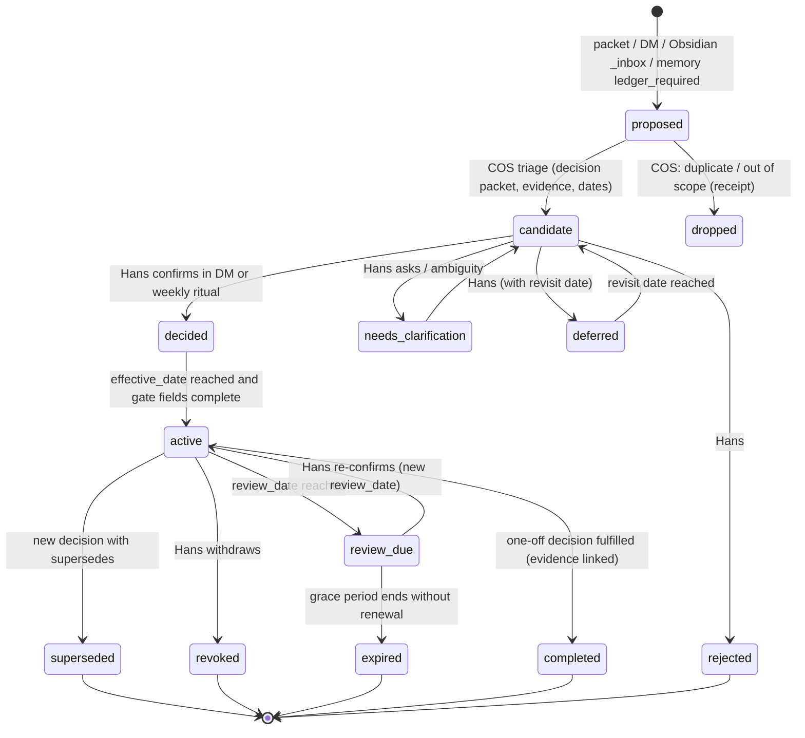

# HVE Decision Ledger and Shared-Knowledge Operating Model

**Date:** 2026-10-29
**Version:** v1.0 (draft)
**Prepared by:** Grok Bot (research and drafting support for HVE Knowledge Ops)
**To:** Hans Westphal; HVE-Chief-of-Staff (HVE-COS); HVE-Librarian; Luna; HVE-CFO; HVE-Coder-Jr
**Decision owner:** Hans Westphal
**Status:** Draft operating model for review. Not policy. Nothing here is active until Hans adopts it through the decision-ledger workflow.
**Classification:** Internal. No credentials, account numbers, wallets, tax figures, client material, or channel/group identifiers.
**ID:** HVE-DEC-OPMODEL-2026-10-29-v1.0
**Companion to:** `2026-10-29-hve-fleet-memory-architecture-recommendation-v1.1.md` (the memory architecture). This file covers how decisions are made, recorded, published, acted on, and retired.

---

## 0. How to read this

- **[F] Fact.** Verified on 2026-10-29 in the KnowOps repo at `b9c6b7b`, its GitHub issues/PRs/comments (public API), PR #47's branch, or the public runtime repos `humanvalueexchange/hanshermesagent` (HEAD `e66632e`, 2026-09-09 18:37 Toronto time) and `humanvalueexchange/hve-librarian` (HEAD `64d7f17`, 2026-10-28 22:12 Toronto time). Paths are given.
- **[P] Proposal.** My recommendation. Inactive until Hans adopts it.
- **[A] Assumption or inference.** Not verifiable from here; check on the Spark before acting.

I did not read anything on the Spark itself. Runtime state (which ledger file is live, what it contains today) is reported only as the repo documents it.

Governing rules this design must respect [F]:
- "Latest approved weekly decision ledger governs tasking" and "If no authoritative ledger entry exists, escalate rather than infer" (`AGENTS.md`).
- "A ledger entry is required only when Hans explicitly adopts a material decision or policy, with the owner, approval status, effective date, review date, and supporting provenance recorded. Do not infer decision or policy authority from 'remember this,' persistence, implementation, or a recommendation alone." (`instructions.md`).
- Dated-policy gate: a strategic policy is active only with `owner + approval status + effective date + review date` (`agent-communications/2026-08-29-hve-operating-plan-v1.1.md`).
- Authority order: Hans's current decision > approved weekly ledger > operating plan > `instructions.md` > other context (same file).
- The Bitcoin discount policy is **undetermined**. Nothing in this document makes it policy.

---

## 1. Summary

**What exists [F].** HVE built a real decision ledger on 2026-08-29: the `hve-decision-ledger` MCP (`hanshermesagent/mcp/decision_log_server.py`), an append-only JSONL file with locking and fsync, the `weekly-decision-log` skill for capturing Hans's decisions from his WhatsApp DM, and the Monday 00:07 weekly mission review. A memory-to-ledger candidate path also exists: the local SQLite memory plugin flags `decision`/`policy` items as `ledger_required` and queues them in a `ledger_handoffs` table for Hans's confirmation. Shared context has a read-only MCP with a `list_decisions` tool.

**Why it isn't working [F + A].** The ledger is hardcoded to the retired `hanshermesagent` profile path. When the COS moved to `hve-chief-of-staff`, the active profile's ledger held only an informational `ledger_initialized` record dated 2026-09-15 (as of 2026-10-17). Approvals since then have happened in Telegram/WhatsApp DMs and agent-communications docs that say "the ledger entry could not be appended". The ledger MCP is not connected in other profiles. Nothing publishes ledger decisions into shared context, so `list_decisions` cannot reflect them. No task carries a decision ID. Result: knowledge is collected well, decisions are made in chat, and the two never meet in a place agents check.

**The model in one paragraph [P].** Anyone can **propose**. COS turns proposals into **candidates** (a decision packet with options, evidence links, and proposed dates). Only Hans **decides**, in his DM or the weekly ritual. COS appends the decision to the ledger as Hans's clerk. The Librarian, as the single writer to shared memory, **publishes** a read-only "active decisions" view into shared context and generates an Obsidian decision note that links the evidence. Every agent checks active decisions before material action, and cites the decision ID in its tasks and artifacts. If none exists, it stops the material part and files a **gap** packet; it does not infer. COS converts decisions into ≤7 ranked, owner-assigned actions each week. Decisions end as **superseded, revoked, expired, completed, or rejected**, and are never deleted.

---

## 2. Evidence audit: implemented vs designed vs missing

### 2.1 Decision ledger core

| Item | Status | Evidence |
|---|---|---|
| `hve-decision-ledger` MCP: `append_decision_events`, `list_decision_events`, `list_ledger_handoff_candidates`; validation of `decision_id` (`D-YYYY-MM-DD-NN`), 8 event types, 9 statuses; `fcntl` lock, flush, fsync; no shell or arbitrary file access | **Implemented [F]** | `humanvalueexchange/hanshermesagent/mcp/decision_log_server.py`; `agent-communications/2026-08-29-hve-session-summary-v1.0.md` |
| Ledger file: append-only JSONL at `/home/hans/.hermes/profiles/hanshermesagent/state/weekly-decision-log.jsonl` (hardcoded `LEDGER_PATH`) | **Implemented [F]**, but bound to a retired profile path | same server file; `agent-communications/2026-08-29-hve-weekly-mission-review-spec-v1.5.md` line 11 |
| Five initial decisions plus one superseding event (retainer now begins with the Time Wealth Pillar), six records, history preserved | **Implemented on 2026-08-29 [F]** | `2026-08-29-hve-session-summary-v1.0.md` |
| `weekly-decision-log` skill v1.0: DM-only authority, intents (log/review/close/defer/update), normalization, confirm-when-ambiguous, append-never-overwrite, `supersedes_decision_id`, review and completion workflows, "a decision alone is not evidence that its related work was completed" | **Implemented [F]** | `hanshermesagent/skills/hve/weekly-decision-log/SKILL.md` |
| Weekly mission review cron, Mondays 00:07, preview to Hans's WhatsApp DM, non-overwriting draft report | **Implemented [F]** (spec v1.5 is still "Draft for CEO review") | `2026-08-29-hve-session-summary-v1.0.md`; `2026-08-29-hve-weekly-mission-review-spec-v1.5.md`; `hanshermesagent/skills/hve/weekly-mission-review/` |
| stdio validation of the ledger server | **Implemented [F]** | `hanshermesagent/scripts/validate-hve-mcp-stdio.sh` |
| Ledger MCP declared in the Hermes config template | **Missing [F]** in the template at `e66632e` (template declares `hve-shared-context` and `hve-team-tasking-pilot`, not `hve-decision-ledger`) | `hanshermesagent/config/hermes-config.template.yaml` lines ~490–525 |
| Ledger in the active COS profile | **Effectively empty [F]**: "The profile-owned `weekly-decision-log.jsonl` contained only the informational `ledger_initialized` record dated 2026-09-15" (inspection 2026-10-17) | `2026-10-22-hve-x333-skill-enhancement-pause-handoff-v1.0.md` §Decision-ledger context |
| Where the six August records went | **Unknown [A]**. Likely still at the old `hanshermesagent` path; the 2026-09-15 date matches the LifeOS decoupling backup (`life-os-decoupling-20260915T230049Z`, issue #40 comment 2026-09-15 20:05 Toronto time) | issue #40 comments; x333 handoff |
| `ledger_initialized` as a record type | **Inconsistent [F/A]**: not in the server's `EVENT_TYPES`, so it was written by something other than `append_decision_events` [A] | server file vs x333 handoff |
| Ledger MCP reachable from Librarian and other profiles | **Missing [F]**: "the `hve-decision-ledger` MCP is not connected here. Handoff to `hanshermesagent` for the ledger append is recommended." | `2026-10-22-hve-machine-native-economy-content-series-approval-v1.0.md` |
| "No current approved weekly decision ledger was located" | **Missing [F]** | PR #47 (`2026-10-28-hve-memory-wiki-cfo-uat-v1.0.md`); `2026-10-12-hve-agent-session-progress-cos-librarian-coder-jr-v1.0.md` |
| Dated-policy gate fields (`effective_date`, `review_date`) in the event schema | **Missing [F]**: schema has `deadline` but no effective or review date | skill schema vs `instructions.md` |
| Terminal states for validity (`superseded`, `expired`, `revoked`) | **Missing [F]**: only `supersedes_decision_id` on the new decision; no event marks the old one | server `STATUSES`/`EVENT_TYPES` |
| Scope/visibility field | **Partial [F]**: `source_channel_scope` (dm) only; guardrail text says restricted decisions must not appear in group output | skill §Privacy |
| Ledger in GitHub ("GitHub is the system of record") | **Not in GitHub [F]**: the ledger is a Spark-local JSONL file | operating plan v1.1 vs server path |

### 2.2 `ledger_required` and the memory-to-ledger candidate path

| Item | Status | Evidence |
|---|---|---|
| `authority_class` (7 classes) and `ledger_required` (true for `decision`/`policy`) on profile memories | **Implemented [F]** | `hanshermesagent/plugins/local-sqlite-memory/store.py` (`_AUTHORITY_CLASSES`, `_LEDGER_CLASSES`); `2026-08-30-hve-hermes-memory-authority-v1.0.md` |
| Explicit-authority regex (e.g., "I approve", "we decided", "make this policy") | **Implemented [F]** | `store.py` `_EXPLICIT_AUTHORITY_RE` |
| `ledger_handoffs` table: `pending_confirmation → appended | rejected | failed`, with `decision_id` and `ledger_event_id` back-links | **Implemented [F]**; schema has the back-link columns, but I found no code that moves a handoff to `appended` [A] | `store.py` `_HANDOFF_SCHEMA`, `_record_ledger_handoffs` |
| Path bound to the retired profile (`.../hanshermesagent/local-memory.db`) | **Implemented, stale [F]** | `decision_log_server.py` `MEMORY_DB_PATH` |

### 2.3 ADRs

| Item | Status | Evidence |
|---|---|---|
| ADR-001 (evidence-first hybrid memory), status "Proposed — pending Hans/HVE ledger approval", with D1–D8 open | **Designed, never ratified [F]** | `2026-09-09-hve-hermes-hve-life-os-long-term-memory-architecture-plan-v1.0.md` §13.2, §13.8 |
| Proposed `memory-architecture/adr/` folder | **Not created [F]** | same §13.10; repo tree |
| ADR as a target-repo prerequisite for agent-card coding | **Designed [F]** | `2026-09-07-hve-hermes-agent-card-implementation-plan-v1.0.md`/`v1.1.md` |
| Architecture decision for the knowledge split (repos own software, `/hve-library` owns data) | **"Approved direction" in a doc, not in the ledger [F]** | `2026-08-31-hve-knowledge-architecture-migration-plan-v1.0.md` |

### 2.4 Decision packets and out-of-band decision records

There is no formal "decision packet" artifact in the repo [F]. But the repo already contains **de facto decision records** written as agent-communications, which are the right raw material for the packet format:

| Pattern | Example | What it gets right | What's missing |
|---|---|---|---|
| Approved decision doc with quote of approval | `2026-10-22-hve-machine-native-economy-content-series-approval-v1.0.md`: approved by Hans in Telegram DM, "Explicitly NOT approved" list, standing rules, provenance (document ID `d4744143ee1ae334`), next actions "owners pending" | Scope boundaries, evidence by document ID | No ledger ID (append failed); came through Telegram, which the ledger skill does not accept as an authority channel; owners and dates unset |
| Scoped decision record | `2026-10-18-hve-cfo-local-desktop-activation-v1.0.md` (Decision owner Hans; accepted unverified controls) | Explicit risk acceptance | No ledger ID or review date |
| Policy artifact | `2026-10-15-hve-skill-enhancement-autoqueue-policy-v1.0.md` (Approved; decision owner Hans; effective 2026-10-15; **review date 2026-10-19**) | Passes the dated-policy gate on paper; cited by later handoffs as the governing artifact | No ledger ID; the review date passed with no recorded review [F: none found in repo], so under this model it is `review_due` today; x333 handoff notes that "ledger absence does not create broader autonomous approval" |
| Proposal brief | `2026-09-02-hve-spec-manifest-inventory-api-v1.0.md` ("PROPOSAL — not policy; not a decision") | Clear status labelling | No path from proposal to candidate |
| Proposed ledger block | My 2026-10-29 memo §12 (HVE-DEC-PROPOSED-2026-10-29-MEM-01) | Per-item ADOPT/REJECT | Not appended |

### 2.5 COS role in tasking

| Item | Status | Evidence |
|---|---|---|
| COS "coordinates, maintains continuity, surfaces conflicts, prepares decisions, verifies outcomes, and routes work"; weekly ≤7 ranked owner-assigned actions; "Priorities change only through the approved ledger or an explicit CEO decision" | **Approved baseline [F]** (effective 2026-08-29) | `2026-08-29-hve-operating-plan-v1.1.md` |
| HVE-COS "coordinates work but does not replace specialist ownership"; decision preparation is in its role | **Current org chart [F]** | `2026-09-18-hve-org-chart-v5.0.md` |
| Team tasking requirements: GitHub Projects in `humanvalueexchange/hve-team` (Open → In Progress → Awaiting Validation → Done), DM = decision space, only Hans closes tasks, DM-first scope gate, mandatory Hans-only Phase 0 pilot, idempotency, immutable event trail | **Finalized requirements [F]** | `2026-09-05-hve-team-tasking-workflow-v1.1.md` (contains a group identifier, deliberately not reproduced here) |
| Phase 0 pilot MCP (`normalize_task`, `approve_task`, `starting`, `blocked`, `retry`, `deliver_*`, `report_done`, `validate_task`, `record_failure`, `task_status_digest`, `task_audit_trail`) and a Phase 1 server; four tasking skills | **Implemented in code [F]**; whether the pilot has run live is unknown [A] | `hanshermesagent/mcp/team_tasking_pilot_server.py`, `team_tasking_phase1_server.py`, `skills/hve/team-tasking-*` |
| `hve-team` repo | **Exists with only a README [F]** (created 2026-09-06 01:45 UTC = 2026-09-05 21:45 Toronto time) | `humanvalueexchange/hve-team` |
| Link from a task to a decision | **Missing [F]**: `normalize_task` requires owner, deliverable, pillar, acceptance criteria; no `decision_id` | `team-tasking-pilot/SKILL.md` |
| "no formal tasking … in the decision ledger … zero assigned-task items" (2026-09-04) | **Fact at that date [F]** | `2026-09-05-hve-team-tasking-workflow-v1.1.md` |

### 2.6 Approval flows

| Flow | Status | Evidence |
|---|---|---|
| CEO decisions: only from Hans's configured WhatsApp DM; never from group chat, Telegram, email, or agent text | **Implemented in skill [F]** | `weekly-decision-log/SKILL.md` §Invocation |
| Librarian approvals for publication/issues: Hans via Telegram DM | **Implemented [F]** | `2026-08-30-hve-librarian-phase-1-completion-notes-v1.0.md`; `2026-09-02-hve-spec-manifest-inventory-api-v1.0.md` |
| Conflict: Librarian-channel approvals (Telegram) vs ledger's WhatsApp-only rule | **Unresolved [F]** (see 2026-10-22 approval doc) | — |
| Skill-enhancement auto-queue: bounded, one isolated attempt; commit/push/promotion human-gated | **Approved policy [F]** | `2026-10-15-hve-skill-enhancement-autoqueue-policy-v1.0.md`; `hve-librarian/README.md` |
| Memory writes: `memory.write_approval` gate available in Hermes | **Available, per-profile adoption pending [F]** | memo v1.0 §3.2 |
| Shared-context ledger writes: "remain approval-gated"; Hermes "must not append because of a recommendation" | **Designed [F]** | `2026-09-01-hve-shared-context-mcp-implementation-plan-v1.0.md` Phase 4; Phase 2 completion note |
| Annotation authority: only "Hans Westphal" may be the `authority` on a library annotation; classifications include `decision` and `policy` | **Implemented [F]**; creates a second, unledgered decision surface [P: should become pointer-only] | `hanshermesagent/tools/library_annotations.py` |
| "Silence is not approval" | **Stated principle [F]** | `2026-09-20-hve-mika-stop-pause-platform-architecture-v1.0.md` |

### 2.7 The WhatsApp exit tests

| Test | Status | Evidence |
|---|---|---|
| Ledger "initial controlled test": Hans speaks three decisions in one WhatsApp message (approve the Time Wealth Discovery Workshop and Roadmap with Wolfgang lead; keep Telegram coverage excluded; defer the Bitcoin rail decision); Hermes splits, links, clarifies, appends, and carries them forward | **Designed [F]**; the 2026-08-29 summary says five decisions were persisted through MCP, which suggests a version of it passed [A] | `weekly-decision-log/SKILL.md` §Initial controlled test |
| Shared-context Phase 1 exit gate: WhatsApp DM → gateway → MCP client → stdio `hve-shared-context` → `/var/lib/hve-shared-context` read-only (`mode=ro`, `PRAGMA query_only=ON`), identity `agent:hermes` read/suggest only | **Designed [F]**; green status questioned on 2026-09-20 ("Is Shared Context Phase 1 WhatsApp UAT actually green, or still a plan?") | `2026-09-01-hve-shared-context-mcp-implementation-plan-v1.2.md`; Mika stop/pause note |
| Phase 2 knowledge-consumer acceptance via WhatsApp (session `20260901_194007_0f65173a`) | **Accepted [F]** | `2026-09-01-hve-shared-context-phase-2-completion-v1.0.md` |
| Phase 7 acceptance: Time Wealth 90-day GTM prompt proving which facts came from shared context, which decisions from the ledger, which evidence from the knowledge layer | **Designed, not run [F/A]** | v1.0 implementation plan Phase 7 |

### 2.8 Shared-context status (Phases 1–7)

| Phase | Status | Evidence |
|---|---|---|
| 1. Read-only MCP, 7 tools incl. `list_decisions` | **Implemented [F]**; WhatsApp UAT status ambiguous | v1.2 plan; template declares the 7 tools |
| 2. Knowledge-layer consumer | **Accepted 2026-09-01 [F]** (commits in knowledge-layer and hanshermesagent; one data-health warning on document `077ca727976752cf`) | Phase 2 completion note |
| 3. Add shared-context MCP to Hermes + retrieval-sequence skill | **Partly built in repo [F]**: `hve-shared-context` is in `config/hermes-config.template.yaml` and `skills/hve/shared-context-planning/SKILL.md` (2026-09-01) encodes the sequence shared context → ledger → knowledge → reconcile → clarify. **Not approved [F]**: "Phase 3 is not started … requires a separate explicit approval from Hans." Live-config state unknown [A] | template; skill; Phase 2 completion note |
| 4. Ledger integration (ledger = governed decision-event boundary; append approval-gated) | **Designed [F]** | v1.0 plan Phase 4 |
| 5. Selective tool loading | **Designed [F]** | v1.0 plan Phase 5 |
| 6–7. Hardening and acceptance | **Not started [A]** | — |
| Who writes the shared-context store's `decisions` | **Missing [F]**: the store "is initialized by a separate governed owner workflow"; no documented sync from the ledger | v1.2 plan |
| Per-agent identities (`agent:hermes` is shared) | **Missing [F]** | v1.2 plan |
| `hve.decide` adapter + "JSONL decision ledger-of-events (evidence, not Authority)" | **Designed (Week 2 of stop/pause) [F]**; not found in code | Mika stop/pause note |

### 2.9 Existing intake structure (what the handoff packet must extend)

Covered in the memo v1.1 §6. In short [F]: Hans sends a link, YouTube URL, PDF, or Proton link (for large PDF/MP3/MP4) to HVE-Librarian over Telegram. One of four tools (`archive_link`, `archive_youtube`, `archive_pdf`, `archive_proton_file`, each `(source, capture_context)`) writes a manifest under `/hve-library/state/manifests/<document_id>.json` with `source_type`, staged status fields, `captures[]`, and hashes. A terminal receipt comes back. Hans's "entries" are the `capture_context` note plus append-only annotations (`annotate_record`). The packet becomes a fifth content type on the same rails.

---

## 3. Diagnosis: five breaks between knowledge and action

1. **Address break [F].** The ledger and candidate queue are pinned to the retired `hanshermesagent` profile. The live COS ledger restarted empty on 2026-09-15.
2. **Channel break [F].** Approvals happen where Hans works: Telegram to the Librarian, WhatsApp to COS, and comments on issues. Only COS's WhatsApp DM is wired to the ledger. Decisions made elsewhere become docs that say "could not be appended."
3. **Publication break [F].** No path from ledger events to shared context or Obsidian. `list_decisions` reads a table nobody keeps current from the ledger.
4. **Execution break [F].** Tasks don't carry decision IDs. The weekly review counts "approved" and "completed" in one status field, so decision validity and work progress are conflated.
5. **Lifecycle break [F].** No effective/review dates in the ledger schema and no supersede/expire/revoke events. A decision cannot age out, and an agent cannot tell a current policy from a stale one. Live example: the auto-queue policy's review date (2026-10-19) has passed, and nothing flags it.

---

## 4. The operating model [P]

### 4.1 Principles

1. **Hans decides; nobody else does by default.** Delegated decision rights (Luna on technical choices, CFO inside finance policy) exist only if Hans grants them in a ledger entry that names the scope and review date.
2. **One clerk, one publisher.** COS is the only writer of the ledger, acting only on Hans's explicit confirmation. The Librarian is the only writer of shared memory, including the published decision view and Obsidian notes. Everyone else reads.
3. **The ledger is the authority; everything else is a view.** Shared context, Obsidian, weekly reports, and memory pointers mirror the ledger and cite its IDs.
4. **Decision validity ≠ execution progress.** Validity lives in the ledger. Progress lives in tasks, linked by `decision_id`.
5. **No decision, no material action.** Agents escalate gaps; they never infer authority from persistence, implementation, or recommendations.
6. **Append, supersede, never delete.**

### 4.2 Roles

| Actor | Proposes | Prepares candidates | Decides | Writes ledger | Publishes to shared context | Executes |
|---|---|---|---|---|---|---|
| Hans (CEO) | Yes | — | **Yes (sole, default)** | Confirms only | — | Yes |
| HVE-COS | Yes | **Yes** | No | **Yes (clerk)** | No | Routes tasks |
| HVE-Librarian | Yes (from evidence/lint) | Supplies evidence | No | No | **Yes (single writer)** | Curation |
| Luna (CTO) | Yes (technical) | Technical options | Only if delegated [open Q] | No | No | Architecture |
| Mika (strategy) | Yes | Strategy options | No | No | No | Analysis |
| HVE-CFO | Yes (finance) | Finance options | Only if delegated | No | No | Finance ops |
| Coder-Jr/Sr, Vulcan, Mercury | Yes (gaps, outcomes) | — | No | No | No | Build |
| Alan, Brian, Wolfgang | Yes (via Hans or COS; later via a scoped channel) | — | No | No | No | Pillar work |

Human roles from `2026-09-18-hve-org-chart-v5.0.md` [F]: Alan (Physical Wealth/fitness), Brian (financial/insurance research), Wolfgang Westphal (Time and Social Wealth, Instagram, content). The repo does not grant them decision authority [F]. I am not inferring any.

### 4.3 Lifecycle



| State | Lives in | Authority | Who moves it |
|---|---|---|---|
| proposed | Librarian intake (packet) or `ledger_handoffs` | None | Anyone |
| candidate | COS candidate queue (generalised `ledger_handoffs`) + a decision packet | None | COS |
| decided / rejected / deferred / needs_clarification | Ledger event | Hans | COS appends on Hans's words |
| active | Derived: decided + `effective_date ≤ today` + gate fields complete + not terminal | **Yes** | Automatic fold |
| review_due | Derived: today ≥ `review_date` | Still active, flagged | Automatic |
| superseded / revoked / expired / completed | Ledger event | Terminal | COS on Hans's words; `expired` by the weekly ritual after the grace period |

Mapping to today's schema [F→P]: existing `status` values `open|approved|in_progress|completed|deferred|rejected|cancelled|blocked|needs_clarification` remain readable. `approved` maps to `decided`. `cancelled` maps to `revoked`. `in_progress` and `blocked` move to the task layer. `open` means "Hans has raised it, awaiting judgment" and stays in the ledger for compatibility. Candidates prepared by agents stay outside the ledger until Hans speaks. That preserves the skill's rule: "Do not append a ledger event until Hans explicitly confirms."

**Proposed defaults [P, Hans to confirm]:**
- Policies require a `review_date` no more than 90 days out.
- One-off decisions have a review date too, but they end with `completed`.
- Grace period after `review_date`: 14 days, then `expired`.

### 4.4 Decision record schema (ledger event v1.1, additive)

[P] This is a superset of the event in `weekly-decision-log/SKILL.md`, so old records stay valid. New fields are marked `+`.

```json
{
  "event_id": "DLE-20261102T041500Z-001",
  "event_type": "created|confirmed|updated|completed|deferred|rejected|cancelled|blocked|+superseded|+revoked|+expired|+reviewed",
  "decision_id": "D-2026-11-02-01",
  "event_at": "2026-11-02T00:15:00-05:00",
  "report_period": "2026-10-26/2026-11-01",
  "decision_text": "One sentence, normative, no secrets.",
  "+decision_class": "decision|policy",
  "status": "open|approved|completed|deferred|rejected|cancelled|needs_clarification",
  "owner": ["Hans"],
  "+decided_by": "Hans Westphal",
  "+decided_via": "whatsapp_dm|weekly_ritual|telegram_dm_relay",
  "+proposed_by": "agent:hve-librarian|human:hans|agent:hve-chief-of-staff|...",
  "+candidate_id": "DC-2026-10-30-03",
  "+effective_date": "2026-11-02",
  "+review_date": "2027-01-31",
  "deadline": "2026-11-30",
  "wealth_pillars": ["Time"],
  "+scope": "fleet|pillar:<name>|restricted:finance|restricted:personal|restricted:client",
  "+applies_to": ["agent:hve-chief-of-staff", "human:wolfgang"],
  "+not_decided": ["Explicit exclusions, e.g., 2028 product proposal"],
  "+standing_rules": ["Rules agents must obey while active"],
  "+evidence_refs": [
    {"kind": "document", "ref": "d4744143ee1ae334"},
    {"kind": "claim", "ref": "<shared-context claim id>"},
    {"kind": "artifact", "ref": "agent-communications/2026-10-22-...-v1.0.md"}
  ],
  "linked_action_id": "A-03",
  "+linked_task_ids": ["<team-tasking task_id>"],
  "rationale": "...",
  "expected_outcome": "...",
  "dependencies": [],
  "supersedes_decision_id": null,
  "+superseded_by_decision_id": null,
  "source_session_id": "...",
  "source_message_id": "...",
  "source_channel_scope": "dm",
  "transcription_confidence": "high",
  "interpretation_confidence": "high",
  "resolution_notes": null
}
```

Validator rules [P]:
- `decision_class=policy` with `status=approved` must carry `owner`, `effective_date`, `review_date`, and at least one `evidence_refs` or source message. Otherwise it is rejected. This is the dated-policy gate in code.
- `superseded` and `revoked` events must reference an existing `decision_id`.
- `scope` defaults to `fleet`. A `restricted:*` scope is never shown in group output.
- `decided_by` must be `Hans Westphal` unless a delegation decision covering that scope is active.
- `LEDGER_PATH` comes from configuration, not a hardcoded profile path.
- A fold function `get_active_decisions(as_of, scope, pillar)` returns current state per `decision_id`.

### 4.5 The decision packet (candidate form)

[P] The candidate form is a **packet type** in the same intake as links and PDFs (memo v1.1 §6): `type: decision_proposal` from a proposer, upgraded by COS to `type: decision_candidate`. Its human-readable body copies the best existing pattern, the 2026-10-22 Machine-Native approval doc:

```markdown
## DC-2026-10-30-03: <title>
- Proposed by / prepared by: <agent or human> / HVE-COS
- Class: decision | policy        Scope: fleet | pillar:Time | restricted:...
- Ask (one sentence Hans can say yes/no to):
- Options: A (recommended) / B / do nothing — with cost, risk, reversibility
- Evidence: document IDs, claim IDs, artifact paths (Librarian-verified)
- Conflicts: active decisions this touches (IDs) — supersede? coexist?
- Proposed owner, effective date, review date, deadline
- Explicitly NOT included:
- Standing rules while active:
- Tasks COS will create if approved (draft, ≤3)
```

Hans answers in his DM with "approve DC-…-03 option A", "defer to <date>", or "reject". COS appends the event and returns the recorded `decision_id`. That is the existing skill's confirmation format.

### 4.6 Publishing active decisions into shared context

[P] Steps:
1. **Trigger:** each successful `append_decision_events` call writes a small "ledger changed" notice into the Librarian's intake (or the Librarian polls hourly).
2. The **Librarian** reads the ledger with read-only `list_decision_events` / `get_active_decisions`.
3. It **writes** the folded state into the shared-context `decisions` table. It becomes the "governed owner workflow" for that table only, which needs Phase 3/4 approval. Each row holds `decision_id, title, decision_text, class, state, scope, applies_to, pillars, effective_date, review_date, standing_rules, not_decided, evidence_refs, supersedes/superseded_by, ledger_event_ids, published_at`.
4. It **regenerates** the Obsidian decision note (§4.9) and the vault index of active decisions.
5. It **returns a receipt** to COS: published IDs, the lag in minutes, and any rows withheld by scope.
6. **Agents** read through the existing `list_decisions` tool under their own identity. Scope is filtered server-side on list, search, and fetch-by-id (memo §4.3). A proposed `get_decision(decision_id)` tool returns full provenance.

Publication never changes meaning. If the Librarian finds a problem (missing evidence hash, a conflict with another active decision), it publishes the row with a `data_health` warning and files a gap packet to COS. It does not "fix" the decision.

### 4.7 Check-before-act and the gap protocol (every agent)

[P] **Material action** means any of: external communication or publication; spending or a financial commitment; changing priorities, scope, pricing, or channels; starting a new workstream; installing or changing production runtime; making a mission or policy claim; anything irreversible.

Before a material action:
1. Call `list_decisions(pillar|topic|applies_to=me, state=active)`.
2. If an active decision covers it, proceed within its standing rules. Cite the `decision_id` in the task, commit message, artifact header, or reply.
3. If it is `review_due`, proceed but flag it to COS.
4. If there is a conflict (two active decisions disagree), or **no decision exists**, then:
   - stop the material part;
   - continue only reversible, local preparation;
   - file a `gap` packet with what you were about to do, why, the candidate options, and the evidence;
   - tell the requester "escalated as GAP-…; no authoritative decision exists."
5. COS triages gaps daily. Urgent ones (blocking a deadline in ≤72 h) go to Hans's DM as a one-line ask. Others go into the weekly candidate queue.
6. Never treat silence, a recommendation, an annotation, a memory entry, or an Obsidian page as authority.

Gap packet (extension of the intake envelope):

```yaml
type: gap
from: agent:hve-cfo
subject: "No decision on <X>; needed to <action>"
blocking: true
needed_by: 2026-11-04
options: ["A ...", "B ..."]
evidence: [{kind: document, ref: <id>}]
related_decisions: [D-2026-08-29-02]   # nearest, possibly stale
```

### 4.8 How COS turns decisions into tasking

[P] Steps:
1. Every approved decision gets at least one owner-assigned action within 7 days, or an explicit "no action needed" note.
2. Weekly, COS ranks **≤7 next actions** (operating plan v1.1). Each action carries `decision_id`, owner, observable completion, and due date.
3. Human tasks flow through the team-tasking control plane: Phase 0 Hans-only pilot first, then `hve-team` GitHub Projects. `normalize_task` gains a required `decision_id` field (or `gap_id` for work authorized only to prepare a candidate). Only Hans closes tasks [F, D4 of the tasking workflow].
4. Agent tasks (e.g., Coder-Jr dispatch) cite the `decision_id` in the request contract. The dispatch gateway rejects material requests without one [P].
5. On completion, the owner files an `outcome_evidence` packet. The Librarian links it to the decision. COS appends `completed` only after Hans accepts it. A decision alone is never completion evidence [F, skill].

### 4.9 Obsidian decision notes

[P] The Librarian generates one note per decision under `decisions/` in the vault. It is read-only, regenerated from the ledger and shared context:

```markdown
---
decision_id: D-2026-11-02-01
state: active
class: policy
scope: fleet
pillars: [Time]
owner: [Hans]
effective: 2026-11-02
review: 2027-01-31
supersedes: D-2026-08-29-03
ledger_events: [DLE-...-001]
---
# <title>
**Decision:** ...
**Standing rules:** ...
**Not decided:** ...
## Evidence
- [[doc-d4744143ee1ae334]] (sha256 …) — why it matters
- [[claim-…]]
## Tasks
- [[task-…]] owner, status
## History
- 2026-11-02 approved (WhatsApp DM) · 2027-01-31 review due
## Proposed changes
(humans write here → becomes a packet on the next lint)
```

The vault also gets:
- `Active decisions.md`: a table by pillar.
- `Review due.md`.
- `Gaps.md`: open gap packets.
- Backlinks from every evidence page to the decisions that cite it. This is how a human sees that "this PDF changed what we do."

Restricted decisions never enter slice vaults for collaborators.

### 4.10 Weekly cadence and ritual

[P] This extends the existing Monday 00:07 mission review [F].

| When (Toronto time) | Who | What |
|---|---|---|
| Daily | COS | Triage new proposals and gaps into candidates; ping Hans only for urgent gaps |
| Daily/hourly | Librarian | Publish ledger changes; run lint for decisions that are review-due or missing evidence |
| Sun evening | Librarian | Vault lint report: contradictions, review-due, decisions without tasks, evidence without decisions on hot topics |
| Mon 00:07 | COS (cron) | Mission-review draft, adding four sections: (1) candidates awaiting Hans (≤10, ranked); (2) review-due and expiring; (3) open gaps; (4) metrics (§4.13). Preview to Hans's DM |
| Mon (Hans's choice of time, ~20 min) | Hans + COS | **Decision ritual**: approve/reject/defer each candidate, re-confirm or retire review-due items, settle conflicts. COS appends; Librarian publishes |
| Mon after ritual | COS | Publish the ≤7 ranked actions with decision IDs; create or update tasks |
| Monthly (first Monday) | Hans | Read the decision note index and metrics trend; prune or merge decisions |

### 4.11 Conflicts and supersession

[P] Rules:
- **Detection:**
  - COS checks each candidate against active decisions with the same pillar, scope, or `applies_to`.
  - The Librarian checks at publication.
  - Agents report conflicts through gap packets.
- **Resolution is always Hans's.** The candidate must say "supersedes D-…" or "coexists because …". Without that, it cannot be approved.
- **Supersession writes two events:** a new decision with `supersedes_decision_id`, and a `superseded` event on the old one with `superseded_by_decision_id`. Both stay queryable as-of.
- **Partial supersession** is a new decision that restates the surviving parts. There are no silent edits.
- **Precedence while a conflict is unresolved:**
  1. Hans's explicit current decision.
  2. The later `effective_date` among approved entries.
  3. The operating plan.
  4. `instructions.md`.

  Agents still escalate and do not pick a side in material matters.
- **Knowledge conflicts don't override decisions** [F, shared-context-planning skill]: new evidence that undermines a decision becomes a candidate to supersede it, flagged in the weekly ritual.

### 4.12 Audit trail

[P] The chain:

> source message ID / packet ID → candidate ID → ledger `event_id` (append-only, fsync'd) → Librarian publication receipt → shared-context row (`ledger_event_ids`) → task IDs (`task_audit_trail`, already implemented [F]) → outcome evidence document IDs → `completed` event.

Additions:
- Weekly integrity check: hash-chain or checksum of the ledger file recorded in the weekly report, line count delta, and malformed-line count (the server already raises on malformed lines [F]).
- Backups ride the profile backup procedure [A: confirm].
- A sanitized decision index (ID, title, state, dates; no restricted text) may be exported to a **private** repo if Hans wants GitHub as system of record. Never to the public KnowOps repo.
- Out-of-band decisions found in agent-communications without a ledger ID are listed in the weekly report as "unledgered approvals" until back-filled.

### 4.13 Metrics: is knowledge being acted on?

[P] Reported in the Monday review. Targets are proposals.

| Metric | Definition | Target |
|---|---|---|
| Decision throughput | Candidates decided per week / candidates open | Queue ≤10, median age ≤7 days |
| Decision → task latency | Days from approved to first linked task | ≤7 days for 90% |
| Task decision coverage | % of material tasks/actions with a `decision_id` (or `gap_id`) | ≥90% |
| Orphan decisions | Active decisions with no task and no "no action" note after 14 days | 0 |
| Completion evidence rate | % of `completed` with ≥1 outcome evidence ref | 100% |
| Review hygiene | % active policies past `review_date` | 0% beyond grace |
| Publication lag | Ledger event → visible in `list_decisions` | <1 h median, <24 h max |
| Check-before-act compliance | Sampled agent material actions with a prior `list_decisions` call in the trace | ≥95% |
| Gap response time | Gap filed → decided or explicitly deferred | Urgent ≤72 h; others ≤1 ritual |
| Unledgered approvals | Approval docs or messages without a ledger ID | 0 after back-fill |
| Knowledge-to-decision linkage | % of decisions citing ≥1 knowledge-layer document or claim ID | ≥80% |
| Evidence utilization | Library documents cited by ≥1 active decision or task, by pillar | Trend up; shown as backlinks in Obsidian |

### 4.14 Humans beyond Hans

[P] Rules:
- Alan, Brian, and Wolfgang **propose** through Hans or COS. Later they can use the team WhatsApp surface or Obsidian `_inbox/` in their slice vault. They **read** active decisions scoped to their pillar.
- They do not approve. Their pillar tasks carry decision IDs like any other.
- Group chats never carry decision authority [F, skill], and never display restricted decisions.

---

## 5. Build steps (top five, in order) [P]

1. **Re-anchor the ledger (read-only investigation first, then one bounded change).**
   - On the Spark, locate every `weekly-decision-log.jsonl` and `local-memory.db` the ledger server points to.
   - Confirm whether the six 2026-08-29 records survive.
   - Choose one canonical path under `hve-chief-of-staff`.
   - Make `LEDGER_PATH`/`MEMORY_DB_PATH` configurable and declare `hve-decision-ledger` in the config template.
   - Import the old records as-is with an `imported_from` note; do not rewrite them.
   - *Gate:* `list_decision_events` from COS returns the historical six plus `ledger_initialized`.
2. **Ledger schema v1.1 + fold tool** (Coder-Jr bounded task).
   - Additive fields and events from §4.4.
   - Dated-policy gate in the validator.
   - `get_active_decisions(as_of, scope)`.
   - Tests for supersede, revoke, expire, and policy-without-review-date rejection.
   - *Gate:* the existing skill's controlled test passes, plus a supersession test.
3. **Back-fill and ritual v1.**
   - COS prepares candidates for the out-of-band approvals: the 2026-10-22 Machine-Native series, the 2026-10-15 auto-queue policy, the 2026-10-18 CFO activation acceptance, the 2026-09-02 Librarian cutover, and a review of the August six.
   - Hans confirms them in one session.
   - Extend the Monday report with candidates, review-due, gaps, and metrics.
   - *Gate:* the first Monday ritual produces ≤7 ranked actions, each with a decision ID.
4. **Publication path (needs shared-context Phase 3/4 approval).**
   - Librarian `publish_decisions` into the shared-context `decisions` table, plus Obsidian decision notes and receipts.
   - Read-only ledger and shared-context tools in every profile, under per-agent identities.
   - *Gate:* publication lag <1 h, and restricted decisions invisible to non-listed identities on list/search/fetch (≥30 probes per path).
5. **Decision gate and tasking link.**
   - A `decision-gate` skill in every profile (check-before-act + gap packet).
   - `decision_id`/`gap_id` required in `normalize_task` and the Coder-Jr dispatch contract.
   - Packet types `decision_proposal`, `decision_candidate`, `gap`, `outcome_evidence` added to Librarian intake.
   - *Gate:* the Phase 7 Time Wealth GTM prompt shows shared-context facts, ledger decisions, and knowledge evidence separately. A planted "no decision" task produces a gap, not an action.

Do not build yet:
- Mika's hosted `hve.decide` (fold its intent into steps 2–4).
- Agent-side ledger write tools.
- Automatic expiry without a ritual.
- Decision authority in group chats.

---

## 6. Proposed ledger block (adopt or reject)

```markdown
### HVE-DEC-PROPOSED-2026-10-29-DEC-01: Decision ledger operating model

- Status: PROPOSED (inactive until Hans marks ADOPTED)
- Decision owner: Hans Westphal
- Proposed by: Grok Bot draft (HVE-DEC-OPMODEL-2026-10-29-v1.0)
- Effective date: on adoption       Review date: 2027-01-31

- E1 Lifecycle proposed → candidate → decided → active → review_due →
  superseded | revoked | expired | completed (+ rejected/deferred); never delete.   [ ]
- E2 Roles: Hans sole decider by default; COS is ledger clerk (append only on Hans's
  explicit confirmation); Librarian is sole publisher to shared context/Obsidian.    [ ]
- E3 Authority channels: Hans's WhatsApp DM to COS and the weekly ritual; Telegram DM
  approvals to the Librarian are relayed to COS as candidates and confirmed. ___     [ ]
- E4 Schema v1.1 with dated-policy gate enforced in code; configurable ledger path.  [ ]
- E5 Every agent checks active decisions before material action; no decision → gap
  packet, no inference.                                                              [ ]
- E6 Every material task carries a decision_id or gap_id; ≤7 ranked actions weekly.  [ ]
- E7 Policy review ≤90 days; 14-day grace then expired. ___                         [ ]
- E8 Back-fill the listed out-of-band approvals as candidates for one confirmation pass. [ ]
- E9 Metrics in §4.13 reported every Monday.                                         [ ]

Not decided by this entry: any financial policy; the Bitcoin discount (undetermined);
delegation of decision rights to Luna, CFO, or any human; hve-coder-sr installation.
```

---

## 7. Open questions only Hans can answer

1. **Ledger clerk:** keep COS as the only ledger writer (matches the code and the DM rule), or make the Librarian clerk too for strict single-writer purity? My recommendation is COS as clerk, Librarian as publisher.
2. **Authority channels:** do Telegram DM approvals to the Librarian (as on 2026-10-22) count as decisions, or are they candidates until confirmed in the WhatsApp DM or the ritual?
3. **The August six:** are they still authoritative? For example, the Time Wealth Discovery Workshop decision with Wolfgang as lead, target 2026-09-05. Should they be imported and reviewed, or archived as history only?
4. **Delegation:** may Luna decide technical matters, or the CFO finance-operational matters, in their own name within a scope you set? Or is every ledger entry yours?
5. **Expiry:** should policies auto-expire after the review date plus grace, or stay active until you review them?
6. **Visibility:** which active decisions may Alan, Brian, and Wolfgang see, and through what (an Obsidian slice vault, the team WhatsApp digest)?
7. **System of record:** do you want a sanitized decision index in a private GitHub repo, given the KnowOps repo is public?
8. **Shared-context Phase 3/4:** do you approve the Librarian as the governed writer of the shared-context `decisions` table, plus per-agent identities?
9. **Team tasking:** has the Hans-only Phase 0 pilot run? Should `decision_id` become mandatory on tasks now or after the pilot?
10. **Ritual slot:** what day and time for the ~20-minute weekly decision ritual?

---

## 8. Sources (all read on 2026-10-29)

**KnowOps repo (`HansHWestphal/hve-knowledge-and-operations` @ `b9c6b7b`)**
- `AGENTS.md`, `instructions.md`, `README.md`
- `agent-communications/`:
  - `2026-08-29-hve-session-summary-v1.0.md`, `2026-08-29-hve-weekly-mission-review-spec-v1.5.md`, `2026-08-29-hve-operating-plan-v1.1.md`
  - `2026-08-30-hve-hermes-memory-authority-v1.0.md`, `2026-08-30-hve-identity-and-authority-index-v1.0.md`, `2026-08-30-hve-telegram-collector-config-v1.2.md`, `2026-08-30-hve-librarian-phase-1-completion-notes-v1.0.md`, `2026-08-30-hve-librarian-profile-build-session-note-v1.0.md`
  - `2026-08-31-hve-knowledge-architecture-migration-plan-v1.0.md`
  - `2026-09-01-hve-shared-context-mcp-implementation-plan-v1.0.md` and `-v1.2.md`, `2026-09-01-hve-shared-context-phase-2-completion-v1.0.md`
  - `2026-09-02-hve-librarian-cutover-v1.1.md`, `2026-09-02-hve-spec-manifest-inventory-api-v1.0.md`
  - `2026-09-05-hve-team-tasking-workflow-v1.1.md`
  - `2026-09-09-hve-hermes-hve-life-os-long-term-memory-architecture-plan-v1.0.md`
  - `2026-09-18-hve-org-chart-v5.0.md`
  - `2026-09-20-hve-mika-stop-pause-platform-architecture-v1.0.md`, `2026-09-20-hve-chief-of-staff-completion-plan-v1.0.md`, `2026-09-21-hve-chief-of-staff-completion-evidence-v1.11.md`
  - `2026-10-12-hve-agent-session-progress-cos-librarian-coder-jr-v1.0.md`, `2026-10-15-hve-skill-enhancement-autoqueue-policy-v1.0.md`, `2026-10-18-hve-cfo-local-desktop-activation-v1.0.md`
  - `2026-10-22-hve-x333-skill-enhancement-pause-handoff-v1.0.md`, `2026-10-22-hve-machine-native-economy-content-series-approval-v1.0.md`
- PR #47 branch `docs/fleet-tool-availability-policy`: `2026-10-28-hve-memory-wiki-cfo-uat-v1.0.md`
- Issues/PRs #1–#48 and 268 comments via the public GitHub API. Relevant: #10, #13, #16, #18 (comment 2026-09-10 21:00 Toronto time: restore the "Decision Ledger" in the authority chain; owned, evidence-gated table with review dates), #31 (artifact lifecycle incl. superseded), #40 (COS repo/migration; profile-owned weekly mission job, 2026-09-15), #43 (reliability review ledger, a separate operational ledger), #47.

**Runtime repos (public, read-only clones)**
- `humanvalueexchange/hanshermesagent` @ `e66632e`:
  - `mcp/decision_log_server.py`
  - `skills/hve/weekly-decision-log/SKILL.md`, `skills/hve/shared-context-planning/SKILL.md`, `skills/hve/team-tasking-pilot/SKILL.md`
  - `plugins/local-sqlite-memory/store.py`
  - `tools/library_annotations.py`
  - `config/hermes-config.template.yaml`
  - `mcp/team_tasking_pilot_server.py`, `mcp/team_tasking_phase1_server.py`
  - `scripts/validate-hve-mcp-stdio.sh`
- `humanvalueexchange/hve-librarian` @ `64d7f17`: `mcp/link_collector_server.py`, `tools/link_collector.py`, `tools/pdf_collector.py`, `tools/proton_file_collector.py`, `README.md`
- `humanvalueexchange/hve-team` @ `1da3284`: `README.md` only
- `humanvalueexchange/hve-shared-context` and `hve-knowledge-layer`: not publicly readable (HTTP 404); their internals are described here only as the KnowOps docs describe them.

Separate "ledgers" that are **not** the decision ledger [F]: the COS reliability-review ledger (`reliability.db`, issue #43), the COS execution ledger (`delivery_outcome`, issue #40), and the Instagram carousel `ledger.jsonl` (issue #24). Keep the names distinct in future docs to avoid confusion.
