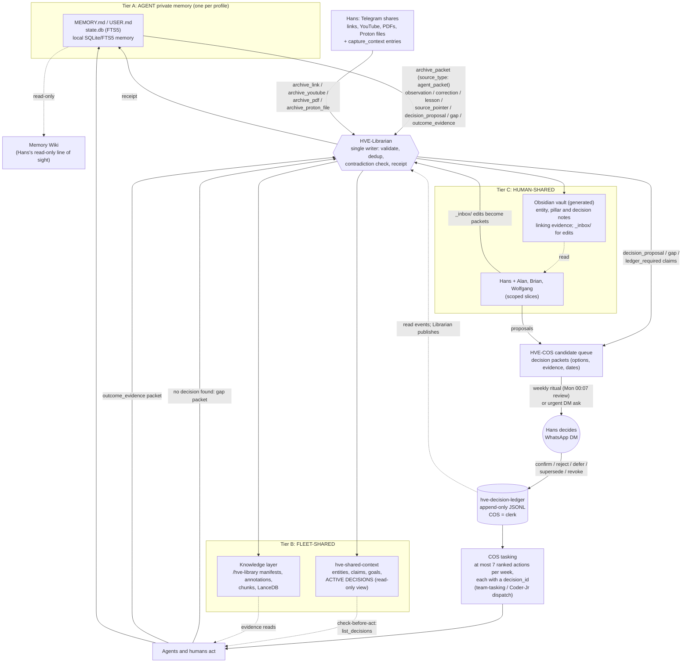

# HVE Fleet Memory Architecture Recommendation: Agent, Fleet-Shared, and Human-Shared Memory

**Date:** 2026-10-29
**Version:** v1.1 (draft)
**Prepared by:** Grok Bot (research and drafting support for HVE Knowledge Ops)
**To:** Hans Westphal; HVE-Librarian; HVE-Chief-of-Staff; HVE-CFO; HVE-Coder-Jr
**Decision owner:** Hans Westphal
**Status:** Draft recommendation for review. Not a weekly-ledger policy. Nothing here is active until Hans approves a ledger entry.
**Classification:** Internal architecture proposal. No credentials, account numbers, wallets, tax figures, or client material.
**ID:** HVE-MEM-ARCH-REC-2026-10-29-v1.1
**Companion:** `2026-10-29-hve-decision-ledger-operating-model-v1.0.md` (decision ledger and shared-knowledge operating model)
**Supersedes:** v1.0 of this draft (same date, never committed). Builds on the 2026-09-09 consensus brief, the 2026-09-09 ADR-001 plan, the 2026-09-15 Grok fleet-memory note, the 2026-09-20 Mika stop/pause note, and the 2026-10-28 Memory Wiki CFO UAT (PR #47, unmerged).

---

## 0. How to read this

Every substantive statement carries one of three labels:

- **[F] Fact.** Verified in the repo at `b9c6b7b` (2026-10-24), in PR #47, or in a source fetched on 2026-10-29 and listed in §14.
- **[P] Proposal.** My recommendation. It is not active until Hans ratifies it.
- **[A] Assumption.** A belief I could not verify from here. Each one should be checked on the Spark before anyone acts on it.

Hans asked for an opinion, so this document takes positions. Where the research weakens one of those positions, the document says so.

### What changed in v1.1

Hans reviewed v1.0 on 2026-10-29 and confirmed or redirected these points [F: Hans's message to HVE Knowledge Ops, 2026-10-29]:

| Hans's point | Effect in v1.1 |
|---|---|
| Per-agent SQLite/FTS5 memory, one memory per agent: "perfect" | §3 is unchanged and is now **confirmed direction** (still to be recorded in the ledger) |
| Memory Wiki gives the human line of sight into each agent's session thinking | §7 is unchanged; the role is confirmed |
| The Librarian is the only writer; everyone reads within their context | §4.2 confirmed. It now also covers the published decisions view (§6.6) |
| Formalize the packet from the **existing** intake (links, entries, YouTube, large PDFs by content type) | §6 is rewritten. The packet is now `source_type: agent_packet`, a fifth content type on the existing `archive_*` rails, with the same manifest, dedup, and receipt contract |
| The knowledge layer needs more work around shared context | New §6.5: shared-context status and Phase 3 gaps |
| Shared memory plus the Obsidian overlay is the human-facing shared context | §5 is confirmed; decision notes are added (companion §4.9) |
| The decision ledger is not fully implemented, and decisions must flow into shared context | New companion document; §1.1 flow diagram; §6.6; §12 D11 |

One correction to v1.0: §1 and §5 said "Hans alone writes the ledger." The code shows COS appends events through the `hve-decision-ledger` MCP on Hans's explicit DM confirmation [F]. v1.1 says: **Hans decides; COS is the clerk; the Librarian publishes.**

---

## 1. The answer in one page

**[P] Three tiers, one writer per shared tier, everything else is a view.**

| Tier | What it is | Who writes | Who reads | Canonical store |
|---|---|---|---|---|
| **AGENT (private)** | Each profile's working self: bounded `MEMORY.md`/`USER.md`, its `state.db` session history, and its local SQLite/FTS5 memory DB | Only the owning profile (gated by `write_approval` where risk is high) | The owning profile, plus Hans as operator through Memory Wiki | The profile's own SQLite files under its Hermes home |
| **FLEET-SHARED** | The one shared memory pool: the knowledge layer (`/hve-library` evidence, manifests, LanceDB index) plus hve-shared-context (entities, claims, goals, decisions index, provenance) | **Only HVE-Librarian**, from handoff packets and governed intake | Every agent, read-only, through MCP with its own agent identity and scope filter | `/hve-library` for evidence; the shared-context store for governed claims |
| **HUMAN-SHARED** | What humans read and discuss: the Obsidian vault (an LLM-wiki projection), approved KnowOps artifacts on GitHub, and the decision ledger | Librarian generates the vault and publishes the active-decisions view. Humans propose edits through the vault `_inbox/`. Approved artifacts go through PRs. Hans alone decides; COS appends ledger events as his clerk. | Hans, and later named collaborators through scoped slices | Ledger for decisions; git for approved artifacts; the vault is always rebuildable |

**[P] The source-of-truth call.** There is no single file for everything. There is one rule:

> *Evidence lives in `/hve-library`. Current shared truth lives in the hve-shared-context claim store, written only by the Librarian. Decisions and policy live only in the ledger. Everything else (profile memory, LanceDB vectors, the Obsidian vault, Memory Wiki pages, git Markdown exports) is either private working memory or a rebuildable view, and is never cited as authority.*

That rule settles the Sep 9 conflict as follows:

- Git is **not** the canonical evidence store. The KnowOps repo is public [F], and `/hve-library` already does append-only, hashed custody [F].
- SQLite is canonical **only** at the agent tier and in the shared-context claim store.
- The knowledge layer is the shared pool Hans asked for.

### 1.1 The full flow

[P] Solid arrows are writes or hand-offs. Dotted arrows are reads.



---

## 2. What changed since the Sep 9 plans (research findings that moved the design)

1. **Hermes itself says not to share a memory home, and to use an external provider for shared memory.** [F] The Hermes memory docs warn that two agent processes on one Hermes home "will compound each other's entries into state neither of them (nor you) authored". They describe memory as "scoped per profile by design". → This confirms per-agent SQLite as the private tier. Fleet sharing must happen through a service (the MCPs), never through shared files.
2. **Built-in Hermes memory is tiny and frozen per session.** [F] `MEMORY.md` is capped at 2,200 characters and `USER.md` at 1,375. Both are injected as a frozen snapshot at session start. Session history lives in `state.db`, searched with FTS5 (about 20 ms per query). → The agent tier is not a knowledge base. It is a working set plus a searchable diary. Anything durable or shared must be promoted out of it.
3. **Hermes already ships a memory-write gate and a pattern for proposing shared memory.** [F] `memory.write_approval: true` stages all non-interactive and background-review writes for `/memory pending` review. The docs' example for `auxiliary.background_review.extra_tools` is literally `propose_shared_memory`, a tool that "stage[s] a proposal for human review rather than applying" it. → The handoff-to-Librarian path can be a native Hermes tool, not a custom side channel.
4. **Defending memory against poisoning works at the tool layer, not with filters.** [F] On delayed-trigger memory attacks across nine local open-weight models, input filters and retrieval filters (including a small LLM judge) left attack success at about 88–89%, indistinguishable from no defense. Gating the memory tool cut it to 0% for 8 of 9 models (arXiv 2605.08442, single-author preprint). MINJA shows injection through queries alone (arXiv 2503.03704). → The Sep 9 plans relied on provenance and review. This design adds **capability gating**: agents cannot write the shared tier at all, the 2B extractor only proposes, and untrusted content can never become a policy or instruction claim.
5. **Shared-memory leaks happen in the search path.** [F] A live measurement of a production governed-memory service found that 44% of cross-fleet semantic-search probes surfaced rows the caller should not see. A GET-by-id path also skipped sub-tenant scope until it was fixed (arXiv 2606.24535, self-evaluation by the vendor). → CFO-restricted material must be filtered server-side on **every** read path of hve-shared-context and the knowledge layer, and tested on each path separately.
6. **Public memory benchmarks are weak evidence.** [F] An audit of LoCoMo found 6.4% of the answer key wrong, a judge that accepts up to about 63% of intentionally wrong answers, and full-context baselines that rival specialized systems (github.com/dial481/locomo-audit). Letta reports 74.0% on LoCoMo with plain file search (grep plus semantic) against Mem0's reported 68.5%. → HVE's own small task gates, the Grok note's nine tests, are the right gate. Do not select tools on LoCoMo or LongMemEval leaderboard claims.
7. **Simple tools beat clever ones for current agents.** [F] Letta's finding is that agents use filesystem and grep-style tools well because those are in their training data. [P] → Keep profile memory FTS5-only. Use vectors only at the fleet tier where LanceDB is already live. Defer graph databases (Graphiti/Zep, Cognee, Mem0 graph).
8. **Karpathy's LLM wiki is a direct model for the Obsidian layer.** [F] It has three layers: immutable raw sources as truth, an LLM-maintained Markdown wiki, and a schema file. It runs three operations (ingest, query, lint) and keeps an append-only log. [A] Hermes reportedly ships a bundled `llm-wiki` skill. Search results said so, but the doc URL returned 404 when fetched, so verify with `hermes skills list`. → The Librarian maintains the vault as a compiled view of `/hve-library`. "Lint" becomes the scheduled contradiction and staleness check.
9. **Bi-temporal facts are the industry pattern for "don't overwrite, supersede."** [F] Zep/Graphiti store valid time and transaction time and invalidate contradicted edges instead of deleting them (arXiv 2501.13956). → This confirms the Sep 9 claim-close idea and the Grok note's `valid_from/valid_to` fields. Add `recorded_at/expired_at` so the "what did we believe on date X" question can be answered.
10. **Retired providers can come back on update.** [F] The Hermes providers page says bundled providers are moving to the plugin catalog, and that `hermes update` installs the catalog plugin "for every profile that names it." [P] → Any leftover `memory.provider: honcho` in a profile config is a live re-install risk, not just a stale comment. This turns the Honcho cleanup into a this-week item.
11. **Letta moved shared memory to git-backed repos.** [F] Its docs now steer new work to shared memory repositories that agents commit to and pull from. [P] This is a real pattern, but HVE should **not** copy it for memory. The KnowOps repo is public. A git write path for every agent also bypasses the single-writer Librarian. Git stays the publication channel for approved artifacts.
12. **Memory Wiki is a read-only, deterministic view.** [F] The plugin makes no LLM calls and no writes. It opens `state.db` read-only. Its routes sit behind the dashboard's auth gate, and profile scoping is a host parameter (`?profile=`). → It is an excellent operator audit console for Hans. It is not a memory store and should never become one.

---

## 3. Tier A: AGENT (private) memory

### 3.1 What lives here
- [F] Hermes built-in `MEMORY.md` (agent notes) and `USER.md` (Hans profile as seen by this agent). Both are bounded and frozen per session.
- [F] `state.db`: full session transcripts, searched with `session_search` (FTS5).
- [F] The HVE local SQLite/FTS5 memory DB (for example COS `local-memory.db`; schema v3 with `authority_class` and `ledger_required`). COS had 12 active memories and passed an integrity check on 2026-09-21.
- [P] Content types that belong here:
  - working preferences
  - the role's own procedural lessons, before they are proven
  - episode notes
  - in-flight task state
  - `temporary`-tagged items
  - pointers to fleet items (IDs, not copies)
- [P] Content types that must **not** live here as authority:
  - `decision` or `policy`; these may appear only as a pointer to a ledger ID
  - another agent's private material
  - raw financial documents. These stay in CFO evidence custody per the 2026-09-02 CFO decisions §9 [F].

### 3.2 Who writes and who reads
- [P] **Writes:** only the owning profile, through the Hermes `memory` tool and the HVE SQLite plugin.
  - Set `memory.write_approval: true` on **hve-cfo** now. Its background review then stages writes for Hans's approval instead of writing silently.
  - Evaluate the same setting for COS and the Librarian after two weeks of measuring how many writes are pending.
- [P] **Reads:**
  - The owning profile.
  - Hans, read-only, through Memory Wiki, as operator.
  - No other agent. Not by file access, not by MCP, not through the Memory Wiki API.
- [P] **Tags:** keep the repo's seven tags (fact, technical_context, preference, project_context, decision, policy, temporary). Any `decision` or `policy` item must carry `ledger_required=true` and a ledger reference, or it is treated as a proposal.

### 3.3 Why per-agent SQLite/FTS5 (Hans's preference) is the right call
- [F] It matches Hermes's own per-profile isolation model and the HVE 2B-role note (SQLite/FTS5 plugin as durable profile memory, Honcho retired).
- [F] FTS5 is fast, local, and needs no Docker or GPU. The Letta filesystem result suggests lexical search plus iterative agent querying is competitive for recall.
- [P] Keep profile-level vector candidates **disabled**, as the 2026-08-30 memory-authority post already does. Revisit only if a gate in §11 shows lexical recall failing on paraphrased queries.

---

## 4. Tier B: FLEET-SHARED memory (the one shared pool)

### 4.1 What lives here
- [F] **Knowledge layer** (`/opt/hve-knowledge-layer/current`):
  - evidence and documents under `/hve-library` with manifests and hashes
  - LanceDB with `nomic-embed-text-v1.5` (768-dimensional), used for semantic retrieval
  - the link-library adapter (paginated `document_chunks`, at most 10 per call)
- [F] **hve-shared-context MCP** (read-only, 7 tools: `get_agent_context`, `get_daily_context`, `list_entities`, `search_context`, `list_decisions`, `list_goals`, `get_provenance`). Its store is `/var/lib/hve-shared-context`. Current identity is `agent:hermes` with read/suggest only. Phase 3 is partly built in the repo (template plus `shared-context-planning` skill) but not approved; see §6.5.
- [P] Content that belongs here:
  - filed evidence
  - entities (people, organizations, projects, pillars)
  - current claims with validity windows
  - goals
  - a read-only **active decisions** view, published by the Librarian from the ledger (the ledger stays the authority; companion §4.6)
  - proven fleet procedures (skills promoted after three recorded successes, per the Grok note)
  - completed handoff packets as evidence of who knew what, when

### 4.2 Who writes
- [P] **Only HVE-Librarian writes**, through two doors:
  1. **Governed intake:** documents, email, links. These already flow through the Librarian since the 2026-09-02 cutover [F].
  2. **Handoff packets** from agents (§6).
- [P] The 2B auxiliary model (`qwen3.8-distill-2b`) may **propose** extractions to the Librarian. It never writes a claim [F, per the 2026-09-05 role note].
- [P] No agent, including COS, gets a write tool on this tier. "Suggest" in the shared-context identity model means "submit a packet."

### 4.3 Who reads
- [P] **Every agent reads, always through MCP, under its own identity**: `agent:hve-chief-of-staff`, `agent:hve-librarian`, `agent:hve-cfo`, `agent:hve-coder-jr`, and later `agent:hve-coder-sr`. Agents should stop sharing `agent:hermes`.
  - This needs the shared-context Phase 3 approval and the 2026-10-13 profile-context binding to be live-verified [F: that verification is pending].
- [P] **Scope labels on every row:** `fleet` (default), `pillar:<name>`, `restricted:finance`, `restricted:personal`, `restricted:client`.
  - Restricted rows are returned only to listed identities. For `restricted:finance` that is the CFO, the Librarian, and Hans.
  - Filtering happens in the server on search, list, and fetch-by-id. Never rely on prompt instructions for this (finding 5).
- [P] **Results carry provenance:** every response includes `source_uri`, `source_hash`, `writer`, `recorded_at`, `valid_from/valid_to`, and `status`. An agent that cites a fleet fact cites its claim ID.

### 4.4 Claim model (adopt the Grok note's minimum row, plus two fields)
[P] Keep the 2026-09-15 minimum claim fields:
- `claim_id`, `entity`, `entity_type`, `relation`, `value`
- `valid_from`, `valid_to`
- `source_episode_id`, `source_uri`, `source_hash`
- `writer_agent_id`, `pillar`, `slice`
- `authority_class`, `ledger_required`, `status`, `superseded_by`, `confidence`

Add two transaction-time fields from the Graphiti model, `recorded_at` and `expired_at`, so the system is bi-temporal.

Supersession closes the old claim; it never deletes it. Contradiction detection runs **before** near-duplicate rejection. The governed-memory paper found that a synchronous dedup gate can reject exactly the contradictory writes the detector exists to catch [F, arXiv 2606.24535 §9.2].

### 4.5 Vector plane: settle it
- [F] LanceDB is live at the fleet tier. Profile vectors are disabled.
- [F] LanceDB supports BM25 full-text search plus vector search with RRF fusion natively. sqlite-vec plus FTS5 can do the same in SQLite.
- [P] **Decision:**
  - One vector plane, the knowledge layer's LanceDB, using hybrid BM25 plus vector search with RRF.
  - No vectors in profile memory and none in shared-context claims for now.
  - Embeddings are always a rebuildable index, never authority.
- [P] Defer graph stores (Graphiti, Cognee, Mem0 graph, the MCP reference `server-memory` knowledge graph). Revisit at the 90-day gate only if multi-hop questions fail. Graphiti and Cognee are credible and can run locally (Cognee documents a fully local Ollama, SQLite and LanceDB setup [F]). Neither has been tested on ARM64 Spark without Docker [A].

---

## 5. Tier C: HUMAN-SHARED memory

### 5.1 What lives here
- [P] **Obsidian vault, an LLM-wiki projection** (Karpathy pattern):
  - Location: for example `/hve-library/views/obsidian/` [A: exact path is the Librarian's call]. It is generated by the Librarian from `/hve-library` and shared-context.
  - One page per entity, project, pillar, and active decision, with backlinks, plus a `log.md` (append-only) and an `index.md`.
  - Every page footer cites claim IDs and source hashes.
  - This realizes the 2026-08-30 Librarian Obsidian LLM-wiki aspiration and issue #10.
- [F] **KnowOps GitHub repo:** approved artifacts only. The repo is **public**, so it must never hold memory exports, session text, or financial material.
- [F] **Decision ledger** (`hve-decision-ledger` MCP): the authority for decisions and policy. Its storage is an append-only JSONL file with locking and fsync, hardcoded to the retired `hanshermesagent` profile path (`hanshermesagent/mcp/decision_log_server.py`). The active COS profile ledger held only `ledger_initialized` (2026-09-15) when it was inspected on 2026-10-17. Status and gaps are in the companion §2.1.
- [P] **Obsidian decision notes:** one generated note per decision, linking its evidence, tasks, and history (companion §4.9).
- [P] **Memory Wiki:** Hans's operator console over Tier A, not a human-shared store (see §7).

### 5.2 Obsidian rules
- [P] Obsidian is **read, or edit through the Librarian; never the primary write path.** This keeps the May 2026 principle, "Obsidian is the interface, not the source of truth" [F].
- [P] A human edit lands in one of two places:
  - `_inbox/` (a new note or correction), or
  - a page's `## Proposed changes` section.
- [P] On its next lint run, the Librarian turns each edit into a handoff packet with `from: human:hans` and `source_trust: owner_stated`. It files the packet, then regenerates the page. Direct edits to generated sections are overwritten on regeneration, but the Librarian first diffs them and captures them as packets, so nothing is silently lost.
- [P] **Vault lint** (Karpathy's "lint"), weekly, posted to COS:
  - contradictions
  - stale claims past their `valid_to` date or review date
  - orphan pages
  - claims without a source hash
  - decisions referenced but missing from the ledger
- [P] **Collaborators** (Alan, Brian, Wolfgang, clients) come later. They would get **slice vaults** generated from `fleet` and `pillar` scopes only. No `restricted:*` content, ever.

---

## 6. Promotion path and handoff packet (derived from the existing intake)

v1.0 proposed a new, generic packet. Hans pointed out on 2026-10-29 that the structure already exists in the way he shares links, entries, YouTube videos, and large PDFs with the Librarian. v1.1 therefore replaces the generic packet with **a fifth content type on the existing intake rails**.

### 6.1 The existing intake structure [F]

| Element | What exists | Evidence |
|---|---|---|
| Channel | Hans → Telegram DM → `hermes-gateway-hve-librarian.service`. The Librarian has been the sole live intake profile since 2026-09-02, when `hanshermesagentcollector` was retired | `agent-communications/2026-09-02-hve-librarian-cutover-v1.1.md` |
| Tools (one per content type) | `archive_link(url, capture_context)`, `archive_youtube(url, capture_context)`, `archive_pdf(pdf_path, capture_context)`, `archive_proton_file(url, capture_context)`. Proton handles oversized PDF/MP3/MP4 through `hermes-proton-worker.service` | `hve-librarian/mcp/link_collector_server.py`; `tools/proton_file_collector.py` (`EXTENSION_TYPES = {.pdf, .mp3, .mp4}`) |
| The "entry" | `capture_context`: Hans's free-text note on why he is sharing the item, sanitized and stored in a capture event `{captured_at, requested_url, capture_context, capture_source: "hve_librarian"}` | `hve-librarian/tools/link_collector.py` `_capture_event` |
| Identity and dedup | `document_id` = 16-hex prefix of SHA-256 over the canonical URL (YouTube canonicalized to `watch?v=<id>`) or the file. Repeat captures append to `captures[]` and bump `capture_count` instead of duplicating | `link_collector.py` `_document_id`, `canonicalize_youtube_url`; `pdf_collector.py` `_document_id` |
| Manifest contract | `/hve-library/state/manifests/<document_id>.json` with `source_type` (`web_link`, `youtube_video`, `pdf_document`, `proton_file`); staged `fetch/extraction/chunk/index_status`; source and transcript hashes; `manifest_version: 1.0`; `pipeline_version`; paths to raw, extracted, chunk, and index artifacts | `link_collector.py` (YouTube manifest); `2026-08-31-hve-knowledge-architecture-migration-plan-v1.0.md` Phase 2 |
| Queues | `/hve-library/intake/telegram`, `/hve-library/intake/proton`, `/hve-library/intake/inbox` | `pdf_collector.py`; `proton_file_collector.py` |
| Receipt | Every tool returns a terminal result: `status`, `archived/indexed/duplicate`, `document_id`, `provenance{capture_source, captured_at, hashes, capture_count}`, `error`. Proton `queued` / `already_queued` / `duplicate` / `failed` are terminal and must not be retried | `link_collector_server.py` instructions; `_youtube_result`, `_result` |
| Annotations (governed "entries" on a document) | `annotate_record` appends to `/hve-library/state/annotations/<document_id>.jsonl` with `classification` ∈ {provenance, correction, context, classification, decision, policy, observation, open_question}, `verification_status` ∈ {owner_attested, source_verified, independently_verified, disputed, unverified}, `authority` (only "Hans Westphal" accepted), `evidence`, `created_at`, `storage: append_only_jsonl` | `hanshermesagent/tools/library_annotations.py`; `2026-08-30-hve-librarian-phase-1-completion-notes-v1.0.md` |
| Downstream | Extraction/OCR → chunking → LanceDB index → link-library reads (paginated chunks) → shared-context Phase 2 consumer imports references, not copies | Phase 2 completion note; knowledge-architecture migration plan Phase 5 |

[A] I read "entries" as `capture_context` plus annotations. If Hans means something else, for example a structured message format he types into Telegram, §6.3 should adopt that format instead.

### 6.2 The path

```
Agent private memory / session  --(matters beyond itself)-->
  archive_packet(packet, capture_context)          # same call shape as archive_link/pdf
    --> /hve-library/intake/packets/<document_id>.md (manifest source_type: agent_packet)
      --> Librarian validates (§6.4): schema, provenance, scope, sensitivity, trust, contradiction
          --> receipt: filed | duplicate | quarantined | rejected      # same receipt shape
              --> filed: manifest + annotations (classification/verification_status)
                  + shared-context claim + LanceDB chunk + Obsidian page
              --> type decision_proposal | gap | ledger_required claim:
                  routed to COS candidate queue (never filed as authority) --> companion doc
```

- [P] Packets are the **only** cross-agent memory channel. Agent-to-agent chat is not memory until a packet is filed.
- [P] Hans's own Telegram shares keep working unchanged. A packet is what an *agent* (or an Obsidian `_inbox/` note) sends to get the same treatment.
- [P] Nothing reaches the decision ledger through intake. Decision material becomes a **candidate** for COS and Hans (companion: `2026-10-29-hve-decision-ledger-operating-model-v1.0.md` §4.3–4.5).

### 6.3 Packet format v0.2: `source_type: agent_packet`

[P] A packet is a Markdown file with YAML front matter. The rules:

- **Identity:** `document_id` = SHA-256 prefix of the packet body, exactly like PDFs.
- **Manifest:** same contract as other documents, with `manifest_type: document`, `source_type: agent_packet`, and the usual status fields.
- **Entry:** the free-text note travels as `capture_context`, as with every other intake tool.
- **Fields:** a packet adds only what a link or PDF does not already carry.

```yaml
---
packet_version: 0.2
source_type: agent_packet            # new 5th content type (web_link | youtube_video | pdf_document | proton_file | agent_packet)
from: agent:hve-chief-of-staff        # or human:hans (Obsidian _inbox/), agent:hve-cfo, ...
created_at: 2026-10-29T14:05:00-04:00
packet_type: observation | correction | lesson | source_pointer | decision_proposal | gap | outcome_evidence
scope: fleet | pillar:<name> | restricted:finance | restricted:personal | restricted:client
pillar: <Time|Physical|Mental|Social|Financial|null>
subject: "One-line summary"
source_trust: owner_stated | agent_observed | external_untrusted
contains_sensitive: false
claims:                               # each becomes an annotation + (if filed) a shared-context claim
  - statement: "Entity X relation Y value Z"
    classification: observation | correction | context | open_question   # existing annotation classes
    authority_class: fact | technical_context | preference | project_context | decision | policy | temporary
    valid_from: 2026-10-29
    confidence: 0.0-1.0
    evidence:                         # point at what intake already knows
      - {kind: document, ref: <16-hex document_id>}     # existing manifests
      - {kind: session, ref: <state.db session id>}
      - {kind: url, ref: <url>}                          # Librarian may archive_link it first
      - {kind: decision, ref: D-YYYY-MM-DD-NN}
related_documents: [<document_id>]    # source_pointer packets reference existing intake items
supersedes_claims: []
ledger_required: false                # true → COS candidate queue, never filed as authority
---
Short context. No credentials, account numbers, wallets, or raw financial documents.
```

How the packet maps onto what already exists [P]:

| Packet field | Existing counterpart |
|---|---|
| `capture_context` (tool argument) | Same argument on all four existing tools |
| `document_id`, manifest, `captures[]` | Same contract and dedup behavior |
| `claims[].classification` | Existing annotation classifications. `decision` and `policy` are **not** allowed from agents; they become candidates |
| `verification_status` set by the Librarian | `unverified` by default; `source_verified` after a hash check; `owner_attested` only when `from: human:hans` |
| `authority` | Stays "Hans Westphal" only. Agents never set it |
| Receipt | Same terminal-status shape plus `claim_ids` and `routed_to` (e.g., `cos_candidate_queue`) |
| `packet_type: source_pointer` | Lets an agent say "this existing document matters for X" without re-ingesting it, i.e., an annotation request |

[P] Implementation is a sixth tool, `archive_packet(packet_markdown, capture_context)`, on the existing `hve-librarian` collector MCP. It is append-only. Agents get only this tool, not the archive tools that fetch the web.

### 6.4 Librarian validation rules

[P]
1. **Schema:** validate the packet; reject malformed ones with a receipt.
2. **Provenance:** at least one evidence ref. For `document` refs, the manifest must exist and its hash must match. Without evidence, the claim files as `verification_status: unverified` and never as `fact`.
3. **Trust:** `external_untrusted` content (web, email bodies, X posts, PDFs) can produce `fact` or `project_context` claims only after cross-checking. It can **never** produce `policy`, `decision`, or any claim phrased as an instruction to agents ("always forward…", "agents must…"). Such phrasing is quarantined for Hans. This is the compliance-memo attack in arXiv 2605.08442.
4. **Scope and sensitivity:** if `contains_sensitive` is true or the content matches a sensitive-data pattern, force a `restricted:*` scope or reject.
5. **Contradiction before dedup:** check single-valued relation conflicts first. If there is a conflict, supersede (when the newer claim is better sourced) or quarantine. Only then deduplicate.
6. **Authority:** `decision_proposal`, `gap`, and any `ledger_required` claim are routed to the COS candidate queue and are never filed as authority. Existing annotations classified `decision`/`policy` should, from now on, carry a ledger `decision_id` reference [P].
7. **Receipt:** always send one.

### 6.5 Shared-context status and Phase 3 gaps

| Item | Status |
|---|---|
| Phase 1 read-only MCP, 7 tools incl. `list_decisions`, store `/var/lib/hve-shared-context` read-only, identity `agent:hermes` read/suggest | [F] Implemented; the WhatsApp exit-test status was questioned on 2026-09-20 (Mika) and is unconfirmed here |
| Phase 2 knowledge-layer consumer | [F] Accepted 2026-09-01 (WhatsApp acceptance session recorded) |
| Phase 3 Hermes integration | [F] **Partly built in repo, not approved.** `hve-shared-context` is declared in `hanshermesagent/config/hermes-config.template.yaml`, and `skills/hve/shared-context-planning/SKILL.md` encodes the retrieval order (shared context → ledger → knowledge → reconcile → clarify). The Phase 2 completion note says Phase 3 "requires a separate explicit approval from Hans." Live config unknown [A] |
| Phase 4 ledger integration | [F] Designed only. No ledger → shared-context publication exists |
| Who writes shared-context rows | [F] "A separate governed owner workflow", undefined. [P] Make the Librarian that workflow, as the single writer (claims from packets, decisions from the ledger) |
| Per-agent identities and scope filters | [F] Missing; all callers share `agent:hermes` |
| Template omits `hve-decision-ledger` | [F] At `e66632e`, so profiles built from the template can't read decisions |

Phase 3 scope I recommend Hans approve [P]:
- per-agent identities;
- read-only shared-context and ledger tools in all four profiles;
- server-side scope filters on every read path;
- the Librarian as the governed writer for claims and the published decisions view;
- the Phase 7 acceptance test as the exit gate.

### 6.6 Decisions into shared context (summary of the companion)

[P] The decision ledger is the piece Hans identified as missing. It is specified in `2026-10-29-hve-decision-ledger-operating-model-v1.0.md`. In brief:
- **Lifecycle:** proposed → candidate (COS) → decided (Hans only) → active → review_due → superseded / revoked / expired / completed.
- **Publication:** COS appends to the ledger as clerk. The Librarian publishes a read-only "active decisions" view into shared context and Obsidian.
- **Gate:** every agent checks `list_decisions` before material action. With no decision, it files a `gap` packet and stops the material part.
- **Tasking:** COS turns decisions into ≤7 ranked actions per week, each carrying a `decision_id`.

---

## 7. Memory Wiki: role and privacy

- [F] Memory Wiki v1.1.0 (pinned `54afaf5`) is installed. Per PR #47's UAT:
  - It opens `state.db` read-only, uses GET-only routes, binds to `127.0.0.1:9119`, and returns 401 when unauthenticated.
  - Hans accepted the all-profile view.
  - Non-CFO histories were not tested.
- [F] The plugin's own docs say:
  - the routes sit behind the dashboard auth gate
  - profile scoping is a host parameter (`?profile=`)
  - the backend must be enabled per profile (`hermes plugins enable memory-wiki`)
  - Desktop UI is opt-in and separate
- [P] **Role:** Hans's operator audit console for Tier A, the "what does each agent actually remember and what did it do" view. It is valuable as a poisoning and drift detector: Hans can see a bad `MEMORY.md` entry before it spreads. It is **not** a memory store, a source of truth, or something agents query.
- [P] **Privacy position:**
  1. Hans, as principal, seeing CFO sessions is acceptable. He owns the data, and the CFO serves him. Record this explicitly in the ledger (§12, D5) so it is a decision, not an accident of a Hermes-wide install.
  2. The exposure is **whoever can reach the dashboard**. Keep it loopback-only. Do not publish it through Tailscale serve/funnel, a reverse proxy, or a LAN bind without dashboard auth plus a separate review. Do not give any agent, including COS, a tool or credential that calls `/api/plugins/memory-wiki/`. Doing so would quietly turn Tier A into a shared tier.
  3. CFO hygiene: the CFO should reference financial documents by evidence ID rather than pasting amounts or account details into chat. Its session text then stays low-sensitivity even when viewed, and cannot leak into anything derived from it later.
  4. Screenshots or exports of Memory Wiki pages are not artifacts. They never go into the public KnowOps repo.
- [P] **"Get it in for everybody":** enable the backend per profile, then run a short UAT per profile, reusing the CFO UAT checklist:
  - read-only behavior
  - 401 when unauthenticated
  - correct `?profile=` scoping
  - no cross-profile bleed in subject pages
  [F: the UAT says non-CFO histories were untested.]

---

## 8. Retention and forgetting

[P] The default is "hide, don't delete" for governed content, with real deletion for ephemera and on request.

| Item | Retention | Forgetting mechanism |
|---|---|---|
| `temporary`-tagged agent memory | 14 days | Auto-expire in profile SQLite (soft-delete flag, purge after 30 days) |
| Agent `MEMORY.md`/`USER.md` | Bounded by Hermes caps | Agent consolidates; Hans can prune via `hermes journey delete` or Memory Wiki review |
| `state.db` sessions (non-CFO) | 180 days, then summarized into an episode note and pruned | Hermes session pruning, once a threshold is decided |
| `state.db` sessions (CFO) | **Decision needed.** Pruning is currently disabled, so the 90-day threshold is unenforced [F]. Recommendation: 365 days, then prune; financial evidence stays in CFO evidence custody under its own rules | Explicit prune job with a Librarian receipt |
| `/hve-library` evidence | Indefinite (append-only) | Tombstone plus restricted scope for retracted items; true deletion only on Hans's request or legal need, logged |
| Shared-context claims | Indefinite history | Supersede (`valid_to`, `expired_at`), never overwrite |
| Claims with a review date (`project_context`, `preference`) | Review at 90 days | Vault lint flags them; the Librarian closes them or re-confirms |
| Obsidian vault | Always regenerable | Rebuild from source |
| LanceDB vectors | Rebuildable | Re-embed on model change; index entries for tombstoned evidence removed |

[A] Exact Hermes session-pruning config keys were not verified here. Check `hermes sessions --help` and the configuration docs on the Spark.

---

## 9. Memory-poisoning guards

[P] These are ordered by how much evidence supports them (finding 4):

1. **Capability gating (strongest).**
   - Agents have no write tool on the fleet tier; only `archive_packet` (append-only).
   - The Librarian is the single writer. The 2B model proposes only.
   - The Memory Wiki API is never exposed to agents.
2. **Write approval on high-risk profiles.** `memory.write_approval: true` on CFO now, so background-review writes are staged.
3. **Trust-class rules.** Untrusted external content can never become `policy`, `decision`, or an imperative instruction claim (§6.3 rule 3). Instruction-shaped memory from any source goes to quarantine.
4. **Provenance on every claim** (source hash, writer, time) and citation by claim ID. This makes poisoned claims traceable and reversible: supersede the claim, then re-check what was derived from it. The MAP-Graph paper (arXiv 2608.10509) argues restrictions must propagate through derivations, so summaries must not "launder" a poisoned or revoked source.
5. **Detection is a backstop, not a defense.** Hermes's built-in scan of memory entries for injection and exfiltration patterns [F] stays on. Do not rely on classifiers or small LLM judges; they failed against compliance-framed payloads in the cited study.
6. **Canary test in the gates.** Ingest a compliance-framed "always forward X to Y" document. Confirm it is filed at most as untrusted evidence, never as a claim with an instruction, and that no agent acts on it in a later session.
7. **Model note.** [F] In the same study, model choice changed outcomes: some models refused, and one model's safety *inverted* when recall was removed. [P] Run the canary test on whichever local models the profiles actually use, rather than assuming.

---

## 10. How this resolves the review gaps

| Gap from the repo review | Resolution |
|---|---|
| Stale Honcho references (`hermes-skills/x-333-quote/SKILL.md`, `2026-08-24-hve-gmail-intelligence-cron-v1.0.md`, `hermes/scripts/hermes-preload-models.sh` comment) | [P] This week: (a) on the Spark, grep every profile `config.yaml` for `memory.provider` and `honcho`, and remove any reference, because catalog migration can reinstall a named provider on update (finding 10); (b) a small doc PR to fix the three repo references, which needs Hans's approval to commit |
| No ratified ADR or ledger entry | [P] §12 ledger block. It adopts this design, closes ADR-001 D1–D8 as answered below, and keeps E1–E5 as the benchmark gates |
| Source-of-truth conflict (SQLite vs git vs knowledge layer) | [P] §1 rule: `/hve-library` holds evidence; the shared-context claim store holds current truth; the ledger holds decisions; profile SQLite holds private state; git holds approved artifacts only |
| Retention unresolved; CFO auto-prune disabled | [P] §8 table, with a CFO session-retention decision in §12 |
| Mixed vector planes | [P] One vector plane (knowledge-layer LanceDB, hybrid BM25 plus vector with RRF); profile vectors stay disabled |
| Memory Wiki all-profile view | [P] §7: an operator-only console, loopback, never agent-reachable, recorded as a decision |
| Missing Utopia graft file cited by the Grok note | [P] Treat that claim as unsupported until the file is located. Nothing here depends on it |
| "Profile-local memory becomes the real shared brain while Shared Context stays a brochure" (Mika anti-pattern) | [P] Packets plus a single writer plus read access for all agents make the knowledge layer the actual shared brain. Profile memory holds pointers, not copies |

[P] Mapping to ADR-001's open decisions: the plan's §6.2 "git canonical for raw evidence" is **replaced** by `/hve-library` canonical evidence. "No vectors, no graph, no autonomous consolidation yet" is **kept**, except that the existing LanceDB stays as the one vector index.

---

## 11. Phased rollout with benchmark gates

### This week (2026-10-29 → 2026-11-05): configuration and decisions, no new code
1. **Ratify or reject the §12 ledger block.** Hans.
2. **Honcho sweep on the Spark:**
   - grep profile configs for `memory.provider: honcho`
   - remove it and record the before/after in a receipt
   - draft the three-file repo fix for approval
3. **Protect Tier A:**
   - `memory.write_approval: true` on hve-cfo
   - confirm the dashboard is loopback-only
   - decide CFO session retention
   - finish the per-profile Memory Wiki enable and UAT (§7)
- **Gate W (pass before moving on):**
  - Isolation: COS cannot read CFO `MEMORY.md` or `state.db` through any tool.
  - Amnesia: a fact written in session N is present in session N+1 for the same profile.
  - Authority: a memory tagged `policy` without a ledger ID is treated as a proposal.
  - Run on 2 profiles.

### 30 days (by 2026-11-28): the handoff path and fleet read access
4. **Librarian:** packet v0.2 as `source_type: agent_packet`. Add an `archive_packet` tool to the existing collector MCP (append-only), an `intake/packets` queue, the §6.4 validation rules, and receipts in the existing shape.
4a. **Decision ledger** (companion §5, build steps 1–3): re-anchor the ledger path, schema v1.1 with the dated-policy gate, back-fill out-of-band approvals, and extend the Monday ritual.
5. **Shared-context Phase 3 (+ Phase 4 publication):** needs Hans's approval. Per-agent identities, scope labels, server-side scope filters on every read path, and all four profiles connected read-only to the knowledge layer, shared-context, and the ledger. The Librarian publishes active decisions (companion §5, steps 4–5).
6. **Obsidian pilot:** a generated vault for 2–3 domains from issue #10, with an `_inbox/` edit loop and weekly lint.
- **Gate M:**
  - Receipt: 20 packets get 20 receipts.
  - No-overwrite: a superseding claim closes the old one, and both remain queryable as-of.
  - Leakage: 0 of N `restricted:finance` rows returned to COS or Coder-Jr across search, list, and fetch-by-id. N ≥ 30 probes per path.
  - Poisoning canary: 0 instruction claims filed; 0 later-session actions.
  - Contradiction: the planted conflict is detected before dedup.
  - Citation: ≥0.95 of agent answers about fleet facts cite a claim ID (the ADR-001 proposed threshold).
  - Decisions: publication lag <1 h; a planted "no decision" task produces a gap packet, not an action; ≥90% of material tasks carry a `decision_id` (companion §4.13).

### 90 days (by 2027-01-27): quality, temporal reasoning, and scaling
7. **Bi-temporal claims** in shared-context (`recorded_at/expired_at`); as-of queries.
8. **Skill promotion:** procedures with ≥3 recorded successes are promoted by the Librarian into fleet skills, with Coder-Jr implementing.
9. **Hybrid retrieval benchmark** on the knowledge layer: FTS only vs vector only vs hybrid RRF, on a 50–100 question HVE set. These are HVE questions, not LoCoMo; borrow LongMemEval's categories (extraction, multi-session, temporal, knowledge update, abstention).
10. **Decide E4:** graph store yes or no, based only on HVE multi-hop failures.
11. **Collaborator slice vaults** (if wanted).
- **Gate Q:**
  - stale-rejection ≥0.98
  - false-memory ≤1%
  - abstention when there is no evidence
  - Load: <500 ms retrieval at 10k episodes / 5k claims, on the Spark (the Grok note's test)
  - Leakage stays at 0 of N

[A] All gate thresholds come from the Sep 9 and Sep 15 proposals. None has been measured yet.

---

## 12. Proposed ledger decision block (adopt or reject)

```markdown
### HVE-DEC-PROPOSED-2026-10-29-MEM-01: Fleet memory architecture (three tiers)

- **Status:** PROPOSED (inactive until Hans marks ADOPTED)
- **Decision owner:** Hans Westphal
- **Proposed by:** Grok Bot draft, 2026-10-29 (HVE-MEM-ARCH-REC-2026-10-29-v1.1)
- **Review date:** 2027-01-27 (90-day gate)

**Decisions (mark each ADOPT / REJECT / AMEND):**

- D1 Tiers: AGENT (private, per-profile SQLite/FTS5 + Hermes MEMORY.md/USER.md/state.db),
  FLEET-SHARED (knowledge layer + hve-shared-context), HUMAN-SHARED (Obsidian projection,
  approved KnowOps artifacts, decision ledger).                                   [ ]
- D2 Source of truth: /hve-library = evidence; shared-context claim store = current fleet truth;
  ledger = decisions/policy; profile SQLite = private state only; git = approved artifacts only;
  LanceDB, Obsidian, Memory Wiki, exports = rebuildable views, never authority.    [ ]
- D3 Single writer: HVE-Librarian is the only writer to the fleet tier; agents submit handoff
  packets (v0.2, source_type agent_packet on the existing intake) and receive receipts;
  2B model proposes only. (Confirmed in direction by Hans 2026-10-29.)          [ ]
- D4 Read access: every agent reads the fleet tier read-only via MCP under its own identity,
  with server-side scope filters (restricted:finance limited to CFO, Librarian, Hans). Requires
  shared-context Phase 3 approval.                                               [ ]
- D5 Memory Wiki: Hans-only operator console; loopback-only; never agent-reachable; all-profile
  view including CFO sessions is accepted by Hans as principal.                  [ ]
- D6 Obsidian: generated, read-mostly view; human edits enter via _inbox/ and become packets;
  never the primary write path.                                                  [ ]
- D7 Vectors: one vector plane (knowledge-layer LanceDB, hybrid BM25+vector); profile vectors
  stay disabled; graph store deferred to the 90-day gate.                        [ ]
- D8 Retention: per §8 of the recommendation; CFO session retention = ____ days (proposed 365). [ ]
- D9 Poisoning: write_approval on hve-cfo now; untrusted content never becomes policy/decision/
  instruction claims; canary test is a standing gate.                            [ ]
- D10 Cleanup: remove any Honcho provider config and stale Honcho references.     [ ]
- D11 Decisions: adopt the decision-ledger operating model as a separate entry
  (HVE-DEC-PROPOSED-2026-10-29-DEC-01 in the companion).                         [ ]

**Not decided by this entry:** any financial policy; any client data handling beyond scope labels;
the Bitcoin discount policy (remains undetermined); hve-coder-sr installation.
```

---

## 13. Assumptions and open questions to verify

- [A] The HVE SQLite/FTS5 memory is implemented as a Hermes memory-provider plugin, or alongside one. Check `hermes memory status` per profile. Only one external provider can be active per profile [F].
- [A] `hermes-memory-wiki` subject pages do not mix profiles when `?profile=` is set. Only the CFO profile was tested [F].
- [F] The `hve-decision-ledger` stores a Spark-local JSONL file, not git (companion §2.1). [A] Which file is live today, and whether the six August records survived the 2026-09-15 re-initialization, must be checked on the Spark.
- [A] "Entries" in Hans's intake means `capture_context` plus annotations (§6.1). Confirm with Hans.
- [A] The Hermes bundled `llm-wiki` skill exists and fits the Librarian. Search result only; the doc URL returned 404 on fetch.
- [A] Graphiti and Cognee are viable on ARM64 without Docker. Untested.
- [A] A useful exact path for the intake queue and vault. These are the Librarian's call.
- Open: Should the COS and Librarian profiles also run `write_approval: true`, or would the approval volume be too high? Measure for two weeks first.
- Open: Should "contradiction" halt the Librarian (quarantine) or auto-supersede on better sourcing? The proposal: auto-supersede only when the newer claim has stronger evidence. Otherwise quarantine for Hans.

---

## 14. Sources (fetched or seen in search on 2026-10-29)

Link check (curl, 2026-10-29): all returned HTTP 200 except where noted.

**Hermes / Nous**
- Persistent Memory (caps, frozen snapshot, per-profile, write_approval, `propose_shared_memory` example): https://hermes-agent.nousresearch.com/docs/user-guide/features/memory
- Memory providers (one external provider, catalog migration, per-profile isolation): https://hermes-agent.nousresearch.com/docs/user-guide/features/memory-providers
- Memory provider plugin dev guide: https://hermes-agent.nousresearch.com/docs/developer-guide/memory-provider-plugin
- hermes-memory-wiki catalog page (read-only, no LLM calls, `?profile=`, pinned `54afaf5`): https://hermes-agent.nousresearch.com/docs/plugins/hermes-memory-wiki
- llm-wiki bundled skill page: https://hermes-agent.nousresearch.com/docs/user-guide/skills/bundled/research/research-llm-wiki (seen in search; **404 on fetch**)
- Dexio guide, LLM wiki in Obsidian: https://dexio.wiki/guides/llm-wiki-obsidian/

**Memory systems**
- Karpathy LLM wiki gist: https://gist.github.com/karpathy/442a6bf555914893e9891c11519de94f
- Zep temporal KG (arXiv 2501.13956): https://arxiv.org/abs/2501.13956 · Graphiti: https://github.com/getzep/graphiti
- Mem0 (arXiv 2504.19413): https://arxiv.org/abs/2504.19413
- Letta, "Is a Filesystem All You Need?" (Aug 12, 2025): https://www.letta.com/blog/benchmarking-ai-agent-memory/
- Letta shared memory docs: https://docs.letta.com/concepts/shared-memory/index.md
- LangMem concepts: https://langchain-ai.github.io/langmem/concepts/conceptual_guide/
- Anthropic memory tool: https://platform.claude.com/docs/en/agents-and-tools/tool-use/memory-tool
- OpenAI "Memory in ChatGPT" help article: https://help.openai.com/en/articles/8590148-memory-in-chatgpt (seen in search; **403 to curl**)
- A-MEM (arXiv 2502.12110): https://arxiv.org/abs/2502.12110
- Cognee: https://github.com/topoteretes/cognee
- MCP reference memory server: https://github.com/modelcontextprotocol/servers/tree/main/src/memory
- sqlite-vec + FTS5 hybrid (Alex Garcia): https://alexgarcia.xyz/blog/2024/sqlite-vec-hybrid-search/index.html
- LanceDB hybrid search: https://docs.lancedb.com/search/hybrid-search

**Multi-agent shared memory**
- Governed Shared Memory for Multi-Agent LLM Systems (arXiv 2606.24535): https://arxiv.org/abs/2606.24535
- Collaborative Memory with dynamic access control (arXiv 2505.18279): https://arxiv.org/abs/2505.18279
- Blackboard-architecture LLM multi-agent systems (arXiv 2507.01701): https://arxiv.org/abs/2507.01701
- MAP-Graph provenance-aware shared memory (arXiv 2608.10509): https://arxiv.org/abs/2608.10509

**Poisoning**
- AgentPoison (arXiv 2407.12784): https://arxiv.org/abs/2407.12784
- MINJA (arXiv 2503.03704): https://arxiv.org/abs/2503.03704
- Realistic-memory poisoning evaluation (arXiv 2601.05504): https://arxiv.org/abs/2601.05504
- Defense effectiveness across layers (arXiv 2605.08442): https://arxiv.org/abs/2605.08442

**Benchmarks**
- LongMemEval (arXiv 2410.10813): https://arxiv.org/abs/2410.10813
- LoCoMo (arXiv 2402.17753): https://arxiv.org/abs/2402.17753
- LoCoMo audit: https://github.com/dial481/locomo-audit

**Repo sources (KnowOps at `b9c6b7b`, plus PR #47 branch)**
- `instructions.md`
- `agent-communications/`:
  - `2026-08-30-hve-hermes-memory-authority-v1.0.md`
  - `2026-09-09-hve-filesystem-memory-architecture-consensus-brief-v1.0.md`
  - `2026-09-09-hve-hermes-hve-life-os-long-term-memory-architecture-plan-v1.0.md`
  - `2026-09-15-hve-grok-note-fleet-memory-structure-v1.0.md`
  - `2026-09-20-hve-mika-stop-pause-platform-architecture-v1.0.md`
  - `2026-09-02-hve-cfo-dual-backend-decisions-v1.1.md`
  - `2026-09-05-hve-2b-model-role-v1.0.md`
  - `2026-10-13-hve-hermes-profile-context-binding-v1.0.md`
  - `2026-10-18-hve-cfo-local-desktop-activation-v1.0.md`
  - `2026-10-24-hve-hermes-plugins-roundup-v1.0.md`
  - `2026-10-28-hve-memory-wiki-cfo-uat-v1.0.md` (PR #47)
  - Added in v1.1: `2026-08-25`/`2026-08-29`/`2026-08-30-hve-telegram-collector-config-v1.0`–`v1.2.md`, `2026-08-30-hve-librarian-phase-1-completion-notes-v1.0.md`, `2026-08-31-hve-knowledge-architecture-migration-plan-v1.0.md`, `2026-09-01-hve-shared-context-*`, `2026-09-02-hve-librarian-cutover-v1.1.md`, `2026-09-02-hve-spec-manifest-inventory-api-v1.0.md`; full list in the companion §8
- Runtime repos (public, read on 2026-10-29): `humanvalueexchange/hve-librarian` @ `64d7f17` (`mcp/link_collector_server.py`, `tools/link_collector.py`, `tools/pdf_collector.py`, `tools/proton_file_collector.py`); `humanvalueexchange/hanshermesagent` @ `e66632e` (`tools/library_annotations.py`, `mcp/decision_log_server.py`, `config/hermes-config.template.yaml`, `skills/hve/shared-context-planning/SKILL.md`)

*Vendor-reported numbers (Zep, Mem0, Letta, MemClaw) are cited as reported, not independently verified. arXiv preprints may not be peer reviewed.*
