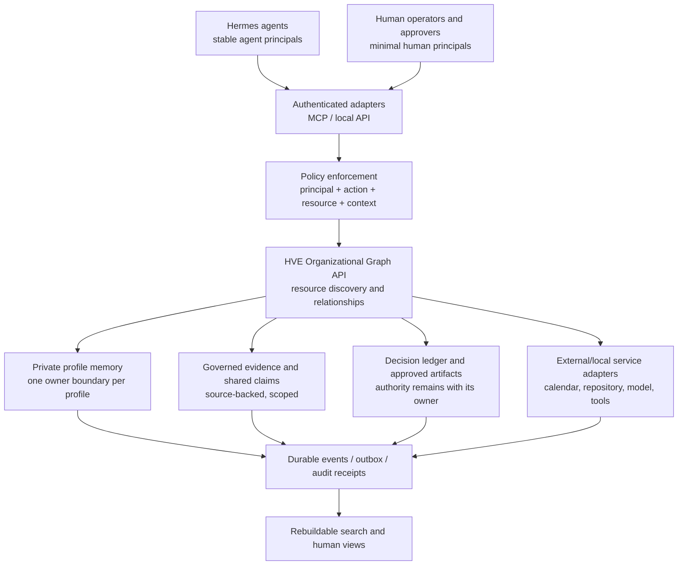

# HVE Agent-First Organizational Graph: Microsoft Graph Research and Luna's Design View

- **Date:** 2026-11-01
- **Version:** v1.0
- **Status:** Research and architecture proposal for independent review; not approved policy, a ledger decision, or implementation authorization
- **Prepared by:** Luna, HVE CTO / Head Architect
- **Audience:** Hans Westphal; Grokbot for independent review; HVE-COS; HVE-Librarian
- **Decision owner:** Hans Westphal
- **Scope:** A local-first HVE identity, knowledge, delegation, and resource-access architecture, beginning with an agent fleet and later expanding human-facing capabilities
- **Publication note:** This copy is suitable for the public KnowOps repository. It excludes credentials, private memory/session contents, sensitive host details, and unverified live-runtime claims.

## Executive position

Hans's insight reframes the problem productively: HVE may not need another shared-memory application so much as a **permissioned organizational graph and API** through which agents and, later, humans can discover and use the resources they are authorized to access.

The analogy is useful if we keep it precise. Microsoft Graph is a resource-and-relationship API, identity and authorization framework, and set of data-integration patterns over Microsoft cloud services. It is not simply one large shared database, a graph database, or an agent memory product. HVE should borrow the architectural ideas, not attempt to reproduce Microsoft's product or presume that describing a Graph API has completed the memory layer.

**Luna's recommendation:** Treat the target as an **HVE Organizational Graph**: a local-first, provider-neutral control and access layer for stable agent and human identities, resources, explicit grants, provenance, decisions, and events. Keep private agent memory, governed shared knowledge, and authoritative decisions as distinct resources with distinct owners. Expose them through consistent APIs/MCP tools, with authorization enforced before retrieval or action. Do not select a graph database until demonstrated queries require one.

The agent-first sequence is sound for the resource model, but it must not be humanless. Minimal human principals and accountable sponsors/approvers are required from the beginning. HVE can postpone broad human productivity features; it cannot postpone the human control plane that authorizes, reviews, and can suspend agents.

This is a technical recommendation for Grokbot and Hans to reconcile. It does not activate a memory policy, grant any agent new access, approve a Linux-user migration, or authorize a build.

## What Microsoft Graph actually provides

Microsoft's documentation describes Microsoft Graph as a gateway to data and services across Microsoft Entra, Microsoft 365, Windows, and other products. Its API has typed resources with identifiers, properties, relationships, and actions; clients navigate those relationships and use metadata to discover the model. Different resources and operations require different permissions. That is a useful organizational graph pattern, but it does not imply that every resource's content lives in one physical store. The API can act on source-service data; Microsoft's separate Data Connect option produces scheduled cached exports for analytics.

Three Microsoft integration mechanisms are especially relevant to HVE:

| Microsoft component | What it does | HVE design lesson |
|---|---|---|
| Microsoft Graph API | Provides a consistent REST/SDK surface for operations on Microsoft service resources and their relationships. | Present a stable HVE resource model and policy-enforced interface across separate services; do not make the API itself synonymous with the canonical content store. |
| Synced Copilot connectors | Copy external items and metadata into Microsoft Graph for indexing and search. Items include access-control information; source changes and deletions must be synchronized. | A local search index is a projection. Preserve source, provenance, visibility, and deletion/supersession state, and enforce item-level permissions in the retrieval path. |
| Federated Copilot connectors | Retrieve from an external source at query time without copying or indexing its content. | For sensitive or frequently changing sources, prefer an authenticated source adapter/MCP call when that better preserves source-side access controls. |
| Microsoft Graph Data Connect | Exports large datasets on a recurring schedule into analytics storage; it is not the transactional API path. | Keep bulk analytics/backup projections separate from low-latency operational reads and writes. |

This distinction also corrects a possible naming trap: **Microsoft Graph API is not the same thing as a graph database.** Microsoft's public architecture emphasizes a unified resource API and relationships. The API model can be backed by multiple services. HVE can represent relationships in a relational store and expose a graph-shaped API; a specialized graph database is an implementation choice, not a prerequisite.

Microsoft's current model is also more than “a user account per agent.” Entra Agent ID defines a specialized Entra service principal for an agent, with a blueprint that can create multiple agent identities. A separate agent user account is optional, intended for user-oriented Microsoft 365 resources such as a mailbox, and currently documented as available only to Frontier preview tenants. Microsoft documents S2S (agent acts as itself) and OBO (agent acts in a signed-in human's context) as different execution modes. Its model requires a business sponsor for each agent identity and blueprint and separates sponsorship from technical ownership. HVE can reuse these distinctions without requiring Entra for local-only agents.

Finally, Microsoft's synchronization model is deliberately resilient: change notifications are a push signal, while delta queries provide a pull-based way to reconcile changes. Microsoft warns that push delivery/order is not guaranteed and that synchronization cursors can expire or replay changes. A local HVE graph should therefore use durable events/outbox records, idempotent processing, and reconciliation—not trust a best-effort notification as the only record of change.

## The EA calendar memo as a delegation design test

The [Executive-EA Calendar Delegation Research](2026-11-01-hve-executive-ea-calendar-delegation-research-v1.0.md) shows why a single relationship such as `delegate_of` is too coarse. Microsoft's human EA pattern separates calendar read/edit rights, private-item visibility, meeting-request routing, mailbox access, and sender attribution (Send on Behalf versus Send As). A calendar-folder `Editor` grant alone is not the whole delegate workflow.

The corresponding HVE model should represent a grant as a qualified object, not just an untyped graph edge:

- **Principal:** which agent or human is requesting the operation?
- **Resource:** which calendar, document, memory item, tool, or service?
- **Action:** read, propose, create, update, send, approve, or another explicit operation?
- **Scope and conditions:** which folder/items, sensitivity class, channel, or context?
- **Delegation context:** is the agent acting as itself, or on behalf of a specific human?
- **Accountability:** who approved the grant, who owns the resource, and when does it expire or require review?
- **Attribution:** record the acting agent and, when applicable, the human subject separately.

For example, an EA agent authorized to schedule on Hans's calendar must not thereby receive Hans's email, all files, private event details, or the right to send as Hans. Each is a separate resource/action decision. Sponsorship or technical ownership is not itself a data-access grant.

## HVE starting point: architecture is clearer than deployment

HVE's existing memory architecture already describes a useful separation:

1. **Agent-private:** one profile's working memory and session history.
2. **Fleet-shared:** curated evidence and claims, served under profile-specific identity and scope.
3. **Human-shared/authoritative:** the decision ledger and approved artifacts; human-facing wikis or indexes are projections, not authority.

This is compatible with an Organizational Graph: the graph/API can connect these resources and enforce who may traverse them without merging their storage or authority.

The current documents do **not** show that the full shared layer is already deployed. The v1.1 memory recommendation is explicitly a draft and describes the shared-context integration as partly built, not approved, and not live-verified. The dated Memory Wiki UAT and runbook describe a read-only operator view and carefully limit what was actually inspected; that viewer is not a shared write/read service for the fleet. These records are documentation evidence, not a fresh Spark inspection. This paper therefore distinguishes the **architectural insight** from the **runtime state** and makes no live deployment claim.

Likewise, the common tool baseline is an approved rollout plan, not evidence that each target profile has completed deployment and validation. Tool availability does not confer action authority. The graph's authorization layer must keep that invariant.

## Proposed HVE graph model

The following is a design vocabulary for review, not a finalized schema.

### Core object types

- **Principal:** a stable nonhuman agent, human, or platform-service identity. An agent's stable HVE ID is not its Linux username, Hermes profile name, Entra ID, or model endpoint; those are bindings to the principal.
- **Agent definition:** a versioned template/blueprint describing a class of agent, its default capabilities, extension points, and required controls.
- **Agent instance:** one enrolled, governed agent with a purpose, sponsor, technical owner, lifecycle state, approved tools, and deployment bindings.
- **Resource:** a typed object with an owning authority and canonical source. Examples include a private memory store, evidence document, shared claim, decision, calendar, repository, tool, channel, or inference service.
- **Grant/delegation:** an explicit, revocable relationship between principal, action, resource/scope, and validity period, with an approver and evidence of the grant.
- **Claim/memory item:** a sourced statement with provenance, authority class, visibility, recorded time, applicable/valid time, confidence where appropriate, and lifecycle/supersession status.
- **Decision:** an authoritative decision with its approval, owner, effective/review dates, and evidence references. A search result or agent memory is not a decision.
- **Event/receipt:** a content-minimized record of an action, proposal, approval, denial, synchronization, or lifecycle change, with actor, optional on-behalf-of subject, resource, time, result, and correlation ID.

Potential relationships include `sponsored_by`, `technically_owned_by`, `member_of`, `owns_resource`, `may_read`, `may_propose`, `may_write`, `acts_on_behalf_of`, `derived_from`, `approved_by`, and `supersedes`. Access edges should usually resolve through a grant object carrying scope, conditions, expiry, and provenance; a bare edge can hide important distinctions.

### Authorization before retrieval

For every operation, evaluate **principal + action + resource + context** at the service boundary. Default to deny. Check permissions before a result is placed in an agent's prompt, not after broad search results have already been retrieved. The same check must apply to search, list, fetch-by-ID, relationship traversal, exports, and tool calls.

This is especially important for shared memory: filtering a mixed-scope result in prompt instructions is not a security boundary. The service must return only records the authenticated caller may see. A write to shared knowledge should be a governed proposal/packet until its authorized steward accepts it; a memory fact does not acquire decision authority merely because it was stored or indexed.

### API facade over bounded stores

The graph/API is the consistent **access and relationship layer**. It need not absorb every database. Agent-private SQLite remains private; the Librarian's evidence and claims remain governed knowledge; the ledger remains authoritative for decisions. Search indexes and human dashboards are derived views that can be rebuilt and must not silently become sources of authority. The API transport could be MCP for Hermes and another interface for human clients; the authorization and resource contract should not depend on a particular model or interface.

For a first implementation, relational tables with stable IDs, foreign keys, explicit grants, and append-only event records may be simpler and easier to validate than a separate graph database. Use FTS/vector indexes only as derived retrieval structures; preserve citations and apply access checks in the retrieval service. Revisit graph storage only if measured multi-hop queries, scale, or consistency requirements justify the operational cost.

### Agent-to-agent delegation

An agent fleet with hundreds or thousands of agents will delegate work among agents. Delegation must not amplify authority. A delegated task should carry a bounded task/resource/action scope, expiry, and traceable parent actor. The child receives only the intersection of its own grants and the delegator's explicitly delegated capability; it never receives another agent's private memory or raw human credentials by default. Record the actor chain for consequential operations.

## Agent-first, but not humanless

HVE can be agent-first in the order of enrollment and in the common API. It should still create a minimal set of human principals from day one for sponsorship, approval, technical ownership, resource ownership, emergency suspension, and audit attribution. The broader employee/collaborator directory, human-facing productivity tools, and personal memory features can come later.

This matches a key lesson from Entra Agent ID: every agent identity needs human accountability, while technical owners and business sponsors have different responsibilities. At HVE, the org chart and current authority model remain controlling: Hans is CEO and final authority; Luna owns technical architecture; specialist agents retain their defined lanes. This paper does not delegate any of Hans's decision authority.

For a future citizen-developer program, separate four roles:

1. **Maker:** defines an agent's purpose and builds within approved templates/adapters; cannot grant itself access.
2. **Business sponsor:** remains accountable for the agent's purpose and continued need.
3. **Technical/platform owner:** manages template, runtime identity, release, and operational safety.
4. **Resource owner/approver:** authorizes access to a particular resource and its actions.

Automate provisioning, validation, expiry reminders, revocation, and evidence capture. Do not route every routine low-risk operation to Hans, but do not assume makers or agents can approve consequential access. Any delegation of approval authority or risk-based auto-approval requires a separate HVE decision.

## Scaling from 100 to 1,000+ agents and 10 to 100 humans

Count **definitions, identities, active executions, and persistent profiles separately**. A thousand registered agents do not imply a thousand resident model processes. A scalable design should support many stable agent identities while scheduling a bounded number of jobs through shared inference services, with per-principal admission controls, quotas, back-pressure, and auditable tool access.

Recommended distinctions:

- A **long-lived agent profile** with private memory, tools, or credentials gets a stable agent ID, separate profile-owned data, and a distinct local runtime principal (for example, its own non-login Linux UID and service boundary).
- An **ephemeral task worker** gets a short-lived job identity/sandbox, narrowly scoped task access, and no persistent private memory unless explicitly designed and approved.
- A **shared model service** is a platform resource, not the agent identity. It should not become an implicit path to other profiles' files or authorities. Where the model endpoint itself lacks per-caller identity, a trusted admission/policy layer must mediate use and resource limits.
- A **human M365 account** is not the default agent identity. If an agent needs Microsoft API access, use an agent identity and an explicitly chosen S2S or OBO mode; create an agent user only when the agent truly needs user-oriented resources such as its own mailbox. Verify the tenant licensing and product prerequisites before adopting Agent 365 governance features.
- **Templates/blueprints are credential and permission boundaries.** Do not put agents with materially different secret, scope, or risk requirements under one inherited baseline merely to reduce administration.

Linux users provide local process/file isolation, not a registry, access-request workflow, API identity, sponsor, or audit trail. Conversely, an Entra identity does not isolate a Spark process from local files. The stable HVE principal should map to both layers where needed, while the actual local and remote enforcement points independently verify the caller.

For 10-100 humans, group/role-based assignment and risk-tiered workflow can reduce one-off grants, but a group is not automatic authority to approve every action. High-risk finance, identity, communications, external publication, and irreversible actions need explicit resource/action policies and human approval gates. Lower-risk operations may be automated only under a policy Hans has approved.

## Suggested sequencing for review

These are research recommendations, not approved build steps:

1. **Name the target and boundaries.** Decide whether “HVE Graph” means an internal API/control plane, a domain data model, or both. Keep it provider-neutral and local-first; do not conflate it with Microsoft's hosted product.
2. **Inventory authoritative resources and owners.** For each data class, identify its canonical store, steward, visibility, retention, read path, write path, and approval authority. Distinguish documented state from live Spark state before an implementation gate.
3. **Define identity and grant contracts.** Specify stable principal IDs and bindings to Hermes profiles, Linux UIDs/system services, tools, and any external identities. Define actor/subject attribution, grant expiry/revocation, resource scopes, and access tests.
4. **Build a read-only graph slice first.** Expose agent registry/context, evidence search, provenance, and approved decision views through authenticated per-agent interfaces. Test denied cross-scope search and fetch-by-ID paths with synthetic data.
5. **Add controlled write proposals, not direct shared writes.** Use a packet/intake workflow with receipts and steward review. Keep decision creation/publication behind the authoritative ledger process.
6. **Add synchronization and indexes as projections.** Use durable outbox/change records, idempotent consumers, periodic reconciliation, and explicit deletion/supersession handling. Choose live federation versus local indexing per source sensitivity, latency, and permissions.
7. **Add the human-resource adapter.** Use the EA calendar scenario as the first delegation test: grant only the needed calendar actions, make private-item and request-routing choices explicit, and audit actor plus on-behalf-of subject. Do not infer mailbox or send-as rights.
8. **Scale only after gates pass.** Automate profile provisioning and lifecycle; validate isolation, revocation, restore, policy enforcement, event recovery, and inference service limits before expanding the cohort.

The current staged memory proposal and any Spark rollout remain governed by their own explicit approval gates. This document neither changes that sequence nor authorizes reconfiguration.

## Questions for Grokbot's independent review

Please challenge the framing and propose alternatives with evidence and trade-offs:

1. Is “HVE Organizational Graph” the right model, or does it collapse identity, authorization, knowledge, and memory concerns that should remain separate services?
2. Which objects and relationships are essential for an agent-first v1, and which should be deferred? Is a graph database justified now, or is a relational model plus API and search projection the safer starting point?
3. What is the correct stable identity boundary: agent definition, deployed profile, individual job, or a combination? How should those map to Linux users, systemd services, Hermes profiles, and external API identities?
4. What authorization model best prevents cross-profile or cross-scope leakage across search, fetch-by-ID, MCP tools, delegated tasks, and writes?
5. How should HVE distinguish business sponsor, technical owner, resource owner, maker, and final approver for 100-1,000 agents with comparatively few humans, without weakening Hans's current authority?
6. Which information should be federated from source at query time, and which can be copied into a permission-aware local index? What are the deletion, revocation, and stale-index guarantees?
7. How should the system record on-behalf-of actions and agent-to-agent delegation so neither identity nor authority is ambiguous?
8. What is the smallest reversible pilot that proves the model without assuming the shared-memory layer is already deployed?

Hans reconciles Grokbot's and Luna's recommendations and makes any final decision. Until then, this paper remains a research proposal.

## Sources

### HVE source documents

- [Executive-EA Calendar Delegation Research v1.0](2026-11-01-hve-executive-ea-calendar-delegation-research-v1.0.md) - Microsoft calendar, mailbox, and sender-attribution delegation patterns.
- [Fleet Memory Architecture Recommendation v1.1](2026-10-29-hve-fleet-memory-architecture-recommendation-v1.1.md) - three-tier architecture proposal and explicit deployment/approval gaps.
- [Memory Wiki CFO UAT v1.0](2026-10-28-hve-memory-wiki-cfo-uat-v1.0.md) and [Memory Wiki Dashboard Runbook v1.0](../SOPs/2026-10-30-hve-spark-memory-wiki-dashboard-runbook-v1.0.md) - dated read-only viewer scope and operational evidence boundaries.
- [Fleet Common Tool Baseline Rollout v1.0](2026-10-30-hve-fleet-common-tool-baseline-rollout-v1.0.md) - approved rollout plan, which is not itself deployment evidence.
- [Current HVE Organization and Fleet v5.0](2026-09-18-hve-org-chart-v5.0.md) - current role and authority reference.
- [Repository mission and governance index](../instructions.md) - decision authority and policy precedence.

### Microsoft Learn (first-party documentation, accessed 2026-11-01)

- [Overview of Microsoft Graph](https://learn.microsoft.com/graph/overview)
- [Use the Microsoft Graph API](https://learn.microsoft.com/graph/use-the-api)
- [Navigate resources and relationships](https://learn.microsoft.com/graph/traverse-the-graph)
- [Authentication and authorization basics](https://learn.microsoft.com/graph/auth/auth-concepts)
- [Overview of Microsoft Graph permissions](https://learn.microsoft.com/graph/permissions-overview)
- [Common Microsoft Graph integration patterns](https://learn.microsoft.com/graph/integration-patterns-overview)
- [Microsoft 365 Copilot connectors overview](https://learn.microsoft.com/graph/connecting-external-content-connectors-overview)
- [Create, update, and delete connector items](https://learn.microsoft.com/graph/connecting-external-content-manage-items)
- [Manage connector access permissions](https://learn.microsoft.com/microsoft-365/copilot/connectors/manage-access-permissions)
- [Microsoft Graph Data Connect overview](https://learn.microsoft.com/graph/data-connect-concept-overview)
- [Delta query change tracking](https://learn.microsoft.com/graph/delta-query-overview)
- [Microsoft Graph change notifications](https://learn.microsoft.com/graph/change-notifications-overview)
- [What is Microsoft Entra Agent ID?](https://learn.microsoft.com/en-us/entra/agent-id/what-is-microsoft-entra-agent-id)
- [Agent ID authorization](https://learn.microsoft.com/en-us/entra/agent-id/authorization-agent-id)
- [Agent identity owners, sponsors, and managers](https://learn.microsoft.com/en-us/entra/agent-id/agent-owners-sponsors-managers)
- [Governing Agent Identities](https://learn.microsoft.com/en-us/entra/id-governance/agent-id-governance-overview)
- [Agent 365 identity](https://learn.microsoft.com/en-us/microsoft-agent-365/developer/identity)
