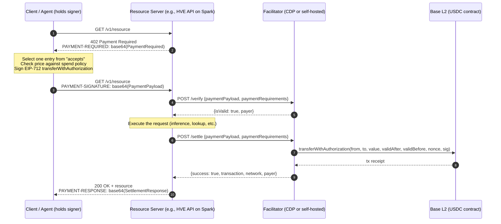
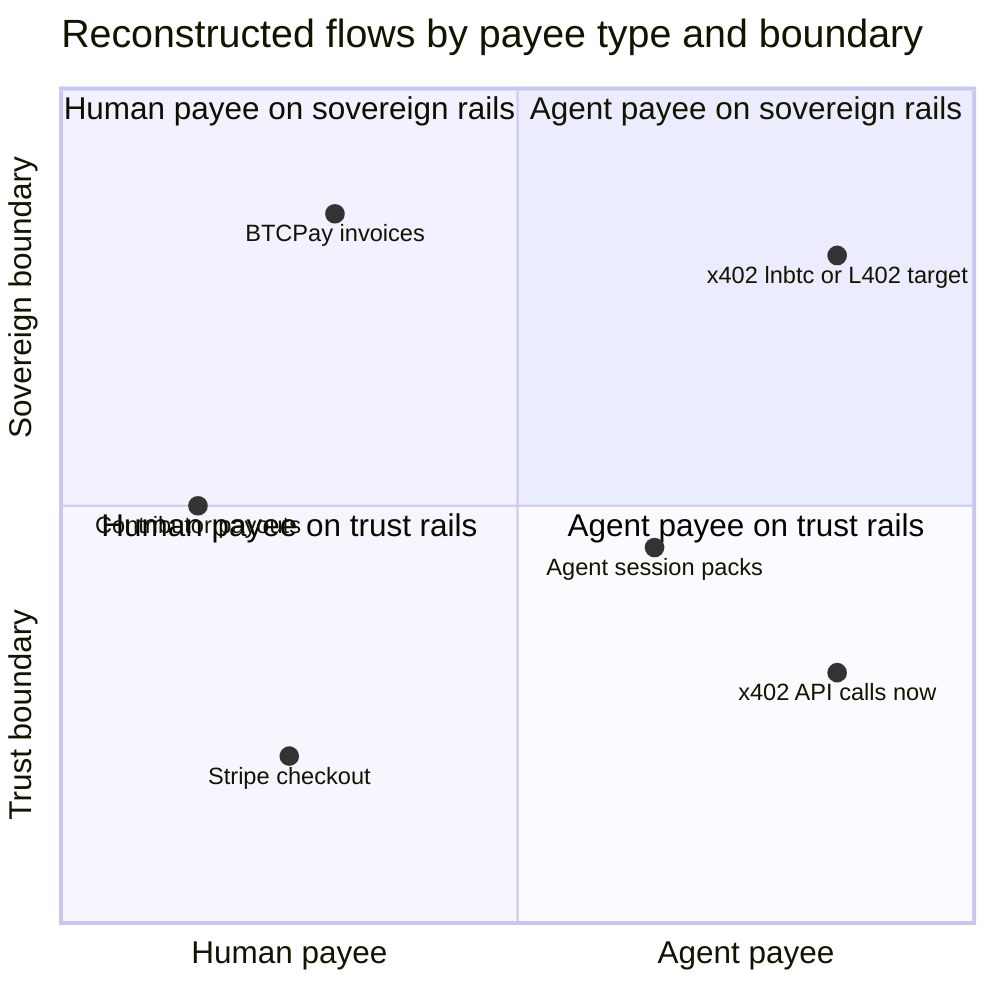
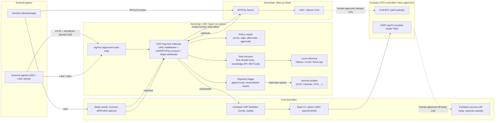

# x402 Protocol Primer and HVE Domination Plan: Monetizing Machine-Native Payments Across Sovereign and Trust Boundaries

| Field | Value |
|---|---|
| **Status** | **DRAFT / proposal — not approved policy** |
| **Version** | v0.1 |
| **Date** | 2026-10-22 |
| **Author** | HVE Knowledge Ops |
| **Prepared for** | Hans Westphal, Founder and CEO, Human Value Exchange (HVE) |
| **Decision owner** | Hans Westphal |
| **Commit authority** | Hans explicitly asked for this draft to be committed for review. Committing it does not adopt any part of it. |
| **Policy effect** | None. Nothing here is active until Hans records it through the weekly decision-ledger workflow with owner, approval status, effective date, and review date ([operating plan v1.1, dated-policy gate](../../agent-communications/2026-08-29-hve-operating-plan-v1.1.md)). |

> **How to read this document.** Statements are labelled where it matters:
> **[Fact]** means verified from a cited source or a committed HVE record;
> **[Decision]** means an existing, recorded HVE decision (with its source);
> **[Proposal]** means a recommendation in this paper that needs Hans's approval;
> **[Assumption]** means a working premise that has not been verified;
> **[Open question]** means something Hans or an owner must resolve.
> All prices, volumes and timelines in Part II are **illustrative example
> assumptions**, not forecasts, offers or policy. Web facts were checked on
> 2026-10-22 and may change.

> **Bitcoin discount policy.** Per [`instructions.md`](../../instructions.md), the
> Bitcoin discount policy is **undetermined**. This paper does not describe any
> Bitcoin discount, eligibility rule or payment advantage as active. Where such a
> mechanism is mentioned, it is an *option that requires Hans's decision-ledger
> approval*.

---

## Table of contents

- [Executive summary](#executive-summary)
- [Part I — x402 Protocol Primer](#part-i--x402-protocol-primer)
  - [1. Origins and governance](#1-origins-and-governance)
  - [2. The HTTP 402 flow in detail](#2-the-http-402-flow-in-detail)
  - [3. Payment schemes](#3-payment-schemes)
  - [4. Base specifics](#4-base-specifics)
  - [5. Facilitators](#5-facilitators)
  - [6. Roles: client, resource server, facilitator, agent](#6-roles-client-resource-server-facilitator-agent)
  - [7. Ecosystem and volume status, October 2026](#7-ecosystem-and-volume-status-october-2026)
  - [8. Comparison: x402 vs Lightning/L402 vs MPP](#8-comparison-x402-vs-lightningl402-vs-mpp)
  - [9. Practical integration patterns](#9-practical-integration-patterns)
- [Part II — HVE Domination Plan](#part-ii--hve-domination-plan)
  - [10. Strategic thesis and the hybrid Venn](#10-strategic-thesis-and-the-hybrid-venn)
  - [11. Sovereign and trust boundaries](#11-sovereign-and-trust-boundaries)
  - [12. DGX Spark reference architecture](#12-dgx-spark-reference-architecture)
  - [13. Revenue models](#13-revenue-models)
  - [14. Agent service offerings](#14-agent-service-offerings)
  - [15. Marketplace payouts](#15-marketplace-payouts)
  - [16. Inference and API monetization (illustrative pricing)](#16-inference-and-api-monetization-illustrative-pricing)
  - [17. Phased go-to-market](#17-phased-go-to-market)
  - [18. Risks](#18-risks)
  - [19. KPIs](#19-kpis)
  - [20. Actionable recommendations](#20-actionable-recommendations)
  - [21. Open questions and decisions for Hans](#21-open-questions-and-decisions-for-hans)
- [22. Verification log](#22-verification-log)
- [23. References](#23-references)

---

## Executive summary

**What x402 is.** x402 is an open protocol that turns the long-dormant HTTP
`402 Payment Required` status code into a working payment handshake. A server
answers an unpaid request with `402` and a machine-readable price; the client
(a person's app or an autonomous agent) signs a payment authorization and
retries; a *facilitator* verifies and settles the payment on a blockchain; the
server returns the resource with a settlement receipt. There is no account,
checkout page or API-key signup in the loop. **[Fact]** Coinbase introduced x402
in May 2025 ([Coinbase launch page](https://www.coinbase.com/developer-platform/discover/launches/x402)).
The Linux Foundation announced the x402 Foundation on 2 April 2026
([LF press release](https://www.linuxfoundation.org/press/linux-foundation-is-launching-the-x402-foundation-and-welcoming-the-contribution-of-the-x402-protocol))
and announced its operational launch and the completed Coinbase contribution on
14 July 2026, with 40 member organizations
([LF press release](https://www.linuxfoundation.org/press/linux-foundation-announces-operational-launch-of-x402-foundation-to-standardize-internet-native-payments-for-ai-agents-and-applications)).
The canonical repository is now
[`x402-foundation/x402`](https://github.com/x402-foundation/x402); `coinbase/x402`
describes itself as a development fork.

**Where it stands (October 2026).** **[Fact]** The protocol is at version 2,
using the `PAYMENT-REQUIRED`, `PAYMENT-SIGNATURE` and `PAYMENT-RESPONSE` headers
(v1 used `X-PAYMENT` and `X-PAYMENT-RESPONSE`). The `exact`, `upto` and
`batch-settlement` schemes all exist in the specification, and Coinbase's CDP
facilitator lists all three on Base mainnet (`eip155:8453`). Third-party
trackers agree that x402 has processed on the order of 10^8 cumulative
settlements, but they disagree sharply on dollar volume and show that organic
commerce is small and concentrated (Section 7). Lightning appears in the spec as
an `exact` binding (`lnbtc`), which matters for HVE's Bitcoin-first posture.

**Why it matters to HVE.** HVE is building the Human Life Operating System around
the Five Wealth framework to strengthen human sovereignty, and already runs a
local agent fleet (Hermes on an on-prem NVIDIA DGX Spark) and a sovereign Bitcoin
and Lightning operating node (Mercury, with BTCPay Server). x402 is currently the
most widely deployed protocol for *agents paying other services*. HVE can earn
from that traffic while keeping Bitcoin custody, client data and core inference
under its own control.

**The proposed plan in one paragraph.** **[Proposal]** Treat payment rails as
three layers that meet at one HVE-controlled policy and ledger service:

1. **Sovereign Bitcoin core.** BTCPay Server and Lightning stay under Mercury,
   reporting to HVE-CFO, as already recorded.
2. **Agent bridge.** x402 on Base, settled through the Coinbase CDP facilitator,
   with an option to self-facilitate later.
3. **Human and fiat layer.** Stripe for cards and invoices, with Stripe's x402 and
   MPP support kept as a later option.

Expose a small set of HVE-owned, Spark-served agent endpoints, starting with
low-risk knowledge and Five Wealth tooling. Do not resell general-purpose
compute. Collect evidence in a 0–30 / 30–90 / 90–180-day sequence gated by
Hans's approvals. Bitcoin stays sovereign. x402 receipts are treated as
operating revenue under HVE-CFO controls, and any conversion or sweep policy
needs a separate decision.

**Top decisions needed from Hans** (detailed in Section 21):

1. Approve or reject a **testnet-only** x402 pilot on Spark.
2. Decide whether HVE will **hold USDC at all**, and under which custody model.
3. Confirm the **jurisdictional and regulatory posture** (HVE is recorded as a
   Canadian private corporation) before any mainnet receipt.
4. Choose **which first endpoint** to monetize.
5. Confirm that **BTCPay remains on Mercury**, not co-located on the Spark.
6. Settle the **hybrid Venn definition**: the source could not be found in the
   repository and is reconstructed here.

---

# Part I — x402 Protocol Primer

## 1. Origins and governance

### 1.1 Origin at Coinbase

**[Fact]** Coinbase introduced x402 in May 2025 as an open standard for
internet-native payments built on HTTP
([Coinbase launch page](https://www.coinbase.com/developer-platform/discover/launches/x402);
[Cointelegraph coverage](https://cointelegraph.com/news/coinbase-x402-payments-protocol-make-ai-agents-more-autonomous)).
The design goal was to revive HTTP 402 so that a client can be priced, pay and
receive a resource in one request–response loop, with stablecoins (mainly USDC)
as the first payment instrument. The x402 docs describe the target use cases as
"API monetization, agentic commerce, paywalled content, and any scenario where
traditional payment methods are too slow or expensive"
([x402.org](https://x402.org/)).

### 1.2 Move to the Linux Foundation

**[Fact]** The governance timeline, as published by the Linux Foundation:

| Date | Event | Source |
|---|---|---|
| May 2025 | Coinbase publishes x402 | [Coinbase](https://www.coinbase.com/developer-platform/discover/launches/x402) |
| 2 Apr 2026 | LF announces it is launching the x402 Foundation with Coinbase's contribution. LF names Coinbase, Cloudflare and Stripe as initial developers of the governing body, and lists intended participants including AWS, Google, Microsoft, Visa, Mastercard, American Express, Circle, Shopify, Base and Solana Foundation | [LF press release](https://www.linuxfoundation.org/press/linux-foundation-is-launching-the-x402-foundation-and-welcoming-the-contribution-of-the-x402-protocol) |
| 14 Jul 2026 | LF announces operational launch, the **completed** Coinbase contribution, and 40 member organizations. Premier members listed include Adyen, AWS, American Express, Circle, Cloudflare, Coinbase, Fiserv, Google, Mastercard, Shopify, Stripe and Visa | [LF press release](https://www.linuxfoundation.org/press/linux-foundation-announces-operational-launch-of-x402-foundation-to-standardize-internet-native-payments-for-ai-agents-and-applications) |
| 13 Aug 2026 | x402 Foundation participation agreement and charter amended. The Foundation is a *directed fund* of the LF supporting the technical project, "x402 a Series of LF Projects, LLC", and is governed by a Governing Board with Premier, General and Associate members | [Charter PDF](https://cdn.platform.linuxfoundation.org/agreements/x402-foundation.pdf) |

**[Fact]** The README of [`coinbase/x402`](https://github.com/coinbase/x402) says
the repository moved under the x402 Foundation, that issues and PRs were
transferred to [`x402-foundation/x402`](https://github.com/x402-foundation/x402),
and that `coinbase/x402` is "now a development fork". The Foundation repository
includes a `TSC.md` (technical steering) file, specifications under `specs/`, and
SDKs in TypeScript, Python, Go and Java (repository inspected at commit
`a9772e5`, 2026-10-22).

**Implication for HVE.** **[Assumption]** Neutral LF governance lowers
single-vendor risk at the protocol layer. It does not remove vendor dependence
at the *settlement* layer. In practice, most mainnet volume runs through a few
facilitators, with Coinbase the largest by dollar value (Section 7).

## 2. The HTTP 402 flow in detail

### 2.1 Version 1 vs version 2 naming

**[Fact]** x402 v2 carries all protocol data in three Base64-encoded JSON
headers ([HTTP transport v2 spec](https://github.com/x402-foundation/x402/blob/main/specs/transports-v2/http.md);
[docs.x402.org — HTTP 402](https://docs.x402.org/core-concepts/http-402)):

| Purpose | v1 | v2 | Direction |
|---|---|---|---|
| Payment requirements | In response body | `PAYMENT-REQUIRED` | Server → client (with `402`) |
| Payment payload (signed authorization) | `X-PAYMENT` | `PAYMENT-SIGNATURE` | Client → server |
| Settlement result | `X-PAYMENT-RESPONSE` | `PAYMENT-RESPONSE` | Server → client |
| Network identifier | String, e.g. `base-sepolia` | CAIP-2, e.g. `eip155:84532` | — |
| Version field | `x402Version: 1` | `x402Version: 2` | — |
| TS packages | `x402`, `x402-express`, `x402-axios` | `@x402/core`, `@x402/express`, `@x402/axios`, `@x402/evm` | — |

Sources: [x402 v1→v2 migration guide](https://docs.x402.org/guides/migration-v1-to-v2);
[CDP migration guide](https://docs.cdp.coinbase.com/x402/migration-guide). CDP
notes that v2 libraries check for both header sets for backward compatibility,
but new implementations should use the v2 headers.

### 2.2 The three logical layers

**[Fact]** The v2 specification separates **types** (data structures such as
`PaymentRequirements`, `PaymentPayload`, `SettlementResponse`), **logic** (the
scheme, such as `exact`, plus the network binding, such as EVM or Solana) and
**representation** (the transport: HTTP, MCP or A2A)
([x402 v2 specification](https://github.com/x402-foundation/x402/blob/main/specs/x402-specification-v2.md)).
This is why the same scheme can run over plain HTTP or as a paid MCP tool call.

### 2.3 Sequence (default `authorization` flow, `exact` on Base)



**[Fact]** The v2 specification defines this verify → resource → settle ordering
as the default `authorization` flow. It also defines `upfront` (settle →
resource) and `escrow` (settle → resource → settle) flows. `/verify` is
read-only and must not commit payment or on-chain state. `/settle` commits
state and may be called more than once in multi-step schemes. `GET /supported`
lets a facilitator advertise the scheme/network combinations it supports
([x402 v2 spec §6.1, §7.1–7.3](https://github.com/x402-foundation/x402/blob/main/specs/x402-specification-v2.md)).

### 2.4 Example payloads

The examples below follow the v2 specification. They use Base Sepolia, the
testnet (`eip155:84532`), and the specification's own placeholder addresses.
**Do not reuse these addresses.** HVE production addresses are deliberately not
included in this repository.

**Step 2 — `PAYMENT-REQUIRED` header (decoded):**

```json
{
  "x402Version": 2,
  "error": "PAYMENT-SIGNATURE header is required",
  "resource": {
    "url": "https://api.example.com/premium-data",
    "description": "Access to premium market data",
    "mimeType": "application/json"
  },
  "accepts": [
    {
      "scheme": "exact",
      "network": "eip155:84532",
      "amount": "10000",
      "asset": "0x036CbD53842c5426634e7929541eC2318f3dCF7e",
      "payTo": "0x209693Bc6afc0C5328bA36FaF03C514EF312287C",
      "maxTimeoutSeconds": 60,
      "extra": { "name": "USDC", "version": "2" }
    }
  ]
}
```

`amount` is in atomic units. USDC has 6 decimals, so `10000` = 0.01 USDC.
`extra.name` and `extra.version` are the token's EIP-712 domain values, which
the client needs to build the signature
([HTTP transport v2 spec](https://github.com/x402-foundation/x402/blob/main/specs/transports-v2/http.md)).

**Step 4 — `PAYMENT-SIGNATURE` header (decoded), `exact` + EIP-3009:**

```json
{
  "x402Version": 2,
  "resource": { "url": "https://api.example.com/premium-data" },
  "accepted": {
    "scheme": "exact",
    "network": "eip155:84532",
    "amount": "10000",
    "asset": "0x036CbD53842c5426634e7929541eC2318f3dCF7e",
    "payTo": "0x209693Bc6afc0C5328bA36FaF03C514EF312287C",
    "maxTimeoutSeconds": 60,
    "extra": { "assetTransferMethod": "eip3009", "name": "USDC", "version": "2" }
  },
  "payload": {
    "signature": "0x2d6a…571c",
    "authorization": {
      "from": "0x857b06519E91e3A54538791bDbb0E22373e36b66",
      "to": "0x209693Bc6afc0C5328bA36FaF03C514EF312287C",
      "value": "10000",
      "validAfter": "1740672089",
      "validBefore": "1740672154",
      "nonce": "0xf374…3480"
    }
  }
}
```

(Signature and nonce shortened; full examples in the
[exact EVM scheme spec](https://github.com/x402-foundation/x402/blob/main/specs/schemes/exact/scheme_exact_evm.md).)

**Step 11 — `PAYMENT-RESPONSE` header (decoded):**

```json
{
  "success": true,
  "transaction": "0x1234…cdef",
  "network": "eip155:84532",
  "payer": "0x857b06519E91e3A54538791bDbb0E22373e36b66"
}
```

On the wire, a 402 response looks like this (header value truncated):

```http
HTTP/1.1 402 Payment Required
Content-Type: application/json
PAYMENT-REQUIRED: eyJ4NDAyVmVyc2lvbiI6MiwiZXJyb3IiOiJQQVlNRU5ULVNJR05BVFVSRSBoZWFkZXIgaXMgcmVxdWlyZWQi...
```

### 2.5 Why the client never sends gas

**[Fact]** With the default `eip3009` transfer method, the client signs an
off-chain EIP-712 message. The **facilitator** submits
`transferWithAuthorization` on the token contract and pays the gas, so the payer
needs USDC but not ETH
([exact EVM spec](https://github.com/x402-foundation/x402/blob/main/specs/schemes/exact/scheme_exact_evm.md)).
EIP-3009 uses random 32-byte nonces rather than sequential ones, plus
`validAfter`/`validBefore` time bounds. Those properties make it suitable for
concurrent, relayed payments ([ERC-3009](https://eips.ethereum.org/EIPS/eip-3009)).
For tokens without EIP-3009, the spec defines a **Permit2** fallback
(`permitWitnessTransferFrom` through an `x402ExactPermit2Proxy` that binds the
recipient), which needs a one-time Permit2 approval. CDP offers EIP-2612 gas
sponsorship for that approval where the token supports it
([CDP facilitator](https://docs.cdp.coinbase.com/x402/core-concepts/facilitator)).

**[Fact] Note on status:** ERC-3009 is still listed as **Draft** on
eips.ethereum.org, even though it is widely implemented, including by USDC
([ERC-3009](https://eips.ethereum.org/EIPS/eip-3009)).

### 2.6 Request binding, replay and trust

**[Fact]** For EIP-3009, replay protection comes from the token contract's
per-authorizer nonce state (`authorizationState`) and the validity window. The
signature binds `to` (the `payTo`), so a malicious facilitator cannot redirect
funds ([ERC-3009](https://eips.ethereum.org/EIPS/eip-3009);
[upto spec, "Recipient Binding"](https://github.com/x402-foundation/x402/blob/main/specs/schemes/upto/scheme_upto.md)).
A facilitator *can* refuse or delay settlement. That is a liveness risk, not a
theft risk.

**[Inference]** Two trust gaps remain for both sides:

- **Buyer side.** In the default `authorization` flow the server runs the
  request after `/verify` and before `/settle`. A dishonest buyer could try to
  race the nonce. Facilitator simulation and short validity windows reduce this
  risk; they do not eliminate it.
- **Seller side.** `exact` has no built-in refund. Disputes have to be handled
  at the application layer, or with the draft `auth-capture` scheme
  (Section 3).

## 3. Payment schemes

**[Fact]** The Foundation repository's `specs/schemes/` folder contains four
schemes: `exact`, `upto`, `batch-settlement` and `auth-capture` (inspected
2026-10-22). The TypeScript EVM mechanism package contains implementations for
all four (`typescript/packages/mechanisms/evm/src/{exact,upto,batch-settlement,auth-capture}`).

| Scheme | What it does | Typical use | Status (verified) |
|---|---|---|---|
| **`exact`** | Transfers a fixed, pre-stated amount once | Per-call API pricing, paywalled content | Production. Bindings exist for many networks (EVM, Solana, Stellar, Aptos, Sui, NEAR, XRPL and others), including **Lightning (`lnbtc`)**. CDP facilitator supports it on Base ([CDP facilitator](https://docs.cdp.coinbase.com/x402/core-concepts/facilitator)) |
| **`upto`** | Authorizes a *maximum*. The actual charge is set at settlement after the work runs. Single-use, time-bound, recipient-bound; amount ≤ max | Per-token LLM pricing, metered compute and bandwidth | In spec with EVM and SVM bindings ([upto spec](https://github.com/x402-foundation/x402/blob/main/specs/schemes/upto/scheme_upto.md)). CDP lists `upto` on Base and Solana. Circle's facilitator also lists `upto` on Base ([Circle supported networks](https://developers.circle.com/facilitator-service/supported-networks)) |
| **`batch-settlement`** | Client gives a cryptographic commitment. Access is granted immediately; value moves later in a batch (escrow vouchers, payment channels, delegated authorization, or credit-backed billing) | High-frequency micro-calls where gas exceeds per-call value; streaming | In spec with EVM, SVM and Cloudflare bindings ([batch-settlement spec](https://github.com/x402-foundation/x402/blob/main/specs/schemes/batch-settlement/scheme_batch_settlement.md)). CDP lists it on Base and other EVM networks, but not Solana. CDP says one on-chain transaction can process thousands of vouchers |
| **`auth-capture`** | Authorize → capture / void / refund / reclaim lifecycle | Refundable purchases, delayed delivery, holds | Specification marked "v1.0 — 2026-05-13 — Initial draft". **Not** listed on CDP's facilitator table as of 2026-10-22 ([auth-capture spec](https://github.com/x402-foundation/x402/blob/main/specs/schemes/auth-capture/scheme_auth_capture.md)) |

### 3.1 `exact`

`exact` is the workhorse. The price is stated in `amount`, and the client signs
for exactly that amount. On EVM networks the default transfer method is EIP-3009
with a Permit2 fallback (Section 2.5). Use it for predictable per-call prices.

### 3.2 `upto`

**[Fact]** The `upto` spec requires four properties on every network:

1. Single-use authorization.
2. Time-bound validity (`validAfter`, `deadline`).
3. Cryptographic recipient binding.
4. A settled amount no greater than the authorized maximum.

On EVM these are enforced through Permit2 nonces and witness data. `upto`
cannot use the `upfront` flow, because the amount is only known after the
handler runs
([upto spec](https://github.com/x402-foundation/x402/blob/main/specs/schemes/upto/scheme_upto.md)).
CDP notes that Solana `upto` uses an escrow deposit plus a second settlement
([CDP facilitator](https://docs.cdp.coinbase.com/x402/core-concepts/facilitator)).

### 3.3 `batch-settlement`

**[Fact]** Verification confirms that the commitment is valid. Settlement then
*stores* it instead of moving value immediately, and the `PAYMENT-RESPONSE`
carries a **commitment identifier** rather than an on-chain transaction hash.
The spec allows two backing models:

- **Capital-backed:** pre-funded escrow, payment channels or delegated
  authorization.
- **Credit-backed:** a verified identity tied to a billing account, for example
  the Cloudflare binding using HTTP Message Signatures (RFC 9421).

The settlement lifecycle is Commit → Accumulate → Redeem
([batch-settlement spec](https://github.com/x402-foundation/x402/blob/main/specs/schemes/batch-settlement/scheme_batch_settlement.md)).
For HVE bookkeeping, a batch commitment is a receivable until it is redeemed.

### 3.4 `auth-capture` (draft)

**[Fact]** `auth-capture` adds `authorize`, `charge`, `capture`, `void`,
`refund` and `reclaim`, with `escrow` (default) and `authorization` flows. The
client's `reclaim` is a unilateral escape hatch after the capture deadline. The
spec is an initial draft dated 2026-05-13
([auth-capture spec](https://github.com/x402-foundation/x402/blob/main/specs/schemes/auth-capture/scheme_auth_capture.md)).
It is relevant to HVE for future refundable human-facing services, but should
not be relied on yet.

### 3.5 Lightning inside x402 (`exact` on `lnbtc`)

**[Fact]** The `exact` scheme on Lightning uses CAIP-2 identifiers derived from
the Bitcoin genesis hash. Mainnet is `lnbtc:000000000019d6689c085ae165831e93`
and the asset is `"BTC"`. The resource server returns a fresh BOLT11 invoice
that commits to a canonical hash of the request. The client pays and returns
the 32-byte preimage. The facilitator verifies `SHA-256(preimage) ==
payment_hash` and that the invoice was signed by the key named in `payTo`. Only
the `upfront` flow is allowed, because Lightning settles before the preimage is
revealed
([exact lnbtc spec](https://github.com/x402-foundation/x402/blob/main/specs/schemes/exact/scheme_exact_lnbtc.md)).

**[Unverified]** No `lnbtc` implementation was found in the Foundation's
TypeScript, Python or Go SDK trees during this review, and production
facilitator support for `lnbtc` was not verified. This is the single most
strategically relevant item for HVE to watch, because it would let x402 clients
pay HVE in Bitcoin, settled on HVE's own node.

## 4. Base specifics

| Item | Value | Source |
|---|---|---|
| Base mainnet CAIP-2 | `eip155:8453` (chain ID 8453) | [CDP facilitator table](https://docs.cdp.coinbase.com/x402/core-concepts/facilitator); [Circle supported networks](https://developers.circle.com/facilitator-service/supported-networks) |
| Base Sepolia (testnet) CAIP-2 | `eip155:84532` | [CDP facilitator table](https://docs.cdp.coinbase.com/x402/core-concepts/facilitator) |
| Native (Circle-issued) USDC on Base | `0x833589fCD6eDb6E08f4c7C32D4f71b54bdA02913`, 6 decimals | [Circle USDC addresses](https://developers.circle.com/stablecoins/usdc-contract-addresses); [Circle blog](https://www.circle.com/blog/need-to-know-native-usdc-on-base); x402 `DEFAULT_ASSETS.md` |
| Bridged legacy USDbC (do **not** confuse) | `0xd9aAEc86B65D86f6A7B5B1b0c42FFA531710b6CA` | [Circle blog](https://www.circle.com/blog/need-to-know-native-usdc-on-base) |
| Testnet USDC used in spec examples | `0x036CbD53842c5426634e7929541eC2318f3dCF7e` (Base Sepolia) | [x402 HTTP v2 spec](https://github.com/x402-foundation/x402/blob/main/specs/transports-v2/http.md) |
| EIP-712 domain for USDC in x402 examples | `name: "USDC"`, `version: "2"` | x402 spec examples |

**[Fact]** Circle's facilitator documentation describes Base settlement as "L2
block inclusion, canonical receipt, and USDC `Transfer` event verified". It also
says a verified reorg after completion moves a payment to `failed`, and that it
does not automatically resubmit a reorged payment
([Circle supported networks](https://developers.circle.com/facilitator-service/supported-networks)).
**[Assumption]** HVE should treat an L2 inclusion receipt as good enough to
deliver low-value digital resources, and should not treat it as final for
treasury reporting until the CFO has defined a finality rule.

**[Fact]** Stripe's x402 integration also uses Base mainnet `eip155:8453` and
native USDC, with the Stripe deposit address as `payTo`
([Stripe x402 docs](https://docs.stripe.com/payments/machine/x402)). On
observable volume, Base carries most x402 dollar volume in October 2026
(Section 7).

## 5. Facilitators

### 5.1 What a facilitator is

**[Fact]** A facilitator verifies payment payloads and settles them on-chain
for the resource server. The x402 docs say it "does not hold funds or act as a
custodian"
([x402 docs — Facilitator](https://github.com/x402-foundation/x402/blob/main/docs/core-concepts/facilitator.md)).
Funds move directly from the payer's address to the `payTo` address.

### 5.2 Deployment paths

**[Fact]** The x402 docs describe three paths (same source):

| Goal | Path |
|---|---|
| Fastest testnet or local quickstart | Public `x402.org` facilitator (`https://x402.org/facilitator`). The docs say it is intended for development and testnet, not production mainnet |
| Managed production | A production facilitator that supports the target network (e.g., Coinbase CDP, Circle, others) |
| Full control | Run your own facilitator, or *self-facilitate* inside the resource server. The repository includes TypeScript, Python and Go facilitator examples |

### 5.3 Coinbase CDP facilitator vs self-hosted

| Dimension | CDP facilitator (managed) | Self-hosted / self-facilitated |
|---|---|---|
| Setup | CDP API key ID and secret; `createX402Server` or `createCdpFacilitatorClient` | Run facilitator code, plus a Base RPC endpoint and a hot gas wallet |
| Gas | Facilitator pays settlement gas | HVE pays gas from its own hot wallet |
| Pricing **[Fact]** | First 1,000 on-chain facilitator transactions per month free, then $0.001 per on-chain transaction. Verification is free ([CDP facilitator](https://docs.cdp.coinbase.com/x402/core-concepts/facilitator)) | Gas plus operating cost |
| Compliance screening **[Fact]** | OFAC and KYT screening of addresses (same source) | HVE must decide whether and how to screen |
| Schemes on Base **[Fact]** | `exact`, `upto`, `batch-settlement` | Whatever HVE implements |
| Discovery **[Fact]** | Automatic indexing in the CDP "Bazaar" for endpoints that advertise Bazaar metadata | None by default |
| Dependency | Coinbase account, ToS and availability | Base RPC and HVE ops capacity |
| Custody | Non-custodial for funds in transit; HVE's `payTo` can be self-custody, a CDP wallet or a Coinbase Business account (per CDP overview) | Same |

**[Fact]** CDP also says it has processed "more than 100 million x402 payments
across Base and Solana" ([CDP overview](https://docs.cdp.coinbase.com/x402/welcome)).
Its facilitator page says "more than 100 million transactions and $28 million in
payment volume across Base and Solana alone"
([CDP facilitator](https://docs.cdp.coinbase.com/x402/core-concepts/facilitator)).
The pages are not dated, so treat these as Coinbase self-reported figures as of
retrieval on 2026-10-22.

**[Proposal]** Start with the public testnet facilitator for development. Use
CDP for the first mainnet pilot, because Hans already has a Coinbase account and
CDP adds address screening. Assess self-facilitation only after evidence shows
CDP cost or dependency is material. Write the gateway against the generic
`HTTPFacilitatorClient` interface, so that changing facilitator is a
configuration change rather than a rewrite.

## 6. Roles: client, resource server, facilitator, agent

| Role | Responsibility | Holds keys? | HVE mapping (proposal) |
|---|---|---|---|
| **Client (buyer)** | Parses `PAYMENT-REQUIRED`, picks an option, enforces its own spend policy, signs, retries | Yes, a payment signer | External agents buying HVE endpoints. Separately, HVE agents (Hermes profiles) buying external services, which is a later phase |
| **Resource server (seller)** | Declares prices, calls `/verify` and `/settle`, serves the resource, logs receipts | No payment keys needed for `exact`/EIP-3009; needs the `payTo` address and facilitator API credentials | An HVE x402 gateway on the Spark in front of selected endpoints |
| **Facilitator** | Verifies and settles; pays gas | A gas wallet (self-hosted) | CDP first; self-hosted optional |
| **Agent** | An autonomous client, or an MCP host acting for a human | Usually a constrained wallet (per-call and per-session caps) | Constrained buyer wallets for HVE agents, only after Hans approves |
| **Payee treasury** | Receives funds at `payTo` and reconciles | Yes, cold or warm custody | HVE-CFO (controller) under Hans's authority. **No** agent self-approval (see [CFO–Mercury reporting decisions](../../agent-communications/2026-09-02-hve-cfo-mercury-node-reporting-v1.0.md)) |

**[Inference]** The important design point is that the **seller does not need a
private key on the request path**. With `exact`/EIP-3009, the gateway only needs
a receive address and facilitator API credentials. This lets HVE keep treasury
keys entirely outside the Spark's internet-facing services.

## 7. Ecosystem and volume status, October 2026

> **Data caveat.** No official x402 Foundation statistics endpoint was found.
> The figures below come from independent on-chain trackers and Coinbase's own
> documentation. They differ in chain coverage, facilitator lists and
> definitions of "organic". Each figure is shown with its source and the date
> the source shows. None has been independently audited by HVE.

### 7.1 Third-party trackers (retrieved 2026-10-22)

| Source (date shown) | Metric | Figure |
|---|---|---|
| [agenteconomy.to](https://agenteconomy.to/stats/x402-transactions) (as of 22 Oct 2026) | Cumulative on-chain x402 settlements / settled USD volume | 194,713,680 transactions; $42,201,562; 12 chains; 18 facilitators tracked; 100,981 transactions on 21 Oct 2026 |
| [Paymentscan](https://paymentscan.xyz/x402) (Mar 2025 – Oct 2026 series) | Total volume / transactions (tracked chains, tracked facilitators; described as a lower bound) | $67.3M; 284,774,391 transactions; 38 facilitators. Monthly peak Nov 2025 ($29.11M). October 2026 to date $1.359M (Base $857K, Solana $412K) |
| [402radar](https://402radar.io/stats) (updated 22 Oct 2026) | Trailing 30-day attributed volume / transactions | $252,170 (−56.2% vs prior 30d); 6,395,325 transactions (−73.3%). Base 92.4% of attributed revenue. 4,505 services and 140,148 endpoints indexed |
| [x402stats.io — State of x402, October 2026](https://x402stats.io/reports/2026-10) | Organic 30-day volume / businesses earning | $793k organic (−32% m/m); 91 wallets meeting its organic bar out of 37,495 receiving funds; top 10 wallets hold 76% of volume; median seller revenue $0.01. Coinbase clears 42% of settled volume |
| [Infoharmoni Atlas brief, 3–10 Oct 2026](https://atlas.infoharmoni.com/brief/) | Base seller payments over 8 days | $15,716 to 1,223 listed sellers. 62% went to three sellers. Many sellers had exactly one paying wallet. By dollars, Coinbase processed most Solana x402 volume on the days sampled |
| Coinbase CDP docs (undated; retrieved 22 Oct 2026) | CDP facilitator lifetime | ">100 million transactions and $28 million in payment volume across Base and Solana" ([CDP facilitator](https://docs.cdp.coinbase.com/x402/core-concepts/facilitator)) |

The figures cannot be reconciled with each other. The differences come from
which chains are counted, which facilitator addresses are recognized, whether
test and self-dealing traffic is filtered out, and the measurement window. The
agenteconomy.to page itself warns that raw settlement counts "include tests,
infrastructure traffic, repeated service calls, and self-directed usage".

### 7.2 What the data supports

- **[Fact, per the sources above]** Settlement *counts* are large (hundreds of
  millions cumulative) and Base is the leading x402 settlement chain by dollar
  volume in October 2026.
- **[Fact, per the sources above]** Dollar volume is small relative to the
  transaction count. It peaked in late 2025 and has been much lower in 2026.
  Several trackers report month-on-month declines in October 2026.
- **[Fact, per x402stats.io and Infoharmoni]** Organic seller revenue is highly
  concentrated. Most "sellers" earn trivial amounts, and routers prefer sellers
  with an existing sales history, which creates a cold-start problem for new
  entrants.
- **[Inference]** x402 is real, standards-backed infrastructure with strong
  institutional sponsorship. It is **not** yet a large revenue pool. HVE should
  size any x402 plan as an option on future agent commerce, not as a near-term
  revenue engine.

### 7.3 Ecosystem participants (verified)

- **Governance:** x402 Foundation (LF), with members listed in Section 1.2.
- **Facilitators:** Coinbase CDP; Circle Facilitator Service
  ([Circle](https://developers.circle.com/facilitator-service/supported-networks));
  others listed in the [x402 docs facilitator directory](https://github.com/x402-foundation/x402/blob/main/docs/core-concepts/facilitator.md).
  402radar reports 161 known x402 relays; Paymentscan tracks 38 facilitators.
- **Payments companies:** **[Fact]** Stripe documents accepting x402 payments in
  USDC on Base, recorded as PaymentIntents through a Stripe deposit address used
  as `payTo`. Settlement runs through the CDP facilitator on mainnet, and
  Stripe's examples use `Stripe-Version` preview API versions
  ([Stripe x402 docs](https://docs.stripe.com/payments/machine/x402)). Stripe
  says stablecoin payments are available to US businesses except in New York,
  and that businesses outside the US must request access by email. **This is
  relevant because HVE is recorded as a Canadian private corporation** (see
  [CFO Canada bookkeeping plan](../../agent-communications/2026-10-19-hve-cfo-canada-bookkeeping-implementation-plan-v1.0.md)).
- **Agent wallets:** **[Fact]** Coinbase CDP Agentic Wallets offer
  per-transaction ("max per call") and per-session spend caps. The agent cannot
  change these caps ([CDP Agentic Wallet FAQ](https://docs.cdp.coinbase.com/agentic-wallet/mcp/faq);
  [make-x402-request tool](https://docs.cdp.coinbase.com/agentic-wallet/mcp/mcp-tools/make-x402-request)).
- **MCP:** **[Fact]** The `@x402/mcp` package adds paid tool calls to MCP
  servers and automatic payment handling to MCP clients
  ([x402 repo, `typescript/packages/mcp`](https://github.com/x402-foundation/x402/tree/main/typescript/packages/mcp)).
- **Discovery:** **[Fact]** CDP's Bazaar indexes endpoints that advertise Bazaar
  metadata ([CDP facilitator](https://docs.cdp.coinbase.com/x402/core-concepts/facilitator)).
  402radar reports indexing 4,505 services.

## 8. Comparison: x402 vs Lightning/L402 vs MPP

### 8.1 Which "MPP" is meant

**[Fact]** In this paper, **MPP = Machine Payments Protocol**, co-authored by
**Stripe and Tempo** ([Stripe MPP docs](https://docs.stripe.com/payments/machine/mpp);
[mpp.dev protocol overview](https://mpp.dev/protocol)). It standardizes HTTP 402
using an HTTP-authentication-style framework. The server sends a challenge in
`WWW-Authenticate: Payment id=…, realm=…, method=…, intent=…, request=…`. The
client returns a credential in `Authorization: Payment`. The server may return a
`Payment-Receipt`. The normative core is an IETF-style Internet-Draft
(`draft-httpauth-payment-00`, [tempoxyz/mpp-specs](https://github.com/tempoxyz/mpp-specs/blob/b62c37de/specs/core/draft-httpauth-payment-00.md)).
mpp.dev lists two production payment methods: **Tempo** (stablecoins on the
Tempo network) and **Stripe** (cards via Stripe). It also defines intents such
as `charge` and `session`. Stripe's x402 page recommends integrating MPP as well
when a seller wants card payments alongside stablecoins.

### 8.2 L402

**[Fact]** L402 (Lightning Labs) returns `402` with a `WWW-Authenticate` header
containing a token (Macaroon recommended) and a Lightning invoice. The token
commits to the invoice's payment hash. After paying, the client presents the
token plus the preimage. Verification is stateless, and tokens can be attenuated
and delegated. Aperture is Lightning Labs' L402 reverse proxy
([Lightning Labs L402 docs](https://docs.lightning.engineering/the-lightning-network/l402)).

### 8.3 Comparison table

| Dimension | x402 (v2) | L402 | MPP (Stripe/Tempo) |
|---|---|---|---|
| Steward | x402 Foundation (Linux Foundation); contributed by Coinbase | Lightning Labs (open spec) | Stripe and Tempo; IETF-style draft |
| Wire format | `PAYMENT-REQUIRED` / `PAYMENT-SIGNATURE` / `PAYMENT-RESPONSE` (Base64 JSON) | `WWW-Authenticate: L402 …` / `Authorization: L402 …` | `WWW-Authenticate: Payment …` / `Authorization: Payment …` / `Payment-Receipt` |
| Primary money | Stablecoins (USDC) on EVM, Solana and others; Lightning `lnbtc` binding in spec | Bitcoin over Lightning | Tempo stablecoins; cards via Stripe |
| Settlement verifier | Facilitator (`/verify`, `/settle`) or self | Server checks token + preimage (stateless) | Server or method-specific (Tempo chain, Stripe) |
| Pricing models | `exact`, `upto`, `batch-settlement`, `auth-capture` (draft) | Per-request; Aperture supports dynamic tiers | `charge`, `session` intents |
| Delegation / attenuation | Not native (wallet policy does this) | Native via Macaroons | Not native (method-specific) |
| Bitcoin-sovereign fit | Indirect today (lnbtc in spec; SDK support unverified) | Strong: self-hosted LND/BTCPay | Weak (no Bitcoin method listed) |
| Fiat / cards | Spec allows ISO 4217 assets; Stripe records x402 receipts | No | Yes (Stripe method) |
| Agent ecosystem pull, Oct 2026 | Largest by observable settlement count (Section 7) | Established in Bitcoin developer circles; no comparable public volume data found | Backed by Stripe distribution; no public volume data found |
| Main dependency | Stablecoin issuer + facilitator + L2 | Lightning liquidity and node operations | Stripe/Tempo accounts |
| Fit with HVE today | Agent bridge (trust zone) | Sovereign rail (Mercury) | Human/card bridge (trust zone), later |

**[Inference]** The three are complementary rather than mutually exclusive for
HVE. **x402** reaches agents that hold stablecoins. **L402 or x402-`lnbtc`**
keeps Bitcoin-paying agents on HVE's own rails. **MPP/Stripe** covers card-paying
humans and the agents that act for them. A resource server can advertise more
than one option. **[Unverified]** No production server was tested that offers
x402 and L402 challenges on the same endpoint at the same time. Third-party kits
claim compatibility (e.g.,
[l402-kit](https://github.com/ShinyDapps/l402-kit/commit/73ff6d365697a6c80ec2803d3e48ad18b0ba8d11)
claims a BTCPay provider and x402 header compatibility). These are unaudited
community projects and are not recommended for production without review.

## 9. Practical integration patterns

### 9.1 Server middleware (paywalled API)

**[Fact]** The v2 TypeScript SDK provides framework middleware (`@x402/express`,
`@x402/hono`, `@x402/next`). The pattern, adapted from Stripe's x402 quickstart
([Stripe x402 docs](https://docs.stripe.com/payments/machine/x402)), looks like
this. Testnet values are shown; secrets come from the environment and are never
committed:

```typescript
import { HTTPFacilitatorClient } from "@x402/core/server";
import { ExactEvmScheme } from "@x402/evm/exact/server";
import { paymentMiddleware, x402ResourceServer } from "@x402/hono";

const facilitator = new HTTPFacilitatorClient({ url: "https://x402.org/facilitator" }); // testnet only
const server = new x402ResourceServer(facilitator)
  .register("eip155:84532", new ExactEvmScheme());                // Base Sepolia

app.use(paymentMiddleware({
  "GET /v1/five-wealth/time-audit": {
    accepts: [{ scheme: "exact", price: "$0.05", network: "eip155:84532", payTo: process.env.PAY_TO! }],
    description: "Illustrative: structured Time Wealth audit",
    mimeType: "application/json",
  },
}, server));
```

The `$0.05` price is an **illustrative example assumption**, not an offer. For
mainnet, the facilitator client switches to CDP (`createFacilitatorConfig` from
`@coinbase/x402`, authenticated with CDP API credentials held in a secret store)
and the network to `eip155:8453`.

### 9.2 Metered inference (`upto`)

For token-metered LLM calls, advertise `upto` with a ceiling. Compute the actual
charge from tokens generated, then settle that amount. Hard rules: the charge
must never exceed the ceiling, and the authorization must expire quickly
([upto spec](https://github.com/x402-foundation/x402/blob/main/specs/schemes/upto/scheme_upto.md)).
The server should also return the token count and unit price in the response
body, so the buyer agent can audit the charge.

### 9.3 High-frequency calls (`batch-settlement`)

For sub-cent, high-rate calls such as embeddings, retrieval or lookup, use
`batch-settlement` so that thousands of vouchers settle in one on-chain
transaction (per [CDP facilitator](https://docs.cdp.coinbase.com/x402/core-concepts/facilitator)).
Bookkeeping treats unredeemed vouchers as receivables, and the CFO sets a
redemption cadence.

### 9.4 Paid MCP tools

`@x402/mcp` wraps an MCP tool so that a call returns a payment requirement and
the client's MCP host pays automatically within its limits. This matches HVE's
existing MCP-based agent architecture (see the
[shared-context MCP implementation plan](../../agent-communications/2026-09-01-hve-shared-context-mcp-implementation-plan-v1.2.md)).
The x402 v2 spec also lists A2A as a transport, so the same requirements could
travel over an agent-to-agent channel. HVE has previously referenced the A2A
agent card (`/.well-known/agent.json`) in public writing.

### 9.5 Agent wallets and spend limits (buyer side)

When an HVE agent *buys* services:

- Use a dedicated, low-balance wallet per agent profile.
- Set hard caps per call, per session and per day, enforced outside the model
  (CDP Agentic Wallets do this in the wallet layer).
- Allow-list domains or endpoints.
- Require human confirmation above a threshold.
- Log every `PAYMENT-RESPONSE` to the ledger.

This mirrors HVE's existing rule that agents never self-approve fund movement
([CFO–Mercury decisions](../../agent-communications/2026-09-02-hve-cfo-mercury-node-reporting-v1.0.md)).
The CDP Agentic Wallet CLI exposes a `--max-amount` parameter in atomic USDC
units for x402 payments
([CDP pay-for-service skill](https://docs.cdp.coinbase.com/agentic-wallet/cli/skills/pay-for-service)).
Use these limits as defence in depth, not as the only control.

### 9.6 Discovery and cold start

Section 7 shows routers favour sellers with sales history. Practical levers:

- Bazaar metadata on every endpoint.
- Clear `resource.description` and `mimeType` fields.
- A public, human-readable price page.
- An MCP server listing.
- A small number of reliable, well-documented endpoints rather than many thin
  ones.

### 9.7 Integration checklist

| # | Check |
|---|---|
| 1 | v2 headers only; reject v1 unless a compatibility need is documented |
| 2 | `accepts` lists only networks/schemes that `/supported` confirms |
| 3 | `payTo` is a CFO-controlled address, never an agent hot key |
| 4 | Short `maxTimeoutSeconds`; idempotency keyed on the payment nonce or tx hash |
| 5 | Do not run expensive work before `/verify` passes (`authorization` flow) |
| 6 | Log the payload hash, payer, amount, tx/commitment ID, endpoint and time to the ledger |
| 7 | Rate-limit unpaid `402` probes (Section 7.2 notes heavy router probing) |
| 8 | Testnet end-to-end before any mainnet route |
| 9 | No personal data in `resource.url` or `description` (they may be indexed) |
| 10 | Pin SDK versions; track Foundation changelogs for breaking changes |

---

# Part II — HVE Domination Plan

> **Proposal status.** Everything in Part II is a **proposal** for Hans's
> review. "Domination" is the working title Hans requested. In this document it
> means *being the most trusted, sovereignty-respecting service at the
> intersection of human and agent payments within HVE's Five Wealth domain*. It
> does not mean a claim of market share or an assumption that HVE will win.

## 10. Strategic thesis and the hybrid Venn

### 10.1 Repository search result for the Venn

**[Fact]** A search of `HansHWestphal/hve-knowledge-and-operations` on
2026-10-22 did **not** find a prior "hybrid Venn" definition. The search covered
GitHub `search_code` for "Venn", a local full-text search across
`agent-communications/`, `docs/`, `hermes/`, `mission/`, `operational-artifacts/`
and `content-intelligence/`, and searches for "human-to-agent",
"agent-to-human", "agent-to-agent", "human-to-human" and "trust boundary". The
only "Venn" hit is an unrelated October 2025 Substack export line. The closest
related material:

- The [Grok 4.3 intern interview record](../../mission/2026-05-27-grok-4.3-intern-interview-record.md)
  notes that agent-to-agent economic negotiation is a hard, long-term problem
  that needs identity, reputation, verifiable execution and dispute resolution.
- The [May 2026 org chart v2.1](../../agent-communications/2026-05-16-hve-org-chart-v2.1.md)
  describes Mercury as having an "MCP server for agent-to-agent mesh".
- The [Copilot Studio concierge spec v2.0](../../agent-communications/2026-05-13-copilot-studio-concierge-agent-spec-v2.0.md)
  references the A2A protocol.

**[Assumption]** The Venn below is **reconstructed from Hans's description in
the brief** (four flows across sovereign vs trust boundaries). It is listed as
an open question (Q1) for Hans to confirm, correct or replace.

### 10.2 Reconstructed definition

Two axes:

- **Payer type × payee type** gives four flows: **H2H**, **H2A**, **A2H** and
  **A2A**.
- **Boundary**: a **sovereign** boundary means HVE or the individual holds the
  keys, data and compute (on-prem Spark, Mercury/BTCPay, self-custody). A
  **trust** boundary means a third party is relied on (hyperscalers, Coinbase,
  Stripe, Circle).

| Flow | Example in HVE context | Natural rail(s) | Default boundary |
|---|---|---|---|
| **H2H** human → human | Client pays a Five Wealth coach or practitioner | Stripe (cards/invoices); BTCPay/Lightning | Trust (Stripe) or sovereign (BTCPay) |
| **H2A** human → agent | A person pays for an HVE agent session (e.g., Time Wealth audit) | Stripe; BTCPay; MPP-card later | Mixed |
| **A2H** agent → human | An agent pays a human expert, contributor or reviewer (bounty, marketplace payout) | Lightning payouts via Mercury (human-approved); USDC; provider payout products **[Unverified for HVE eligibility]** | Mixed |
| **A2A** agent → agent | An external agent pays an HVE endpoint per call, or an HVE agent buys an external tool | **x402 on Base**; x402-lnbtc / L402 | Trust (facilitator) at first, moving toward sovereign |

### 10.3 Diagram

```text
                 SOVEREIGN BOUNDARY (HVE/individual holds keys, data, compute)
     ┌────────────────────────────────────────────────────────────────────────┐
     │     DGX Spark (Hermes, inference, gateway)    Mercury (BTCPay + LND)   │
     │                                                                        │
     │          .-------------.                   .-------------.             │
     │        /    H2H         \                /     A2A        \            │
     │       |  people pay      |              |  agents pay      |           │
     │       |  people     .----+--------------+----.  agents     |           │
     │        \           / H2A  \   HVE CORE  / A2H \           /            │
     │         '---------|  people|  policy    |agents|---------'             │
     │                   |  pay   |  ledger    | pay  |                       │
     │                    \ agents|  identity  |humans/                       │
     │                     '------+------------+----'                         │
     └───────────────────────────────────┬────────────────────────────────────┘
                                         │ controlled interfaces only
     ┌───────────────────────────────────┴────────────────────────────────────┐
     │  TRUST BOUNDARY: Coinbase/CDP + Base + Circle USDC (x402),             │
     │  Stripe (cards, MPP), hyperscaler models/hosting, Tailscale            │
     └────────────────────────────────────────────────────────────────────────┘
```



The overlap labelled **HVE CORE** is the strategic target. It is one policy
engine, one append-only payment ledger and one identity/consent layer that
every flow passes through, whichever rail settles it. The quadrant placements
are illustrative, not measured.

### 10.4 Thesis

**[Proposal]** HVE should not try to out-scale general API marketplaces. Its
edge is to be the trusted **human-sovereignty layer** at the overlap of the four
flows:

1. **Bitcoin-native and sovereign by default.** HVE already operates its own
   node (Mercury). Few x402 sellers can say that.
2. **Agent-native in practice.** Hermes profiles run on HVE's own hardware with
   documented governance (runbooks, approval gates).
3. **Human-guided.** Every fund-moving action already requires human
   confirmation by policy. That is a feature for buyers who worry about runaway
   agents.
4. **Domain-specific.** The Five Wealth framework provides a bounded, defensible
   catalogue (Time, Physical, Mental, Social, Financial) instead of commodity
   compute.

**[Inference]** The strategic risk on one side is becoming a commodity x402
seller with no differentiation. On the other side, it is ignoring agent payments
until they mature and others have the reputation. The low-cost middle path is
to be **present, reliable and sovereign** on a handful of differentiated
endpoints, and to build reputation (settlement history) early, while volume is
small.

### 10.5 Alignment with the operating plan

**[Fact]** The approved [operating plan v1.1](../../agent-communications/2026-08-29-hve-operating-plan-v1.1.md)
sets these priorities:

- validate the Five Wealth framework;
- use Time Wealth as the first pilot;
- run evidence-led soft launches;
- prepare for an early-2027 official launch.

It also places pricing, channel ownership and public messaging behind the
dated-policy gate. **[Proposal]** This plan supports those priorities only where
it fits them. The first paid endpoint is a Time Wealth tool, and every phase
produces evidence, not commitments. Nothing here reorders the approved
priorities. If Hans wants x402 work prioritised, that is a ledger decision.

## 11. Sovereign and trust boundaries

### 11.1 Boundary map

| Asset | Sovereign option | Trust option | Proposed default |
|---|---|---|---|
| Bitcoin custody | Mercury (Bitcoin Core, LND, BTCPay) under CFO reporting **[Decision]** ([CFO–Mercury](../../agent-communications/2026-09-02-hve-cfo-mercury-node-reporting-v1.0.md)) | Coinbase custody | **Sovereign** (no change proposed) |
| USDC receipts | Self-custody `payTo` (hardware-backed) | Coinbase Business or CDP custodial wallet | **[Open question]** Hans to choose (Q3) |
| Inference | Spark local models (Ollama/vLLM/llama.cpp) **[Fact]** ([Spark shared infra](../../agent-communications/2026-09-18-hve-spark-shared-infrastructure-tailscale-v1.0.md); [inference runbook](../../agent-communications/2026-09-13-hve-spark-core-inference-operations-runbook-v1.0.md)) | Hyperscaler APIs | **Sovereign** for paid endpoints |
| Client personal data | Spark storage, Life OS memory | Cloud SaaS | **Sovereign**; never in payment metadata |
| Settlement verification | Self-facilitation | CDP / Circle facilitator | **Trust** first, re-evaluate at Phase 3 |
| Fiat acceptance | — | Stripe | **Trust** |
| Public ingress | Tailscale Funnel route (requires explicit routing decision) **[Fact]** ([Spark shared infra](../../agent-communications/2026-09-18-hve-spark-shared-infrastructure-tailscale-v1.0.md)) | Cloud reverse proxy / CDN | **[Open question]** (Q6) |
| Identity of payers | Pseudonymous addresses / Lightning node IDs | Stripe customer records; CDP screening | Minimal: collect only what law and the rail require |

### 11.2 Crossing rules (proposal)

1. **Data minimization across the boundary.** Payment metadata (`resource.url`,
   `description`) must never contain personal data, Five Wealth assessment
   content or client identifiers.
2. **Keys never cross.** Treasury keys stay sovereign. Trust-zone services get
   only scoped API keys, and those are stored outside the repository.
3. **One ledger.** Every rail writes to the same HVE ledger (Section 12.4), so
   the CFO sees one picture.
4. **Exit path.** Each trust-zone dependency has a documented alternative (CDP
   → self-facilitation; Stripe → BTCPay for willing payers; hyperscaler →
   Spark).
5. **Bitcoin first in narrative, not in mandatory pricing.** HVE can say that
   Bitcoin is its sovereign rail without offering any Bitcoin price advantage.
   Any such advantage is an **option requiring Hans's decision-ledger
   approval** ([`instructions.md`](../../instructions.md)).

### 11.3 Monetization by boundary

| Boundary | What HVE monetizes | Primary rail | Why |
|---|---|---|---|
| Sovereign | Bitcoin-paid access to the same endpoints; human services paid in BTC | BTCPay / Lightning on Mercury | Aligns with mission; no third-party custody |
| Sovereign (compute) | Local inference and knowledge services | Any rail; served from the Spark | Data never leaves HVE hardware |
| Trust (agent bridge) | Agent-to-agent API calls from stablecoin-holding agents | x402 on Base via CDP | Where the observable agent volume is (Section 7) |
| Trust (human/fiat) | Human subscriptions, session packs, invoices | Stripe | Most humans pay by card |
| Trust (distribution) | Discovery and reputation | Bazaar, MCP registries | Cold-start mitigation |

## 12. DGX Spark reference architecture

### 12.1 Alignment note: where BTCPay lives

**[Fact]** HVE's committed records place BTCPay Server, Bitcoin Core, LND and
NBXplorer on **Mercury Node**, a Raspberry Pi-class appliance. Mercury reports to
HVE-CFO under Hans's authority, and every fund-moving or node-changing action
needs explicit human confirmation
([CFO–Mercury reporting decisions, 2026-09-02](../../agent-communications/2026-09-02-hve-cfo-mercury-node-reporting-v1.0.md);
[Mercury split plan](../../agent-communications/2026-09-03-hve-mercury-split-implementation-plan-v1.0.md);
[org chart v5.0](../../agent-communications/2026-09-18-hve-org-chart-v5.0.md)).
The brief describes "BTCPayServer as Bitcoin core" inside a DGX Spark reference
architecture.

**[Proposal]** Keep BTCPay and LND on **Mercury** as the Bitcoin core. The
**Spark** hosts the payment gateway, the x402 resource server, the policy and
ledger service, and inference, and reaches Mercury only through Mercury's
authenticated local agent API in read and prepare modes. Co-locating BTCPay on
the Spark is presented as Option B for Hans to decide (Q5). This paper does not
assume Option B.

| Option | Description | Pros | Cons |
|---|---|---|---|
| **A (recommended)** | BTCPay/LND on Mercury; Spark gateway calls the BTCPay API with invoice-only scope | Matches approved records; separates the money layer from the internet-facing AI host; smaller blast radius | Two hosts to operate; Mercury availability becomes a dependency for Lightning sales |
| B | Second BTCPay instance on the Spark | One host; more compute | Puts money keys on the internet-facing, multi-agent AI host; conflicts with the current Mercury ownership model; would need a new decision |

### 12.2 Component diagram



### 12.3 Components

| Component | Location | Function | Owner (proposal, aligned to [org chart v5.0](../../agent-communications/2026-09-18-hve-org-chart-v5.0.md)) |
|---|---|---|---|
| Ingress | Spark | TLS termination, rate limits, approved public route | Luna (architecture); explicit routing decision required |
| Payment gateway | Spark (container or user systemd service) | Issues `402` challenges; calls CDP; requests BTCPay invoices; consumes Stripe and BTCPay webhooks; enforces idempotency | Luna design; HVE-Coder-Sr build (financial path = higher risk) |
| Policy engine | Spark | Price table, per-payer rate limits, A2H payout thresholds, approval queue | HVE-CFO defines; Hans approves |
| Ledger | Spark (local DB, plus signed daily export into the CFO bookkeeping workflow) | Single record of every receipt and payout across rails | HVE-CFO |
| Paid services | Spark | Endpoints served by local models | Product owner per Five Wealth pillar |
| BTCPay + LND | Mercury | Lightning/on-chain invoices, sovereign settlement | Mercury (ops), Vulcan (build), HVE-CFO (control) |
| CDP facilitator | Trust zone | x402 verification and settlement | External vendor; HVE-CFO manages the relationship |
| Stripe | Trust zone | Cards and invoices; optional x402 recording; MPP option | External vendor |
| Monitoring | Spark | Gateway health, settlement failures, facilitator latency | Extends existing Spark health watcher |

### 12.4 Data flows

1. **A2A via x402 (Base).** An agent request hits the gateway and receives
   `402`. The agent retries with a signature. The gateway calls `/verify`,
   serves the request from local inference, then calls `/settle`. USDC goes
   directly to the CFO-controlled `payTo`. The gateway writes a ledger row (tx
   hash, amount, endpoint, payer address, timestamp) and returns
   `PAYMENT-RESPONSE`.
2. **A2A or H2A via Lightning.** The gateway asks BTCPay (on Mercury) for an
   invoice through a scoped, invoice-create-only API key. The client pays. A
   BTCPay webhook or preimage check unlocks the resource, and a ledger row is
   written. The Spark gets **no** spend permission on LND.
3. **H2A or H2H via Stripe.** Checkout or invoice → Stripe webhook → gateway →
   ledger row → entitlement granted.
4. **A2H payouts.** Covered in Section 15. Payouts are always
   *prepare-then-human-approve*.
5. **Reporting.** The ledger produces daily read-only exports for HVE-CFO
   reconciliation. Hermes profiles can query aggregates but cannot write.

### 12.5 Key custody (general, no secrets)

| Key / credential | Where | Policy (proposal) |
|---|---|---|
| BTC treasury keys | Cold self-custody | Unchanged; Hans controls; outside any agent's reach |
| LND hot wallet | Mercury | Minimal operational float; Mercury's human-confirmation gate applies |
| BTCPay API key for gateway | Spark secret store | Invoice-create and read scope only |
| USDC `payTo` | Hardware-backed self-custody **or** Coinbase Business (Q3) | Receive-only from the gateway's view; the gateway never holds the private key |
| CDP API key | Spark secret store | Facilitator scope only; rotated; never in Git |
| Stripe restricted key | Spark secret store | Least privilege; webhook signing secret verified |
| Agent buyer wallets (later) | CDP Agentic Wallet or equivalent | Per-call, per-session and per-day caps; allow-list; small balances |

**[Fact]** Repository rules forbid committing credentials, account numbers or
wallets ([AGENTS.md](../../AGENTS.md)). This paper therefore includes no HVE
addresses or keys.

### 12.6 Security controls

- **Network:** Inference ports stay on loopback, as already standard
  ([inference runbook](../../agent-communications/2026-09-13-hve-spark-core-inference-operations-runbook-v1.0.md)).
  Only the gateway is exposed, through an explicitly approved route. The
  existing Funnel route must not be repurposed without a routing decision
  ([Spark shared infra](../../agent-communications/2026-09-18-hve-spark-shared-infrastructure-tailscale-v1.0.md)).
- **Isolation:** The gateway runs as its own service user with no access to
  Hermes profile memory, profile files or the coder queues.
- **Abuse:** Rate-limit unpaid `402` probes; cap request size and compute per
  price tier; use a circuit breaker on inference load.
- **Integrity:** Verify webhook signatures; idempotency keys (tx hash, invoice
  ID, nonce); append-only ledger with hash chaining (proposal).
- **Model safety:** The paid inference endpoints do not take tool-execution
  instructions and have no access to wallets. Prompt-injection content in
  paid requests can never trigger payments.
- **Monitoring:** Extend the [Spark health watcher](../../agent-communications/2026-09-03-hve-spark-health-watcher-v1.3.md)
  pattern with gateway health, settlement failure rate and facilitator latency.
- **Release safety:** Follow the existing
  [runtime release-safety](../../agent-communications/2026-09-08-hve-hermes-runtime-release-safety-proposal-v1.0.md)
  and rollback discipline.
- **Boot and recovery:** Include the gateway in the
  [Spark boot-recovery and readiness](../../agent-communications/2026-10-11-hve-spark-boot-recovery-and-readiness-v1.0.md)
  checks. The gateway should fail closed, refusing paid requests rather than
  serving them unpaid, when the facilitator or ledger is unavailable.

### 12.7 Accounting, tax and treasury handling (general level)

> No figures, rates or account details are given. HVE-CFO owns bookkeeping and
> tax, and professional review is required
> ([CFO Canada bookkeeping plan](../../agent-communications/2026-10-19-hve-cfo-canada-bookkeeping-implementation-plan-v1.0.md);
> [accountant prep plan](../../agent-communications/2026-10-19-hve-cfo-canada-us-tax-accountant-prep-plan-v1.0.md)).

- **Recognition:** Record each receipt at the time of settlement, in the
  functional currency, at a documented valuation source for USDC and BTC.
  `batch-settlement` commitments are receivables until redeemed.
- **Classification:** Separate digital-asset revenue by rail and asset (BTC
  on-chain, Lightning, USDC on Base, fiat via Stripe) so the accountant can
  apply the correct treatment.
- **Sales tax:** Digital services sold to unknown or anonymous agents raise
  place-of-supply and indirect-tax questions. This is an open question for the
  accountant (Q8).
- **Treasury policy:** Any USDC→fiat, USDC→BTC or BTC→fiat conversion, sweep
  cadence or holding limit is a **treasury decision for Hans**. This paper
  proposes none. The [May 2026 BTC deployment circular](../../agent-communications/2026-05-16-ceo-circular-mercury-1-btc-deployment-v1.0.md)
  is historical context, not current treasury policy.
- **Evidence:** Each ledger row is linked to an on-chain tx, a Lightning payment
  hash or a Stripe object ID, which supports reconciliation.
- **Working papers:** Generated bookkeeping is provisional until reviewed, in
  line with the CFO plan's rule that generated output must not be represented
  as verified accounts.

## 13. Revenue models

| # | Model | Flow | Rail(s) | Fit | Notes |
|---|---|---|---|---|---|
| R1 | Pay-per-call knowledge and Five Wealth tools | A2A, H2A | x402 `exact`; Lightning | High | Bounded, domain-specific, local inference |
| R2 | Metered inference on HVE-tuned models | A2A | x402 `upto`, `batch-settlement` | Medium | Capacity-limited (Section 16) |
| R3 | Agent session packs / subscriptions for humans | H2A | Stripe; BTCPay | High | Ties to the Time Wealth pilot |
| R4 | Marketplace take rate on human expert services | H2H, A2H | Stripe; Lightning; USDC | Later | Regulatory weight (Section 18) |
| R5 | Sovereign payment-stack blueprints / advisory | H2H | Stripe; BTCPay | Medium | Monetizes documented architecture; no custody |
| R6 | Education content paywalls; crawler licensing | H2A, A2A | x402; Lightning | Medium | Credit-backed crawler licensing is a `batch-settlement` use case in the spec |
| R7 | HVE agents buying external services (cost side) | A2A outbound | x402 buyer wallet | Enabler | Strict caps |

**[Proposal]** Prioritise R1 and R3 first, R6 and R2 second, and R4 and R5 only
after the earlier phases produce evidence.

## 14. Agent service offerings

**[Proposal]** Candidate endpoints, chosen for low data risk. Any external offer
or price is subject to the dated-policy gate.

| Offering | Pillar | Description | Data risk | Scheme |
|---|---|---|---|---|
| Time Wealth calculator | Time | Converts wage, cost and inflation inputs into "life-hours"; deterministic | Low | `exact` |
| Five Wealth self-assessment scoring | All | Scores a submitted questionnaire; stateless by default | Medium | `exact` |
| Knowledge retrieval over the public HVE corpus | Mental / Financial education | Grounded answers using the [JIT grounded-intelligence pattern](../../agent-communications/2026-05-19-hve-jit-grounded-intelligence-pattern-public-release-v1.0.md) | Low | `exact` or `batch-settlement` |
| Sound-money explainer | Financial | Plain-language explanations of Bitcoin, Lightning or sound-money passages, based on the [Fabric pattern runtime](../../agent-communications/2026-09-29-hve-fabric-local-pattern-runtime-v1.1.md) | Low | `exact` |
| Lightning/BTCPay readiness check | Financial | Read-only checklist for small merchants; no keys requested | Low | `exact` |
| Paid MCP tool bundle | All | The above, exposed through `@x402/mcp` | Low–medium | `exact` |

**Excluded for now:**

- anything touching client financial accounts, trading or investment advice;
- health data;
- any customer-facing use of the OpenAccountants skills, which would need
  separate licensing ([OpenAccountants integration](../../agent-communications/2026-10-19-hve-cfo-openaccountants-skills-integration-v1.0.md)).

## 15. Marketplace payouts

**[Proposal]** Defer a full marketplace. Design the payout path now so the
architecture does not need to change later.

1. **Onboarding.** Identity and tax details are collected by the appropriate
   provider. They are never stored in Git or raw in the ledger.
2. **Accrual.** The ledger credits attributable sales.
3. **Preparation.** The policy engine builds a payout batch; HVE-CFO reviews it.
4. **Approval.** Hans, or a delegate he names, approves. Agents never
   self-approve ([CFO–Mercury §3](../../agent-communications/2026-09-02-hve-cfo-mercury-node-reporting-v1.0.md)).
5. **Execution.** Lightning via Mercury's human-confirmation boundary, USDC from
   treasury, or a provider payout product.
6. **Evidence.** The payment hash, tx hash or provider ID is recorded.

**[Open question]** Paying third parties may create money-transmission or MSB
obligations, depending on structure. Counsel must review this before Phase 3
(Q7).

## 16. Inference and API monetization (illustrative pricing)

> **Every number in this section is an illustrative example assumption.** None
> is a price, offer, forecast or policy.

### 16.1 Capacity reality

**[Fact]** The Spark is a shared host running several Hermes profiles, with a
documented memory budget and a hot-residency target
([inference runbook](../../agent-communications/2026-09-13-hve-spark-core-inference-operations-runbook-v1.0.md);
[inference baseline](../../agent-communications/2026-09-13-hve-spark-inference-baseline-v1.0.md)).
**[Inference]** Paid external inference competes with internal agent work.
Paid endpoints therefore need concurrency caps and lower priority than
internal critical work, unless Hans decides otherwise.

### 16.2 Example price card (ILLUSTRATIVE ONLY)

| Endpoint (example) | Scheme | Example price | Rationale |
|---|---|---|---|
| Time Wealth calculator | `exact` | 0.01 USDC/call *(example)* | Cheap, deterministic; tests the payment path |
| Knowledge retrieval answer | `exact` | 0.05 USDC/call *(example)* | Grounded answer with citations |
| Five Wealth scoring | `exact` | 0.25 USDC/assessment *(example)* | Higher-value structured output |
| Metered chat on local model | `upto` | Ceiling 0.50 USDC; per-1k-output-token rate *(example)* | Usage-based; ceiling protects the buyer |
| Embeddings / lookup | `batch-settlement` | Sub-cent per call *(example)* | Gas amortized over the batch |
| Same endpoints via Lightning | `lnbtc` / L402 | Sats equivalent at invoice time *(example)* | **Parity only. Any Bitcoin discount is undecided and requires decision-ledger approval** |

### 16.3 Unit-economics template

For each endpoint, the CFO tracks:

- price per call (**P**);
- facilitator cost per settlement (**F**; CDP publishes $0.001 per on-chain
  transaction after 1,000 free per month);
- measured marginal compute and energy cost (**C**);
- support and abuse overhead (**O**);
- contribution = P − F − C − O.

**[Inference]** At sub-cent prices, one on-chain settlement per call makes F
large relative to P. That is why `batch-settlement` exists.

## 17. Phased go-to-market

**[Proposal]** Every phase gate requires Hans's explicit approval. Days are
counted from approval, not from today.

### Phase 1 (days 0–30): prove the path, no real money

| Workstream | Deliverable | Owner (proposal) | Exit evidence |
|---|---|---|---|
| Decisions | Hans answers Q1–Q6 | Hans; HVE-COS prepares | Ledger entries |
| Testnet gateway | x402 v2 on the Spark with Base Sepolia and the public facilitator; one endpoint | Luna design; HVE-Coder-Sr build | `402`→`200` with `PAYMENT-RESPONSE` logged |
| Lightning parity (testnet/regtest) | BTCPay invoice path on Mercury; gateway has invoice-only scope | Mercury / Vulcan | Invoice + webhook → ledger row |
| Ledger v0 | Append-only table + daily export | HVE-CFO spec; Coder build | 100% of test payments reconcile |
| Regulatory scoping | Question memo for counsel and accountant | HVE-CFO | Memo filed |

### Phase 2 (days 30–90): small, capped mainnet pilot

| Workstream | Deliverable | Exit evidence |
|---|---|---|
| Mainnet x402 | CDP facilitator; `eip155:8453`; native USDC; 1–3 endpoints; CFO-set daily caps | Settlements reconcile; no incidents |
| Lightning mainnet parity | Same endpoints via BTCPay/Lightning | Parity price; ledger reconciles |
| Discovery | Bazaar metadata; docs page; MCP listing | Measured inbound paid calls |
| Human layer | Stripe checkout for an H2A session pack tied to the Time Wealth pilot (only if pricing is approved) | First paying humans |
| Buyer-side pilot | One HVE agent with a capped wallet buying one external x402 service | Caps enforced; every spend logged |

### Phase 3 (days 90–180): expand only where evidence supports it

| Workstream | Gate |
|---|---|
| `upto` for metered inference; `batch-settlement` for high-rate endpoints | Phase 2 demand evidence |
| Self-facilitation assessment | CDP cost or dependency material |
| x402-`lnbtc` adoption | A maintained SDK and facilitator are verified |
| Stripe MPP / cards for agents | Stripe eligibility for HVE confirmed |
| Marketplace payouts (A2H) | Counsel sign-off |
| Public case study | Dated-policy gate on public messaging |

### Keeping Bitcoin sovereign while capturing x402 volume

- Bitcoin keys, settlement and node operations stay on Mercury. Nothing in the
  x402 path touches them.
- HVE accepts x402 where agents already transact (USDC on Base) without
  committing to hold stablecoins long-term. The holding policy is Hans's
  decision.
- Every paid endpoint is also payable over Lightning at parity, so
  Bitcoin-native buyers never need the trust-zone rail.
- If `lnbtc` matures, the same x402 client could pay HVE in Bitcoin. This is a
  watch item, not an assumption.

## 18. Risks

| Risk | Description | Likelihood / impact | Mitigation (proposal) |
|---|---|---|---|
| MSB / money transmission | **[Fact]** In Canada, businesses dealing in virtual currency (exchange, or transfers for clients) must register with FINTRAC and meet AML obligations ([FINTRAC MSB](https://fintrac-canafe.canada.ca/msb-esm/msb-eng); [registration](https://fintrac-canafe.canada.ca/msb-esm/register-inscrire/reg-ins-eng)). **[Assumption]** Being paid for HVE's own services generally differs from transmitting funds for others; payouts or conversion features could cross the line. US federal and state rules may also apply | Medium / High | Sell only HVE's own services first; no third-party custody; counsel review before A2H or conversion |
| KYC / sanctions | Payers are pseudonymous addresses | Medium / High | CDP OFAC/KYT screening; equivalent screening if self-facilitating; caps |
| Stablecoin | Issuer, depeg, freeze or blacklist risk; reliance on Circle | Medium / Medium | Treasury decision on holding period (Q3) |
| Custody | Compromise of the `payTo` or LND hot keys | Low–Medium / High | Hardware-backed custody; receive-only gateway; human-approved sweeps; Mercury gates |
| Endpoint abuse | Probe floods, prompt injection, resource exhaustion | High / Medium | Rate limits; compute caps; no tool access from paid endpoints; monitoring |
| Facilitator dependency | CDP outage, ToS change or account action | Medium / Medium | `HTTPFacilitatorClient` abstraction; self-facilitation fallback |
| Terms of service | Coinbase/CDP/Stripe restrictions by business type and jurisdiction; Stripe stablecoin access outside the US requires a request | Medium / Medium | ToS review before mainnet |
| Market | Organic x402 demand is small and concentrated (Section 7) | High / Medium | Treat x402 as an option; low build cost; stop if no traction |
| Cold start | Routers favour sellers with sales history | High / Low–Medium | Discovery listings; MCP distribution; HVE community |
| Tax / accounting | Digital-asset receipts; indirect tax on cross-border digital services | Medium / Medium | CFO workflow; accountant review (Q8) |
| Reputational | Crypto association and hype risk | Medium / Medium | Plain, evidence-led messaging per [AGENTS.md](../../AGENTS.md) |
| Spark capacity | Paid traffic degrades internal agents | Medium / Medium | Concurrency caps; priority scheduling; alerts |
| Protocol churn | v1→v2 change; draft `auth-capture`; ERC-3009 still a draft | Medium / Low | Pin versions; follow Foundation changelogs |

## 19. KPIs

**[Proposal]** Hans and HVE-CFO set targets after Phase 1. None are proposed
here, to avoid invented numbers.

| Category | KPI | Definition |
|---|---|---|
| Reliability | Payment success rate | Settled ÷ verified-valid payments |
| Reliability | Median `402`→`200` latency | Client retry → resource delivered |
| Reliability | Settlement failures / reorgs | Facilitator + ledger |
| Revenue | Paid calls per endpoint per week | Ledger |
| Revenue | Distinct and repeat payers | De-duplicated payers; payers with ≥2 paid weeks |
| Revenue | Rail mix | Share by x402-Base, Lightning, Stripe |
| Economics | Contribution per call | P − F − C − O |
| Sovereignty | Revenue share on sovereign rails | Lightning + self-custody receipts ÷ total |
| Sovereignty | Trust-zone dependencies | Count of third parties in the payment path |
| Control | Reconciliation completeness | Matched ledger rows ÷ total |
| Control | Unapproved fund movements | Must be zero |
| Security | Blocked abuse; incidents | Gateway logs |
| Discovery | Probe → paid conversion | Unpaid `402`s vs paid calls |

## 20. Actionable recommendations

1. **Approve a testnet-only x402 v2 pilot on the Spark** for one deterministic
   Time Wealth endpoint (Base Sepolia, public facilitator). No custody decision
   is needed for this step.
2. **Leave Bitcoin sovereign and unchanged.** BTCPay and LND stay on Mercury
   under existing CFO reporting and human-approval gates; the Spark gateway gets
   invoice-only scope.
3. **Build one policy engine and one ledger before the first mainnet dollar**,
   so x402, Lightning and Stripe reconcile in one place under HVE-CFO.
4. **Use the CDP facilitator for the first mainnet pilot** (screening, published
   low cost, Hans's existing Coinbase relationship) and keep a
   self-facilitation exit.
5. **Price every paid endpoint at parity over Lightning.** Any Bitcoin discount
   remains an undecided option for the decision ledger.
6. **Finish regulatory and tax scoping before mainnet**: FINTRAC MSB
   applicability, US exposure, CDP/Stripe eligibility for a Canadian
   corporation, and indirect tax.
7. **Treat x402 as a low-cost option, not a revenue plan.** Measure organic
   paid demand for 90 days before adding `upto` or `batch-settlement`.
8. **Confirm or replace the reconstructed hybrid Venn**, and file the
   authoritative version.

All eight are **[Proposal]**.

## 21. Open questions and decisions for Hans

| # | Question | Owner |
|---|---|---|
| Q1 | Is the reconstructed hybrid Venn correct? Where is the original definition, if it exists outside this repository? | Hans → HVE-Librarian files it |
| Q2 | Approve the testnet-only x402 pilot (Phase 1)? | Hans |
| Q3 | Will HVE hold USDC? If so, under which custody model (self-custody vs Coinbase Business/CDP) and what holding and conversion policy? | Hans with HVE-CFO |
| Q4 | Which first endpoint? (The Time Wealth calculator is suggested.) | Hans |
| Q5 | BTCPay stays on Mercury (Option A) or also runs on the Spark (Option B)? | Hans with Luna |
| Q6 | Which public ingress route for the gateway? The existing Funnel route requires an explicit decision | Luna; Hans approves |
| Q7 | Will HVE ever pay third parties (A2H marketplace)? If yes, counsel review first | Hans; counsel |
| Q8 | What is the accountant's guidance on digital-asset revenue recognition and indirect tax for sales to anonymous agents? | HVE-CFO; accountant |
| Q9 | May HVE agents buy external x402 services? If so, under what caps and approval thresholds? | Hans with HVE-CFO |
| Q10 | The Bitcoin discount policy stays undetermined. Does Hans want an options paper for the decision ledger? | Hans |
| Q11 | When, if ever, may HVE publicly say it accepts x402/USDC? | Hans; Mika / Wolfgang |
| Q12 | Is there an approved weekly decision ledger outside this repository? None was found in the tree (also noted in the [CFO Canada plan](../../agent-communications/2026-10-19-hve-cfo-canada-bookkeeping-implementation-plan-v1.0.md)) | HVE-COS |

## 22. Verification log

| Claim in brief | Result | Source |
|---|---|---|
| Coinbase origin | **Verified** (May 2025) | [Coinbase](https://www.coinbase.com/developer-platform/discover/launches/x402) |
| Move to Linux Foundation | **Verified.** Announced 2 Apr 2026; operational launch and completed contribution 14 Jul 2026; canonical repo `x402-foundation/x402` | [LF Apr](https://www.linuxfoundation.org/press/linux-foundation-is-launching-the-x402-foundation-and-welcoming-the-contribution-of-the-x402-protocol); [LF Jul](https://www.linuxfoundation.org/press/linux-foundation-announces-operational-launch-of-x402-foundation-to-standardize-internet-native-payments-for-ai-agents-and-applications) |
| `PAYMENT-REQUIRED` / `PAYMENT-SIGNATURE` / `PAYMENT-RESPONSE` | **Verified for v2.** v1 used `X-PAYMENT` / `X-PAYMENT-RESPONSE`, with requirements in the response body | [HTTP v2 spec](https://github.com/x402-foundation/x402/blob/main/specs/transports-v2/http.md); [migration guide](https://docs.x402.org/guides/migration-v1-to-v2) |
| Schemes `exact`, `upto`, `batch-settlement` | **Verified.** All three are in the spec and on CDP for Base; `auth-capture` also exists as a 2026-05-13 draft | Spec repo; [CDP](https://docs.cdp.coinbase.com/x402/core-concepts/facilitator) |
| Base `eip155:8453` | **Verified** | CDP; Circle |
| Native USDC `0x833589fCD6eDb6E08f4c7C32D4f71b54bdA02913` | **Verified** (6 decimals) | [Circle](https://developers.circle.com/stablecoins/usdc-contract-addresses) |
| EIP-3009 `transferWithAuthorization` | **Verified.** ERC-3009 is still listed as Draft | [ERC-3009](https://eips.ethereum.org/EIPS/eip-3009) |
| Facilitator `/verify`, `/settle` | **Verified.** `GET /supported` also exists | [v2 spec §7](https://github.com/x402-foundation/x402/blob/main/specs/x402-specification-v2.md) |
| CDP vs self-hosted | **Verified.** CDP pricing, screening and schemes confirmed; self-facilitation examples are in the repo | CDP; x402 docs |
| MPP identity | **Verified.** Machine Payments Protocol, co-authored by Stripe and Tempo | [Stripe](https://docs.stripe.com/payments/machine/mpp); [mpp.dev](https://mpp.dev/protocol) |
| Volume as of Oct 2026 | **Partial.** Only third-party trackers (which disagree) and undated Coinbase self-reports; no official Foundation figure | Section 7 |
| x402 `lnbtc` readiness | **Not verified.** The spec exists; no SDK implementation was found | [lnbtc spec](https://github.com/x402-foundation/x402/blob/main/specs/schemes/exact/scheme_exact_lnbtc.md) |
| Stripe x402 for a Canadian corporation | **Not verified.** Non-US businesses must request access | [Stripe x402](https://docs.stripe.com/payments/machine/x402) |
| HVE hybrid Venn source | **Not found;** reconstructed | Section 10.1 |
| BTCPay on the Spark | **Contradicts HVE records.** BTCPay is documented on Mercury Node | [CFO–Mercury](../../agent-communications/2026-09-02-hve-cfo-mercury-node-reporting-v1.0.md) |

## 23. References

### External (retrieved 2026-10-22)

- Coinbase, Introducing x402: <https://www.coinbase.com/developer-platform/discover/launches/x402>
- x402: <https://x402.org/>; Foundation repo: <https://github.com/x402-foundation/x402>; development fork: <https://github.com/coinbase/x402>
- x402 v2 specification: <https://github.com/x402-foundation/x402/blob/main/specs/x402-specification-v2.md>
- HTTP transport v2: <https://github.com/x402-foundation/x402/blob/main/specs/transports-v2/http.md>
- Schemes: [exact EVM](https://github.com/x402-foundation/x402/blob/main/specs/schemes/exact/scheme_exact_evm.md), [exact lnbtc](https://github.com/x402-foundation/x402/blob/main/specs/schemes/exact/scheme_exact_lnbtc.md), [upto](https://github.com/x402-foundation/x402/blob/main/specs/schemes/upto/scheme_upto.md), [batch-settlement](https://github.com/x402-foundation/x402/blob/main/specs/schemes/batch-settlement/scheme_batch_settlement.md), [auth-capture](https://github.com/x402-foundation/x402/blob/main/specs/schemes/auth-capture/scheme_auth_capture.md)
- x402 docs: [HTTP 402](https://docs.x402.org/core-concepts/http-402), [v1→v2 migration](https://docs.x402.org/guides/migration-v1-to-v2), [Facilitator](https://github.com/x402-foundation/x402/blob/main/docs/core-concepts/facilitator.md)
- Linux Foundation: [launch, 2 Apr 2026](https://www.linuxfoundation.org/press/linux-foundation-is-launching-the-x402-foundation-and-welcoming-the-contribution-of-the-x402-protocol); [operational launch, 14 Jul 2026](https://www.linuxfoundation.org/press/linux-foundation-announces-operational-launch-of-x402-foundation-to-standardize-internet-native-payments-for-ai-agents-and-applications); [charter, amended 13 Aug 2026](https://cdn.platform.linuxfoundation.org/agreements/x402-foundation.pdf)
- Coinbase CDP: [x402 overview](https://docs.cdp.coinbase.com/x402/welcome), [Facilitator](https://docs.cdp.coinbase.com/x402/core-concepts/facilitator), [migration guide](https://docs.cdp.coinbase.com/x402/migration-guide), [Agentic Wallet FAQ](https://docs.cdp.coinbase.com/agentic-wallet/mcp/faq)
- ERC-3009: <https://eips.ethereum.org/EIPS/eip-3009>
- Circle: [USDC addresses](https://developers.circle.com/stablecoins/usdc-contract-addresses), [native USDC on Base](https://www.circle.com/blog/need-to-know-native-usdc-on-base), [facilitator networks](https://developers.circle.com/facilitator-service/supported-networks)
- Stripe: [x402](https://docs.stripe.com/payments/machine/x402), [MPP](https://docs.stripe.com/payments/machine/mpp)
- MPP: [protocol overview](https://mpp.dev/protocol); [core draft](https://github.com/tempoxyz/mpp-specs/blob/b62c37de/specs/core/draft-httpauth-payment-00.md)
- Lightning Labs, L402: <https://docs.lightning.engineering/the-lightning-network/l402>
- FINTRAC: [MSBs](https://fintrac-canafe.canada.ca/msb-esm/msb-eng), [registration](https://fintrac-canafe.canada.ca/msb-esm/register-inscrire/reg-ins-eng)
- Trackers: [agenteconomy.to](https://agenteconomy.to/stats/x402-transactions), [Paymentscan](https://paymentscan.xyz/x402), [402radar](https://402radar.io/stats), [x402stats.io](https://x402stats.io/reports/2026-10), [Infoharmoni Atlas](https://atlas.infoharmoni.com/brief/)

### Internal HVE sources

- [`AGENTS.md`](../../AGENTS.md), [`instructions.md`](../../instructions.md), [`README.md`](../../README.md)
- [Org chart v5.0](../../agent-communications/2026-09-18-hve-org-chart-v5.0.md); [Operating plan v1.1](../../agent-communications/2026-08-29-hve-operating-plan-v1.1.md)
- [HVE-CFO and Mercury Node reporting decisions](../../agent-communications/2026-09-02-hve-cfo-mercury-node-reporting-v1.0.md); [CFO dual-backend decisions v1.1](../../agent-communications/2026-09-02-hve-cfo-dual-backend-decisions-v1.1.md)
- [Mercury split implementation plan](../../agent-communications/2026-09-03-hve-mercury-split-implementation-plan-v1.0.md); historical: [Mercury recommendation](../../agent-communications/2026-05-15-mercury-implementation-recommendation-v1.0.md), [1 BTC deployment circular](../../agent-communications/2026-05-16-ceo-circular-mercury-1-btc-deployment-v1.0.md)
- Spark: [shared infrastructure](../../agent-communications/2026-09-18-hve-spark-shared-infrastructure-tailscale-v1.0.md), [inference runbook](../../agent-communications/2026-09-13-hve-spark-core-inference-operations-runbook-v1.0.md), [inference baseline](../../agent-communications/2026-09-13-hve-spark-inference-baseline-v1.0.md), [health watcher v1.3](../../agent-communications/2026-09-03-hve-spark-health-watcher-v1.3.md), [boot recovery](../../agent-communications/2026-10-11-hve-spark-boot-recovery-and-readiness-v1.0.md), [release safety](../../agent-communications/2026-09-08-hve-hermes-runtime-release-safety-proposal-v1.0.md)
- [Shared-context MCP plan v1.2](../../agent-communications/2026-09-01-hve-shared-context-mcp-implementation-plan-v1.2.md); [JIT grounded-intelligence pattern](../../agent-communications/2026-05-19-hve-jit-grounded-intelligence-pattern-public-release-v1.0.md); [Fabric runtime v1.1](../../agent-communications/2026-09-29-hve-fabric-local-pattern-runtime-v1.1.md)
- CFO: [Canada bookkeeping plan](../../agent-communications/2026-10-19-hve-cfo-canada-bookkeeping-implementation-plan-v1.0.md), [tax accountant prep](../../agent-communications/2026-10-19-hve-cfo-canada-us-tax-accountant-prep-plan-v1.0.md), [OpenAccountants integration](../../agent-communications/2026-10-19-hve-cfo-openaccountants-skills-integration-v1.0.md)
- Venn-adjacent: [Grok 4.3 intern interview](../../mission/2026-05-27-grok-4.3-intern-interview-record.md), [org chart v2.1](../../agent-communications/2026-05-16-hve-org-chart-v2.1.md), [Copilot Studio concierge spec v2.0](../../agent-communications/2026-05-13-copilot-studio-concierge-agent-spec-v2.0.md)

---

*End of draft v0.1, prepared by HVE Knowledge Ops for Hans Westphal's review.
This is not approved policy. Revisions increment the version suffix.*
